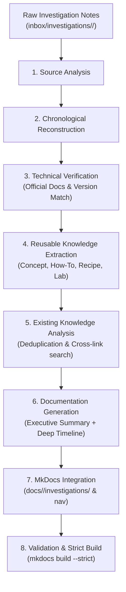

# Skill: Document Engineering Investigation (document-investigation)

Use this skill to transform raw engineering investigation notes, debugging logs, multi-step optimization trials, and post-mortems into structured, verified **Investigation Cases** within the MkDocs Knowledge Base.

Unlike simple troubleshooting summaries, this skill **preserves the entire chronological process**: questions asked, hypotheses formed, failed attempts, negative results, and the evolution of understanding that led to the final resolution.

---

## 1. Input Sources & Directory Conventions

The input typically originates from:
- A staging folder: `inbox/investigations/<investigation-id>/notes.md` (and optional `attachments/`).
- Direct chat logs, execution plans, thread dumps, or terminal recordings.

Raw sensitive data (passwords, tokens, internal customer PII) must be sanitized and never copied into public `docs/`.

---

## 2. The 8-Step Investigation Processing Workflow



### Step 1 — Source Analysis
- Read raw notes and referenced attachments thoroughly.
- Identify the core problem, environment (versions, hardware, topology), constraints, questions, hypotheses, actions, observed results, and decisions.
- **Rule**: Never invent missing data. If an execution time or metric is missing, do not assume or fabricate it.

### Step 2 — Chronological Reconstruction
- Reconstruct the investigation in its authentic chronological sequence.
- For each meaningful step, extract the 6-part anatomy:
  1. **Question**: What was the engineer trying to answer?
  2. **Hypothesis**: What did the engineer suspect at that moment?
  3. **Action / Experiment**: What command, configuration, or code was tested?
  4. **Observation**: What exact metrics, logs, or plan nodes were observed?
  5. **Analysis**: Why did it behave that way?
  6. **Decision / Next Step**: Did this confirm or refute the hypothesis, and what step followed?
- **Preserve Failed Attempts**: Do not discard negative results or dead ends. Failed attempts document non-viable paths that prevent future engineers from repeating the same mistakes.

### Step 3 — Technical Verification
- Verify claims against official documentation (PostgreSQL Docs, OpenJDK JEPs, Spring Boot Reference, AWS Architecture Center).
- Check version-specific behavior (e.g., PostgreSQL 11+ non-rewrite `ALTER TABLE ADD COLUMN`, PostgreSQL 14+ LZ4 TOAST compression, Java 21 Virtual Threads).
- If an observed metric or claim cannot be verified from the notes or official sources, explicitly tag it as:
  - `[Unverified]`
  - `[Not Recorded]`
  - `[Unresolved]`

### Step 4 — Reusable Knowledge Extraction
- Determine which insights represent generalizable engineering knowledge:
  - Concept (relational storage internals, memory barriers)
  - How-To (step-by-step setup or migration procedure)
  - Troubleshooting (quick symptom -> fix runbook)
  - Hands-on Lab (reproducible test environment in `labs/`)
  - Recipe (reusable query or utility snippet)
- **Rule**: Do not automatically create separate pages for every concept. Keep specific findings in the investigation case, and only extract standalone pages when they offer independent long-term value.

### Step 5 — Existing Knowledge Analysis & Deduplication
- Search `docs/` and `mkdocs.yml` using `grep_search` to find related topics.
- Prefer updating or linking existing documentation over duplicating content.
- Ensure bi-directional cross-links: the investigation case links to the concept guide (e.g., `explain-analyze.md`), and the concept guide links to the investigation case.

### Step 6 — Documentation Generation (Dual Reading Modes)
Author the published document using `templates/investigation-case.md` to satisfy two reading needs:
1. **Quick Reference (Mode 1)**: Executive summary, problem, environment, key metrics comparison table, and final resolution. A busy engineer can understand the outcome in 2 minutes.
2. **Deep Chronological Investigation (Mode 2)**: Complete step-by-step timeline, hypotheses, failed attempts, and evidence for deep root cause comprehension.

### Step 7 — MkDocs Integration
- Save the published file to `docs/<pillar>/investigations/<case-id>.md`.
- Register the file in `mkdocs.yml` under the corresponding pillar navigation.
- Update the pillar index (`docs/<pillar>/index.md`).
- Language convention: Clear Vietnamese explanations with standard English technical terms.

### Step 8 — Validation & Strict Build
- Verify relative links and anchors.
- Run:
  ```powershell
  python -m mkdocs build --strict
  ```
- Verify clean build (exit code 0, 0 warnings).

---

## 3. Handling Incremental Updates (Ongoing Investigations)

Investigations often evolve over days or weeks as new logs, vendor responses, or benchmark results emerge.

### Incremental Update Protocol:
1. **Locate Existing Case**: Find the published file in `docs/<pillar>/investigations/`.
2. **Read Current State**: Check previous hypotheses, failed attempts, and status (`IN PROGRESS`, `PARTIALLY RESOLVED`, `RESOLVED`, `UNRESOLVED`).
3. **Ingest New Evidence**: Read the appended steps from `notes.md`.
4. **Append Chronologically**: Add Step N+1, Step N+2 to the timeline.
5. **Update Conclusions Transparently**: If new evidence refutes an earlier conclusion, do NOT erase the earlier hypothesis. Document the revision explicitly:
   > *Update [Date]: New telemetry from Experiment 4 disproved Hypothesis 2.*
6. **Update Quick Reference**: Adjust the Executive Summary and Status badge.
7. **Re-validate**: Run `python -m mkdocs build --strict`.

---

## 4. Integration & Skill Delegation Matrix

| Skill | Interaction with `document-investigation` |
| :--- | :--- |
| **`capture-knowledge`** | Delegates to `document-investigation` when an inbox item contains multi-step experiments or investigations. |
| **`research-topic`** | Invoked when an investigation uncovers a deep engine mechanism requiring comprehensive official documentation research. |
| **`create-hands-on-lab`** | Invoked when the investigation requires an isolated Dockerized reproduction environment in `labs/`. |
| **`review-knowledge`** | Invoked to audit accuracy, link integrity, and strict build compliance. |
| **`summarize-book`** | Referenced when an investigation maps back to theoretical patterns from classic books. |
