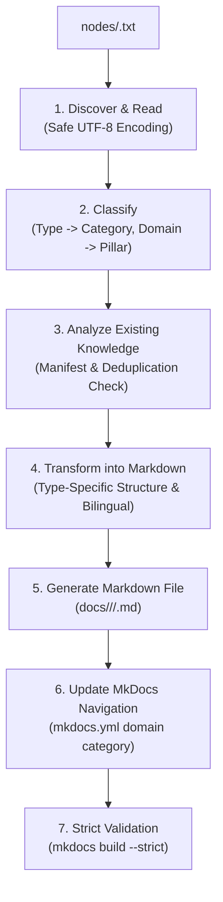

# Skill: Import TXT Notes (import-txt-notes)

Use this skill to read, parse, validate, and transform raw technical notes written in TXT format from the `nodes/` directory into production-grade Markdown documentation within the MkDocs Knowledge Base, automatically routing them to the correct technology domain and navigation category.

---

## 1. Input Specification (`nodes/*.txt`)

Source files are stored under `nodes/` in the format:

```text
Item: <Documentation Title>
Type: <Documentation Type>
Domain: <Technology Domain>

Content:
<Raw technical knowledge, questions, steps,
code, commands, observations and conclusions>
```

### Field Definitions & Normalization Rules:

1. **`Item`** *(Required)*:
   - The authoritative title of the document.
   - Used verbatim as the MkDocs navigation item label.
   - Used as the Markdown `# <Item>` H1 heading.
   - Normalized into a clean, URL-friendly filename slug (e.g., `postgresql-b-tree-index-deduplication.md`).

2. **`Type`** *(Required)*:
   - Maps to the target category and destination subdirectory:

   | Type (Aliases) | Destination Subdirectory | MkDocs Menu Category |
   | :--- | :--- | :--- |
   | `Best Practice`, `best-practice`, `thực hành` | `docs/<domain>/best-practices/` | `Best Practices` |
   | `Concept`, `concepts`, `khái niệm` | `docs/<domain>/concepts/` | `Concepts` |
   | `How-to`, `howto`, `hướng dẫn` | `docs/<domain>/how-to/` | `How-to` |
   | `Investigation`, `điều tra` | `docs/<domain>/investigations/` | `Investigations` |
   | `Troubleshooting`, `sự cố` | `docs/<domain>/troubleshooting/` | `Troubleshooting` |
   | `Lab`, `hands-on lab` | `docs/<domain>/labs/` | `Labs` |
   | `Recipe`, `code recipe`, `sql recipe` | `docs/<domain>/recipes/` | `Recipes` |

   - *Rule*: Never invent an arbitrary category for an unrecognized Type. Report validation errors for unknown types.

3. **`Domain`** *(Required / Inferred)*:
   - Determines the technology pillar in `docs/<domain>/`:
     - `PostgreSQL` -> `docs/postgresql/`
     - `Java` -> `docs/java/`
     - `Spring Boot` -> `docs/spring-boot/`
     - `AWS` -> `docs/aws/`
     - `System Design` -> `docs/system-design/`
   - *Inference*: If `Domain` is absent, the system inspects keywords in `Item` and `Content`. If clear and unambiguous, it infers the domain. If ambiguous, the file is flagged for manual review and not published arbitrarily.

4. **`Content`** *(Required)*:
   - Untrusted raw technical content (problem statements, code, SQL, configuration, benchmark numbers, conclusions).
   - Preserves all original code blocks, SQL queries, and numbered steps.

---

## 2. The 7-Stage Import Workflow



### Stage 1 — Discover and Read
- Safely read `.txt` files with fallback across `utf-8-sig`, `utf-8`, and `cp1252`.
- Extract metadata headers (`Item`, `Type`, `Domain`) and body (`Content`).
- Compute SHA-256 hash of the source file for idempotency tracking.

### Stage 2 — Classify
- Normalize `Type` and `Domain` against canonical mappings.
- Reject unsupported types or unresolvable domains with clear error messages.

### Stage 3 — Check Existing Knowledge & Idempotency
- Check `nodes/.import-manifest.json`:
  - If identical source hash was already imported and target file exists -> **`SKIPPED`** (idempotent, no changes needed).
  - If target file exists but belongs to a different source -> **`CONFLICT`** (preserve existing page, report collision).
- If source hash changed on existing import -> update document while preserving stable URLs.

### Stage 4 & 5 — Transform and Generate Markdown
- Structure the document according to its specific `Type`:
  - **Best Practice**: Summary, Problem/Context, Recommended Approach, Why It Works, Implementation, When to Use, When Not to Use, Trade-offs, Validation, References.
  - **Concept**: Overview, Why It Matters, How It Works, Real-world Examples, Common Misconceptions, Key Takeaways, References.
  - **How-to**: Goal, Prerequisites, Step-by-step Instructions, Commands & Code, Verification, Troubleshooting, References.
  - **Investigation**: Problem Statement, Environment, Questions, Chronological Steps, Hypotheses, Observations, Final Resolution, Lessons Learned.
  - **Troubleshooting**: Symptoms, Environment, Possible Causes, Diagnostic Steps, Root Cause, Resolution, Prevention, References.
  - **Lab**: Learning Objective, Environment & Setup, Experiments, Expected vs Actual Observations, Cleanup, Lessons Learned.
  - **Recipe**: Purpose, Ready-to-use Command/Code, Parameters, Explanation, Limitations, Related Resources.
- Language standard: Vietnamese explanations with preserved English technical terms (*Virtual Threads, B-Tree Deduplication, Connection Pool, GIN Index*).
- Never invent missing benchmark numbers or unverified execution results.
- Never delete or modify the original TXT note file.

### Stage 6 — Update MkDocs Navigation
- Locate the matching Domain under `nav:` in `mkdocs.yml`.
- Locate or create the corresponding category block (`Best Practices`, `How-to`, etc.).
- Add `"<Item>": <rel_path>` without altering unrelated navigation items or stripping comments.
- Avoid duplicate menu entries.

### Stage 7 — Validation
- Execute `python -m mkdocs build --strict` to confirm clean compilation (Exit Code 0).

---

## 3. Execution Modes & CLI Tool

The skill leverages the automated script:
`.agents/skills/import-txt-notes/scripts/import_notes.py`

### Mode 1: Single File Import
```bash
python .agents/skills/import-txt-notes/scripts/import_notes.py --file nodes/sample-note.txt --validate
```

### Mode 2: Batch Import
Processes all `.txt` files in `nodes/` independently:
```bash
python .agents/skills/import-txt-notes/scripts/import_notes.py --batch --validate
```
- **Failure Isolation**: An invalid note does not halt processing of other valid notes.
- **Summary Report**: Outputs counts for `Successfully imported`, `Skipped (unchanged)`, `Conflicts detected`, and `Failed files`.

### Inspection & Manifest Report
```bash
python .agents/skills/import-txt-notes/scripts/import_notes.py --report
```

---

## 4. Integration with Existing Agent Skills

| Skill | Interaction with `import-txt-notes` |
| :--- | :--- |
| **`manage-best-practices`** | When `Type: Best Practice` is imported, the resulting document conforms to the 10-section Best Practice standard and links to the domain hub. |
| **`capture-knowledge`** | Can route `.txt` files discovered in `inbox/` or `nodes/` to `import-txt-notes`. |
| **`document-investigation`** | Can ingest notes of `Type: Investigation` and preserve multi-step chronological timelines. |
| **`review-knowledge`** | Audits newly imported Markdown documents for link integrity, evidence levels, and strict build compliance. |

---

## 5. Practical Usage Prompts

### Example 1: Import a Single PostgreSQL Best Practice Note
```text
Hãy dùng skill 'import-txt-notes' để import file nodes/postgresql-index-deduplication.txt:
1. Đọc và xác thực metadata (Item: PostgreSQL B-Tree Index Deduplication, Type: Best Practice, Domain: PostgreSQL).
2. Tạo file docs/postgresql/best-practices/postgresql-b-tree-index-deduplication.md.
3. Cập nhật navigation trong mkdocs.yml dưới mục PostgreSQL -> Best Practices.
4. Ghi nhận manifest và chạy mkdocs build --strict.
```

### Example 2: Import a Spring Boot How-to Note
```text
Hãy dùng skill 'import-txt-notes' để import file nodes/spring-boot-virtual-threads.txt:
1. Phân loại vào Domain 'Spring Boot' và Category 'how-to'.
2. Chuyển đổi thành bài viết hướng dẫn từng bước chuẩn mực.
3. Thêm vào menu navigation dưới Spring Boot -> How-to.
4. Kiểm tra strict build.
```

### Example 3: Batch Import All Notes
```text
Hãy dùng skill 'import-txt-notes' ở chế độ batch:
1. Quét toàn bộ file .txt trong thư mục nodes/.
2. Bỏ qua các file đã import không có thay đổi (idempotent).
3. Báo cáo bảng tổng kết (Imported, Skipped, Conflicts, Failed).
4. Xác thực toàn bộ website với mkdocs build --strict.
```
