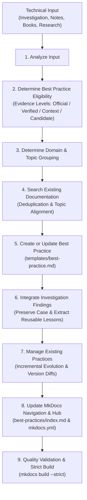

# Skill: Manage Domain-Based Best Practices (manage-best-practices)

Use this skill to extract, synthesize, curate, and maintain production-grade **Best Practices** organized by technology domain (`postgresql`, `java`, `spring-boot`, `aws`, `system-design`).

This skill bridges the gap between raw incident investigations, experimental findings, architectural books, official research, and long-term reusable engineering standards.

---

## 1. Input Sources & Supported Domains

The skill ingests diverse technical inputs:
- **Investigation Cases** (`docs/<pillar>/investigations/*.md` or `inbox/investigations/`)
- **Raw Engineering Notes & Incident Post-mortems** (`inbox/*.md`)
- **Deep Technical Research & JEPs** (`docs/<pillar>/` or official docs)
- **Book Summaries & Architectural Mental Models** (`templates/book-note-template.md`)
- **NotebookLM Research Extracts** (`inbox/`)
- **Troubleshooting Resolutions & Code/SQL Recipes** (`docs/<pillar>/recipe-*.md`)
- **Official Documentation URLs & Architecture RFCs**

### Supported Domains (Pillars)
1. **PostgreSQL**: Query optimization, Indexing strategies, MVCC & Lock contention, Memory/WAL tuning, Backup & High Availability.
2. **Java**: Modern Java 21+ idioms, Virtual Threads & Concurrency, Memory Model (JMM), GC tuning, Exception handling, Security & Resource management.
3. **Spring Boot**: Resilience & WebClient/RestTemplate, Transaction management (`@Transactional`), Hibernate & HikariCP tuning, Security, Observability.
4. **AWS**: Cloud networking (VPC/PrivateLink), IAM Least Privilege, Aurora & DynamoDB, Resilient Messaging (SQS/SNS/EventBridge), Cost optimization.
5. **System Design**: Distributed Transactions (Saga/Outbox), Idempotency & De-duplication, Caching & Invalidation, Resilience (Circuit Breaker/Rate Limiting).
6. **Cross-Domain Topics**: When a practice spans multiple domains (e.g. Spring Boot + PostgreSQL locking), choose the **primary operational impact** as canonical and add cross-links from other domains. Never duplicate identical content.

---

## 2. The 9-Step Best Practice Lifecycle



---

### Step 1 — Analyze Input
Analyze the raw material to extract core technical facts without assumption:
- **The Technical Problem**: What failure, bottleneck, resource exhaustion, or anti-pattern occurred?
- **Root Cause**: What underlying engine or runtime mechanism caused this behavior?
- **Proposed Solution**: What concrete code, query, architecture, or configuration resolves it?
- **Supporting Evidence**: What benchmarks, metrics, telemetry logs, or official doc citations validate it?
- **Applicability Conditions**: Under what workloads, data scale, or version boundaries does it hold true?
- **Trade-offs**: What are the operational costs, memory/CPU overhead, and complexity penalties?
- **Reusable Engineering Lessons**: What generalizable patterns can be extracted for team-wide reuse?

---

### Step 2 — Determine Best Practice Eligibility & Evidence Levels
Not every idea or one-off fix qualifies as a universal Best Practice. The Agent must categorize the input into one of 4 strict **Evidence Levels**:

| Evidence Level | Definition & Criteria | Action in Knowledge Base |
| :--- | :--- | :--- |
| **Official Guidance** | Officially documented by vendor/language maintainers (PostgreSQL Docs, OpenJDK JEP, Spring Reference, AWS Architecture Center). | Directly standardize into Best Practice; cite official documentation and version specs. |
| **Verified Experiment** | Validated through rigorous, reproducible benchmarks, hands-on labs, or production telemetry with quantifiable metrics. | Promote to Best Practice; record baseline vs final metrics, hardware/environment constraints, and link to lab/investigation. |
| **Context-specific Finding** | Solved an issue under specific conditions (e.g., 특정 SSD model, high write:read ratio 9:1, isolated network topology). | Document as a Context-Specific Best Practice with explicit **prerequisites** and **counter-indications (When NOT to use)**. |
| **Candidate** | Promising hypothesis or theoretical recommendation from a book/talk, but lacking local reproduction or definitive production proof. | Tag clearly as `[Evidence: Candidate]`; link to original investigation or concept; **do not present as a proven standard**. |

> [!CAUTION]
> **Anti-Hallucination Guardrail**:
> Never promote a single lucky experiment as a universally optimal truth. If benchmark data is absent, explicitly tag as `[Not Recorded]` or `[Candidate]`. Never invent execution metrics.

---

### Step 3 — Determine Domain and Topic Grouping
- **Identify Canonical Domain**: Map to `postgresql`, `java`, `spring-boot`, `aws`, or `system-design`.
- **Topic-Based Organization**: Group related recommendations into cohesive technical topic pages (e.g., `query-optimization.md`, `indexing.md`, `resilient-webclient.md`, `exception-handling.md`).
- **Avoid Fragmented Granularity**: Do **NOT** create a separate `.md` file for every small finding or single configuration line. Group closely related practices into a well-structured topic page.
- **Cross-Domain Cross-Linking**: When a solution spans domains (e.g., HikariCP connection pool timeout for PostgreSQL), place the guide in its primary operational domain (`spring-boot/best-practices/connection-pooling.md`) and create a cross-reference link in `postgresql/best-practices/index.md`.

---

### Step 4 — Search Existing Documentation (Deduplication Check)
Before creating or modifying any file:
1. Use `grep_search` across `docs/` and `mkdocs.yml` to locate related topics, concepts, troubleshooting guides, and existing Best Practices.
2. Decide the integration action:
   - **Update Existing Best Practice**: If a page for the topic already exists (e.g., `docs/postgresql/best-practices/query-optimization.md`), append or enhance the section with new findings and version caveats.
   - **Create New Best Practice Page**: If the topic represents a distinct technical domain area not yet covered.
   - **Add Cross-Reference Only**: If the finding is already documented elsewhere and only needs cross-linking.

---

### Step 5 — Create or Update Best Practice Content
Author or update the document using `templates/best-practice.md`. Every Best Practice page must adhere to the 10 structural elements:

1. **Summary**: Concise 2-3 sentence executive summary for fast decision-making.
2. **Problem / Context**: Real-world issue, symptoms, and failure modes when absent.
3. **Recommended Approach**: Concrete, actionable solution replacing the anti-pattern.
4. **Why It Works**: Deep technical explanation under the hood (memory model, engine buffers, optimizer cost model, mermaid diagram).
5. **Implementation**: Production-ready code, SQL, configuration, or steps with parameterized values and comments.
6. **When to Use**: Clear operational scenarios, data volumes, traffic thresholds, and versions.
7. **When Not to Use**: Explicit boundary conditions, negative side-effects, and anti-patterns.
8. **Trade-offs**: Multi-dimensional evaluation matrix (Performance, Storage, Complexity, Maintenance, Security).
9. **Validation**: Concrete commands, queries (`EXPLAIN ANALYZE`), metrics, or logs to verify success.
10. **Evidence Level & Related Resources**: Explicit Evidence Level tag, links to original Investigation Cases (`docs/<pillar>/investigations/*.md`), Hands-on Labs (`labs/`), Concepts, and Official Docs.

**Language Standard**: Clear Vietnamese explanations with international English technical terms kept intact (*Virtual Threads, Connection Pool, GIN Index, Write-Ahead Log, Outbox Pattern*).

---

### Step 6 — Integrate Investigation Findings
When promoting lessons from an **Engineering Investigation** (`document-investigation`):
- **Preserve Historical Integrity**: Never delete or overwrite the original Investigation Case (`docs/<pillar>/investigations/<id>.md`). The investigation preserves the authentic chronological process, questions, and failed attempts.
- **Extract Reusable Patterns**: Synthesize the validated final resolution into the domain's Best Practice page.
- **Bi-directional Link**:
  - The Best Practice links back to the Investigation Case as historical proof.
  - The Investigation Case Reusable Knowledge section links forward to the Best Practice page.
- **Preserve Boundary Conditions**: If the investigation succeeded only with specific table sizes or parameter combinations (e.g. `work_mem = 64MB`), record those as explicit prerequisites.

---

### Step 7 — Manage Existing Best Practices (Evolution & Deprecation)
When new evidence, benchmark results, or software versions arrive:
1. **Never Silently Overwrite**: Do not erase a previously verified finding without documenting why the recommendation evolved.
2. **Version-Specific Nuances**: Record differences clearly (e.g., *PostgreSQL 14+ supports LZ4 compression for TOAST; earlier versions require pglz*).
3. **Deprecation Protocol**: When a practice becomes obsolete or superseded by modern features (e.g., `RestTemplate` superseded by `RestClient`/`WebClient`, or `ThreadLocal` replaced by `ScopedValue` in Java 21+):
   - Mark the section with an admonition: `> [!WARNING] Superseded in [Version]`.
   - Provide the modern alternative.
   - Explain the migration path.
4. **Preserve Git History**: Make atomic, meaningful Git commits for traceable engineering history.

---

### Step 8 — Update MkDocs Navigation & Hub Indexes
1. **Maintain Domain Hub**: Every domain has a dedicated `docs/<pillar>/best-practices/index.md` summarizing the domain's curated practices, categorizing them by theme, and detailing evidence levels.
2. **Update `mkdocs.yml`**: Register the new Best Practice pages under the domain's navigation tree:
   ```yaml
   - PostgreSQL:
       - Tổng quan & Roadmap: postgresql/index.md
       - Best Practices:
           - Tổng quan: postgresql/best-practices/index.md
           - Query Optimization: postgresql/best-practices/query-optimization.md
   ```
3. **Maintain Domain Index**: Update `docs/<pillar>/index.md` with cross-references to the Best Practices.
4. **Stable URLs**: Keep URLs permalink-friendly and stable; avoid renaming files once published.

---

### Step 9 — Quality Validation & Strict Build
1. **Authoritative Fact-Check**: Verify all API signatures, parameter names, and engine behaviors against official documentation.
2. **Zero-Hallucination Audit**: Ensure all benchmarks and numbers stem from verified notes or lab experiments.
3. **Strict Build Execution**:
   ```powershell
   python -m mkdocs build --strict
   ```
   Must exit with code 0 and 0 warnings. Fix broken relative links or missing navigation items immediately.

---

## 3. Integration Matrix with Other Agent Skills

| Skill | Interaction with `manage-best-practices` |
| :--- | :--- |
| **`document-investigation`** | Feeds verified resolutions and production lessons into `manage-best-practices`. The investigation preserves the history; the best practice codifies the reusable standard. |
| **`capture-knowledge`** | During initial inbox triage, routes reusable guidelines, standards, and patterns to `manage-best-practices`. |
| **`research-topic`** | Provides official architectural depth and vendor specifications to elevate Candidate or Verified practices to Official Guidance. |
| **`summarize-book`** | Supplies architectural mental models and foundational design patterns, extracted as Candidate Best Practices awaiting empirical validation. |
| **`import-notebooklm`** | Ingests research extracts, separates theoretical claims from verified behaviors, and routes eligible recommendations to `manage-best-practices`. |
| **`create-hands-on-lab`** | Constructs reproducible Docker environments in `labs/` to measure, benchmark, and elevate Candidate practices to Verified Experiments. |
| **`review-knowledge`** | Audits Best Practice pages for outdated advice, missing evidence levels, broken cross-links, and strict build compliance. |

---

## 4. Practical Usage Workflows & Prompts

### Example 1: Promoting Investigation Lessons to Best Practice (PostgreSQL)
```text
Dựa vào hồ sơ điều tra đã xác minh tại docs/postgresql/investigations/inv-001-jsonb-tuning.md:
1. Sử dụng skill 'manage-best-practices' để trích xuất bài học tối ưu hóa truy vấn JSONB.
2. Tổng hợp thành trang Best Practice: docs/postgresql/best-practices/jsonb-query-optimization.md.
3. Làm nổi bật sự khác biệt giữa jsonb_path_ops và jsonb_ops, kết hợp nén LZ4 TOAST trong PostgreSQL 14+.
4. Ghi nhận mức độ bằng chứng: Verified Experiment (dẫn số liệu P99 giảm 50x từ 420ms xuống 8.4ms).
5. Cập nhật docs/postgresql/best-practices/index.md, mkdocs.yml và chạy mkdocs build --strict.
```

### Example 2: Establishing Reusable Idioms (Modern Java)
```text
Sử dụng skill 'manage-best-practices' để biên soạn quy chuẩn xử lý ngoại lệ trong Java 21+:
1. Tổng hợp thành docs/java/best-practices/exception-handling.md.
2. Quy chuẩn hóa: Giữ nguyên root cause stack trace, custom domain exceptions kế thừa đúng phân cấp, pattern matching với switch expressions, và các cạm bẫy khi bắt exception trong Virtual Threads.
3. Gắn nhãn Evidence Level: Official Guidance (Oracle Java SE 21 Spec & Effective Java).
4. Cập nhật docs/java/best-practices/index.md và mkdocs.yml.
```

### Example 3: Production-Oriented Network Resilience (Spring Boot)
```text
Sử dụng skill 'manage-best-practices' để xây dựng hướng dẫn cấu hình WebClient chuẩn production:
1. Lưu vào docs/spring-boot/best-practices/resilient-webclient.md.
2. Bao gồm: Connection timeout, response timeout, read/write idle timeout với Netty HttpClient, connection pool allocation, và retry kèm exponential backoff có jitter.
3. Chỉ rõ chống chỉ định: Không dùng WebClient.block() trên Virtual Threads/EventLoop.
4. Cập nhật navigation và kiểm tra strict build.
```

### Example 4: Context-Specific Infrastructure Finding (AWS)
```text
Chuyển hóa thử nghiệm export dữ liệu lớn từ Aurora PostgreSQL sang Amazon S3 thành Best Practice:
1. Lưu vào docs/aws/best-practices/aurora-s3-export.md.
2. So sánh aws_s3.query_export_to_s3() với pg_dump và DMS.
3. Gắn nhãn Evidence Level: Context-specific Finding (tối ưu cho dataset > 50GB khi có VPC Endpoint PrivateLink).
4. Cập nhật docs/aws/best-practices/index.md và mkdocs.yml.
```

### Example 5: Updating an Existing Best Practice (Incremental Evolution)
```text
Đã có bài viết docs/postgresql/best-practices/jsonb-query-optimization.md.
Hãy dùng skill 'manage-best-practices' để cập nhật khuyến nghị mới:
1. Bổ sung lưu ý vận hành cho PostgreSQL 17 về vacuuming và GIN index pending list (gin_pending_list_limit).
2. Không ghi đè các kết luận đã được kiểm chứng của PostgreSQL 16.
3. Đánh dấu phiên bản cụ thể cho từng mục.
4. Chạy mkdocs build --strict để đảm bảo tính toàn vẹn.
```
