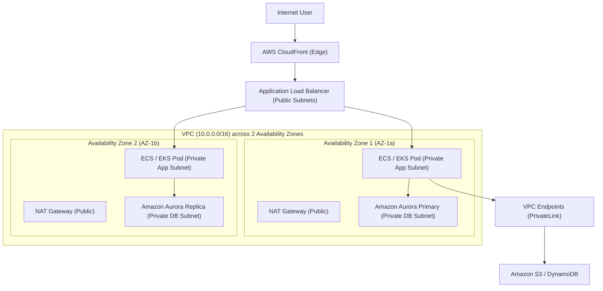

# AWS Cloud Architecture Knowledge Hub

> **Trọng tâm**: Kiến trúc Đám mây chuẩn mực (AWS Well-Architected Framework), Thiết kế mạng VPC bảo mật, DynamoDB Single-Table Design, và Kiến trúc Hướng sự kiện (Event-Driven Architecture).  
> **Phiên bản chuẩn**: AWS Current Architecture (2024+)  
> **Tài liệu chính thức**: [docs.aws.amazon.com](https://docs.aws.amazon.com/) & [aws.amazon.com/architecture/well-architected/](https://aws.amazon.com/architecture/well-architected/)

---

## 1. Bản Đồ Kiến Trúc Hệ Thống Chuẩn (Multi-AZ Resilient Architecture)



Kiến trúc AWS cấp Senior Architect tuân thủ 5 trụ cột cốt lõi:
1. **Network Isolation & Security**: Thiết kế Subnet phân tầng (Public, Private Application, Isolated Database), định tuyến qua NAT Gateway đa vùng (Multi-AZ NAT) chống Single Point of Failure (SPOF), và kiểm soát Stateful Security Groups kết hợp Stateless NACLs.
2. **IAM & Least Privilege**: Nguyên tắc phân quyền tối thiểu, không dùng Access Key tĩnh; sử dụng IAM Roles gắn trực tiếp vào ECS Tasks / EKS ServiceAccounts qua OIDC (IRSA).
3. **Data Tier (Aurora & DynamoDB)**: Tận dụng Aurora Storage Subsystem (6 copies qua 3 AZs) và DynamoDB Single-Table Design cho tải triệu request/giây với latency dưới 10ms.
4. **Event-Driven Resilience**: Tách rời các microservices bằng Amazon SQS FIFO, SNS Fan-out, và EventBridge với chính sách Dead-Letter Queue (DLQ) và Exponential Backoff.

---

## 2. Quy Chuẩn Thực Hành Tốt Nhất (Production Best Practices)

- 🏆 **[AWS Cloud Architecture Best Practices Hub](best-practices/index.md)**: Hệ thống hóa các quy chuẩn thiết kế đám mây an toàn, tối ưu chi phí và chịu lỗi cao.
  - ☁️ **[Best Practice: Export Dữ Liệu Lớn Trực Tiếp Từ Aurora Sang S3](best-practices/aurora-s3-export.md)**: Tận dụng `aws_s3.query_export_to_s3()` và VPC Gateway Endpoint, tiết kiệm 100% phí NAT Gateway, tăng tốc 4x.

---

## 3. Danh Mục Chủ Đề Đang Phát Triển (Curated Topics)

### A. VPC Networking & PrivateLink
- **VPC Subnet Sizing**: Phân bổ dải CIDR hợp lý, tính toán số lượng IP dự phòng cho Auto-scaling và rolling updates.
- **VPC Gateway Endpoints vs Interface Endpoints (PrivateLink)**: Cách chuyển đổi lưu lượng truy cập S3 và DynamoDB vào mạng nội bộ AWS, miễn phí truyền dữ liệu và triệt tiêu nguy cơ lộ IP ra Internet.
- **Transit Gateway**: Mô hình Hub-and-Spoke kết nối đa tài khoản (Multi-Account AWS Organizations) và On-Premises qua Direct Connect / VPN.

### B. DynamoDB Single-Table Design
- **Triết lý Access Patterns First**: Thiết kế lược đồ dựa trên các câu truy vấn thực tế của ứng dụng thay vì chuẩn hóa quan hệ (RDBMS Normalization).
- **Composite Primary Keys**: Kết hợp `PK` (Partition Key) và `SK` (Sort Key) đa hình (polymorphic) để chứa nhiều Entity Types (`USER#123`, `ORDER#456`) trong cùng một bảng.
- **Global Secondary Indexes (GSI) & Sparse Indexes**: Tạo chỉ mục thứ cấp chỉ chứa các items có thuộc tính chỉ định nhằm giảm thiểu chi phí lưu trữ và tối ưu Write Capacity Units (WCU).

### C. Reliable Messaging: SQS FIFO & SNS Fan-out
- **SQS FIFO Guarantee**: Đảm bảo thứ tự chính xác (Strictly-once processing) thông qua `MessageGroupId` và chống trùng lặp dữ liệu với `MessageDeduplicationId` trong cửa sổ 5 phút.
- **Dead-Letter Queue (DLQ) Redrive**: Chiến lược xử lý tin nhắn độc (Poison Messages) và quy trình tự động phân tích / đẩy ngược lại queue chính sau khi fix lỗi.

---

## 3. Mẫu IAM Policy Chuẩn Mực (Least Privilege)

```json
{
  "Version": "2012-10-17",
  "Statement": [
    {
      "Sid": "AllowAppDynamoDBAccess",
      "Effect": "Allow",
      "Action": [
        "dynamodb:GetItem",
        "dynamodb:PutItem",
        "dynamodb:UpdateItem",
        "dynamodb:Query"
      ],
      "Resource": [
        "arn:aws:dynamodb:ap-southeast-1:123456789012:table/ProductionCoreTable",
        "arn:aws:dynamodb:ap-southeast-1:123456789012:table/ProductionCoreTable/index/*"
      ]
    }
  ]
}
```

---

## 4. Tài Liệu Kiểm Chứng (Official References)

- [AWS Well-Architected Framework: Reliability Pillar](https://docs.aws.amazon.com/wellarchitected/latest/reliability-pillar/)
- [Amazon VPC User Guide](https://docs.aws.amazon.com/vpc/latest/userguide/)
- [Amazon DynamoDB Developer Guide: Best Practices](https://docs.aws.amazon.com/amazondynamodb/latest/developerguide/best-practices.html)
- [The Amazon Builders' Library](https://aws.amazon.com/builders-library/)
