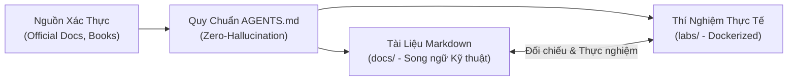

# Developer Knowledge Base

Chào mừng bạn đến với **Personal Developer Knowledge Base** — Hệ thống lưu trữ, tra cứu và chắt lọc tri thức chuyên sâu dành cho Senior Software Architect và Backend/Cloud Engineers.

Kho tri thức này được xây dựng dựa trên sự kết hợp giữa **Tài liệu chính thức (Official Documentation)**, **Sách kỹ thuật kinh điển**, và **Kinh nghiệm thực chiến Production**, được vận hành với sự hỗ trợ của **Antigravity AI Agent Skills**.

---

## 🎯 5 Trụ Cột Tri Thức Cốt Lõi (Core Technical Pillars)

-   :material-database:{ .lg .middle } __PostgreSQL Internals__

    ---

    Cơ chế tối ưu hóa câu truy vấn, Storage Engine, MVCC, Heap & Index B-Tree/GIN/BRIN, WAL, Locking, Partitioning và phân tích sâu Execution Plans với `EXPLAIN ANALYZE`.

    [:octicons-arrow-right-24: Khám phá PostgreSQL](postgresql/index.md)

-   :material-language-java:{ .lg .middle } __Modern Java (21 LTS+)__

    ---

    JVM Memory Model (JMM), ZGC & Generational ZGC, Concurrency & Virtual Threads (Project Loom), Class Loading, Bytecode, và các mẫu hình tối ưu hóa high-throughput.

    [:octicons-arrow-right-24: Khám phá Java](java/index.md)

-   :material-leaf:{ .lg .middle } __Spring Boot Ecosystem__

    ---

    Nội tại Spring Core (IoC/DI, Bean Lifecycle, Proxy/AOP), Spring Data JPA / Hibernate N+1 resolution, Connection Pool Tuning (HikariCP), và Distributed Tracing.

    [:octicons-arrow-right-24: Khám phá Spring Boot](spring-boot/index.md)

-   :material-aws:{ .lg .middle } __AWS Cloud Architecture__

    ---

    Thiết kế hạ tầng Cloud-native tuân thủ Well-Architected Framework: VPC Networking, IAM Least Privilege, DynamoDB Single-Table Design, SQS/SNS Event-driven, ECS/EKS.

    [:octicons-arrow-right-24: Khám phá AWS](aws/index.md)

-   :material-server-network:{ .lg .middle } __System Design & Distributed Systems__

    ---

    Thiết kế hệ thống chịu tải cao (High-load & High-availability), CAP & PACELC, Consensus (Raft/Paxos), Distributed Transactions (2PC, Saga), Rate Limiting, Caching Strategies.

    [:octicons-arrow-right-24: Khám phá System Design](system-design/index.md)

-   :material-robot:{ .lg .middle } __Agent Skills & Engineering Rules__

    ---

    Quy chuẩn vận hành nghiêm ngặt (`AGENTS.md`), bộ kỹ năng Antigravity Agent Skills tự động hóa nghiên cứu và kiểm thử tài liệu, cùng kho Templates chuẩn hóa.

    [:octicons-arrow-right-24: Xem Quy chuẩn Kỹ thuật](standards/agents-governance.md)

---

## ⚡ Nguyên Tắc Thiết Kế & Vận Hành (Guiding Principles)

1. **Zero Hallucination (Không bịa đặt thông tin)**: Không chấp nhận số liệu giả định hay API không tồn tại. Mọi tri thức đều được neo vào phiên bản cụ thể và có link đối chiếu từ tài liệu chính thức.
2. **Vietnamese Explanations with English Technical Terms**: Trình bày tư duy mạch lạc bằng tiếng Việt nhưng giữ nguyên thuật ngữ kỹ thuật tiếng Anh (*Query Planner, Shared Buffers, Garbage Collection, Circuit Breaker, Write-Ahead Logging*).
3. **Docs & Labs Separation**: Thư mục `docs/` là tài liệu tĩnh phục vụ đọc nhanh và tìm kiếm. Toàn bộ mã nguồn thực thi, file Docker Compose, kịch bản benchmark tách biệt hoàn toàn trong `labs/`.
4. **Fast Search & Clean UX**: Tối ưu hóa cho tra cứu tức thời, hỗ trợ chuyển đổi giao diện Sáng / Tối (Light/Dark Mode), sơ đồ Mermaid và copy code một chạm.

---

## 🔬 Bài Viết Điểm Nhấn (Featured Deep Dive)

> [!TIP]
> **Khuyến nghị đọc trước**: Xem bài viết phân tích chuyên sâu về **[PostgreSQL EXPLAIN ANALYZE](postgresql/explain-analyze.md)** để hiểu cách thức mổ xẻ một Execution Plan trong production, đối chiếu giữa Cost Estimation vs Actual Time, và thực nghiệm trực tiếp thông qua Docker Lab tại `labs/postgresql/explain-analyze/`.
