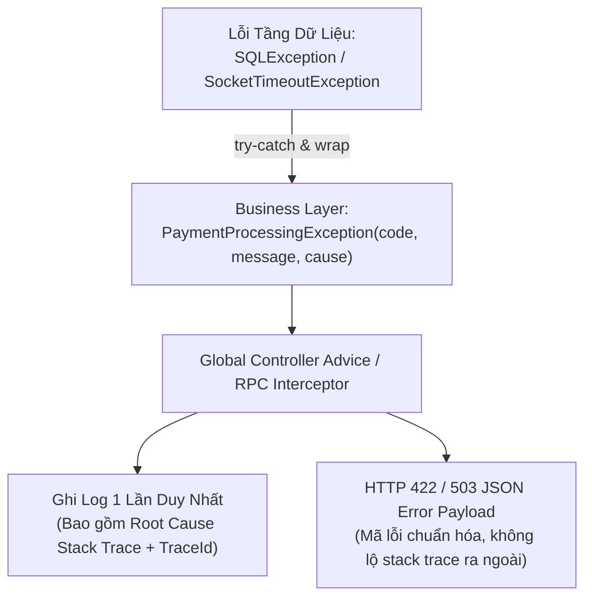

# Best Practice: Xử Lý Ngoại Lệ Chuẩn Mực Trong Modern Java (Java 21+)

> **Lĩnh vực (Domain)**: Java  
> **Chủ đề (Topic)**: Robust Exception Handling & Defensive Programming  
> **Phiên bản áp dụng (Target Version)**: Java 21 LTS+  
> **Mức độ bằng chứng (Evidence Level)**: Official Guidance (Oracle JLS & Effective Java)  
> **Trạng thái**: Active  
> **Ngày cập nhật**: 2026-10-19  

---

## 1. Summary (Tóm Tắt Khuyến Nghị)

> [!NOTE]
> **Executive Summary**:  
> Trong các hệ thống backend Java phân tán chịu tải cao, **xử lý ngoại lệ phải bảo toàn tuyệt đối chuỗi nguyên nhân gốc rễ (Chained Exceptions with Cause)**, phân tách rạch ròi giữa lỗi nghiệp vụ (Domain Errors) và lỗi kỹ thuật (Technical Faults), và triệt tiêu hoàn toàn các anti-patterns: nuốt ngoại lệ (Swallowing Exceptions), bắt `Throwable/Exception` chung chung, hoặc bắt-ghi log-rồi ném lại (Log-and-Rethrow).  
> Với Java 21, hãy áp dụng **Sealed Domain Exceptions**, **Pattern Matching for switch**, và cấu hình `UncaughtExceptionHandler` chuẩn mực cho **Virtual Threads**.

---

## 2. Problem / Context (Bối Cảnh & Vấn Đề Giải Quyết)

- **Vấn đề kỹ thuật**: Trong môi trường microservices, khi một lỗi xảy ra (ví dụ: Timeout khi gọi Gateway bên thứ ba, hoặc vi phạm ràng buộc cơ sở dữ liệu), việc xử lý ngoại lệ cẩu thả dẫn tới:
  1. *Mất dấu vết nguyên nhân gốc (Lost Root Cause)*: Khởi tạo ngoại lệ mới mà không truyền `cause` vào constructor, khiến kỹ sư on-call chỉ thấy `ServiceException` vô nghĩa mà không biết nguyên nhân gốc là `SocketTimeoutException` hay `ConnectException`.
  2. *Ô nhiễm Log (Log Pollution)*: Bắt ngoại lệ, ghi log bằng `log.error()`, sau đó lại ném lại (`throw ex`). Khi ngoại lệ leo lên 5 tầng gọi, cùng 1 lỗi bị in ra 5 lần, làm nghẽn hệ thống Log Aggregator (Elasticsearch/Datadog).
  3. *Nuốt luồng ngắt (Swallowing InterruptedException)*: Bắt `InterruptedException` trong catch block rỗng mà không khôi phục trạng thái `Thread.currentThread().interrupt()`, làm tê liệt cơ chế shutdown của ExecutorService hoặc phá hủy scheduler của Virtual Threads.
- **Mức độ nghiêm trọng**: P2 (Làm tăng thời gian trung bình để xử lý sự cố - MTTR từ vài phút lên nhiều giờ do thiếu telemetry chẩn đoán).

---

## 3. Recommended Approach (Giải Pháp Khuyến Nghị)

Áp dụng 5 quy tắc vàng xử lý ngoại lệ:
1. **Always Preserve Cause**: Khi bọc (wrap) một ngoại lệ kỹ thuật cấp thấp thành ngoại lệ nghiệp vụ cấp cao, luôn truyền `cause` vào constructor (`super(message, cause)`).
2. **Standard vs. Custom Exceptions**: Ưu tiên sử dụng lại các Exception chuẩn của Java (`IllegalArgumentException`, `IllegalStateException`, `NoSuchElementException`) theo Effective Java Item 72. Chỉ tạo Custom Exception khi cần đính kèm mã lỗi nghiệp vụ (Business Error Code) hoặc siêu dữ liệu phục vụ client.
3. **Fail-Fast & Unchecked by Default**: Sử dụng Unchecked Exception (`RuntimeException`) cho hầu hết các lỗi trong backend hiện đại để tránh làm ô nhiễm chữ ký phương thức; chỉ sử dụng Checked Exception khi client thực sự có khả năng và bắt buộc phải khôi phục logic nghiệp vụ (e.g., thử lại qua kênh dự phòng).
4. **Log OR Throw, Never Both**: Hoặc là ghi log và xử lý xong tại chỗ (phục hồi hoặc trả về giá trị fallback), hoặc là ném lại cho tầng trên xử lý. Không bao giờ vừa log vừa re-throw.
5. **Virtual Threads Exception Safety**: Luôn đăng ký `UncaughtExceptionHandler` cho các Virtual Threads chạy ngầm (`Thread.ofVirtual()`) để không bị rơi mất ngoại lệ unhandled.

---

## 4. Why It Works (Nguyên Lý & Cơ Chế Kỹ Thuật)



### Cơ chế hoạt động của JVM (JVM Internals):
1. **Stack Unwinding & Bytecode `athrow`**:
   - Khi lệnh `athrow` thực thi, JVM unwinds call stack để tìm `ExceptionHandler` table khớp với kiểu exception trong class metadata.
   - Quá trình này thu thập snapshot của call stack tại thời điểm xảy ra lỗi. Nếu ta tạo mới exception mà bỏ qua `cause`, cây call stack ban đầu tại thời điểm I/O sụp đổ sẽ bị Garbage Collector thu hồi, triệt tiêu bằng chứng lỗi.
2. **Chained Exception Mechanism (`Throwable.cause`)**:
   - Trường `cause` trong `java.lang.Throwable` liên kết các lỗi thành một danh sách liên kết đơn (Linked List). Khi gọi `e.printStackTrace()` hoặc slf4j format, toàn bộ chuỗi từ nguyên nhân đầu tiên (`Caused by:...`) được in ra đầy đủ.
3. **Suppressed Exceptions in Try-With-Resources**:
   - Cú pháp `try-with-resources` tự động giải phóng tài nguyên. Nếu cả khối `try` và phương thức `close()` đều ném ngoại lệ, JVM tự động dùng cơ chế `Throwable.addSuppressed()` để bảo toàn ngoại lệ chính mà không làm mất ngoại lệ khi đóng kết nối.

---

## 5. Implementation (Hướng Dẫn Triển Khai Thực Tế)

### 5.1. Cấu Trúc Domain Exception Chuẩn Mực

```java
package com.knowledgebase.common.exception;

import java.time.Instant;
import java.util.Collections;
import java.util.Map;

/**
 * Lớp ngoại lệ nghiệp vụ cơ sở (Base Domain Exception).
 * Kế thừa RuntimeException, bất biến và hỗ trợ mang context dữ liệu.
 */
public abstract class BaseDomainException extends RuntimeException {
    
    private final String errorCode;
    private final Instant timestamp;
    private final Map<String, Object> errorContext;

    protected BaseDomainException(String errorCode, String message) {
        super(message);
        this.errorCode = errorCode;
        this.timestamp = Instant.now();
        this.errorContext = Collections.emptyMap();
    }

    protected BaseDomainException(String errorCode, String message, Throwable cause) {
        // QUY TẮC BẮT BUỘC: Luôn truyền cause vào super constructor
        super(message, cause);
        this.errorCode = errorCode;
        this.timestamp = Instant.now();
        this.errorContext = Collections.emptyMap();
    }

    protected BaseDomainException(String errorCode, String message, Throwable cause, Map<String, Object> errorContext) {
        super(message, cause);
        this.errorCode = errorCode;
        this.timestamp = Instant.now();
        this.errorContext = errorContext != null ? Map.copyOf(errorContext) : Collections.emptyMap();
    }

    public String getErrorCode() {
        return errorCode;
    }

    public Instant getTimestamp() {
        return timestamp;
    }

    public Map<String, Object> getErrorContext() {
        return errorContext;
    }
}
```

### 5.2. Kế Thừa Cụ Thể Trong Tầng Nghiệp Vụ

```java
package com.knowledgebase.payment.exception;

import com.knowledgebase.common.exception.BaseDomainException;
import java.util.Map;

public class PaymentGatewayException extends BaseDomainException {
    
    public static final String GATEWAY_TIMEOUT = "PAYMENT_GATEWAY_TIMEOUT";
    public static final String INSUFFICIENT_FUNDS = "PAYMENT_INSUFFICIENT_FUNDS";

    public PaymentGatewayException(String errorCode, String message, Throwable cause, Map<String, Object> context) {
        super(errorCode, message, cause, context);
    }
}
```

### 5.3. Sử Dụng Trong Service Layer (Preserving Root Cause & Try-with-resources)

```java
package com.knowledgebase.payment.service;

import com.knowledgebase.payment.exception.PaymentGatewayException;
import org.slf4j.Logger;
import org.slf4j.LoggerFactory;

import java.io.IOException;
import java.util.Map;

public class PaymentService {
    private static final Logger log = LoggerFactory.getLogger(PaymentService.class);

    public void processPayment(String orderId, long amount) {
        try {
            callThirdPartyGateway(orderId, amount);
        } catch (IOException ex) {
            // ĐÚNG: Wrap với nguyên nhân gốc (ex) và đính kèm ngữ cảnh dữ liệu
            // KHÔNG log.error() ở đây nếu đã ném lại lên tầng trên!
            throw new PaymentGatewayException(
                PaymentGatewayException.GATEWAY_TIMEOUT,
                "Lỗi kết nối cổng thanh toán đối tác cho đơn hàng: " + orderId,
                ex,
                Map.of("orderId", orderId, "amount", amount)
            );
        }
    }

    private void callThirdPartyGateway(String orderId, long amount) throws IOException {
        // Giả lập network call có thể ném IOException
        throw new IOException("Connection reset by peer");
    }
}
```

### 5.4. Xử Lý Ngoại Lệ An Toàn Cho Virtual Threads (Java 21+)

```java
package com.knowledgebase.common.concurrency;

import org.slf4j.Logger;
import org.slf4j.LoggerFactory;

public class SafeVirtualThreadFactory {
    private static final Logger log = LoggerFactory.getLogger(SafeVirtualThreadFactory.class);

    public static Thread startVirtualTask(String taskName, Runnable task) {
        return Thread.ofVirtual()
            .name("v-task-" + taskName)
            .uncaughtExceptionHandler((thread, throwable) -> {
                // QUY TẮC: Virtual Threads không có default handler nếu không đăng ký,
                // dẫn tới exception bị nuốt im lặng khi thread chết!
                log.error("Unhandled Exception trong Virtual Thread [{}]: {}", 
                    thread.getName(), throwable.getMessage(), throwable);
            })
            .start(task);
    }
}
```

---

## 6. When to Use (Ngữ Cảnh Áp Dụng)

- Toàn bộ các dịch vụ backend viết bằng Modern Java (Java 17, 21+).
- Khi xây dựng API công khai hoặc Microservices nội bộ cần định dạng lỗi nhất quán.
- Khi làm việc với tác vụ I/O bất đồng bộ, CompletableFuture, hoặc Virtual Threads.

---

## 7. When Not to Use (Chống Chỉ Định & Anti-patterns)

> [!WARNING]
> **Tuyệt đối tránh 4 anti-patterns sau**:
> 1. **Dùng Exception để điều khiển luồng (Control Flow)**:  
>    *Sai*: Dùng `try { findUser(); } catch (NotFoundException e) { createUser(); }`.  
>    *Đúng*: Trả về `Optional<User>` và dùng `.orElseGet()`. Tạo Exception tốn chi phí CPU tạo stack trace.
> 2. **Catch và nuốt trôi (Swallowing Exception)**:
>    ```java
>    // NGUY HIỂM: Lỗi bị biến mất không dấu vết
>    try { doSomething(); } catch (Exception e) {}
>    ```
> 3. **Bắt `Throwable` hoặc `Error`**:  
>    Không bao giờ bắt `Throwable` trừ framework container cấp cao nhất. Việc bắt `OutOfMemoryError` hoặc `VirtualMachineError` ngăn JVM tự thoát an toàn khi tài nguyên cạn kiệt.
> 4. **Quên khôi phục trạng thái ngắt (`InterruptedException`)**:
>    ```java
>    try {
>        Thread.sleep(1000);
>    } catch (InterruptedException e) {
>        // BẮT BUỘC phải khôi phục interrupt status
>        Thread.currentThread().interrupt();
>        log.warn("Tác vụ bị ngắt bởi scheduler");
>    }
>    ```

---

## 8. Trade-offs (Đánh Đổi Kỹ Thuật)

| Khía cạnh | Chuẩn Mực (Chained & Typed Exceptions) | Anti-pattern (Generic / Lost Cause) |
| :--- | :--- | :--- |
| **Debuggability & MTTR** | **Cực cao**: Stack trace trỏ thẳng vào dòng code gốc gây lỗi | **Thấp**: Mất hàng giờ mò log vì không có root cause |
| **Chi phí khởi tạo CPU** | Nhẹ (Thu thập stack trace trong ~1-5 microseconds) | Tương đương (nhưng không đem lại giá trị chẩn đoán) |
| **Bảo trì mã nguồn** | Cần định nghĩa một số class Exception chuẩn theo domain | Tiện lúc viết code ban đầu nhưng trả giá đắt lúc production sập |
| **Ô nhiễm Log** | Log in 1 lần duy nhất tại Global Handler | Log bị spam lặp lại nhiều lần qua từng tầng |

---

## 9. Validation (Phương Pháp Kiểm Chứng & Đo Lường)

### 9.1. Unit Test Kiểm Chứng Bảo Toàn Root Cause

```java
@Test
void shouldPreserveRootCauseWhenPaymentFails() {
    PaymentService service = new PaymentService();
    
    PaymentGatewayException ex = assertThrows(
        PaymentGatewayException.class, 
        () -> service.processPayment("ORD-101", 50000)
    );

    // Kiểm chứng chuỗi nguyên nhân không bị đứt đoạn
    assertNotNull(ex.getCause(), "Root cause không được phép là null!");
    assertInstanceOf(IOException.class, ex.getCause(), "Root cause phải là IOException!");
    assertEquals("Connection reset by peer", ex.getCause().getMessage());
}
```

---

## 10. Evidence Level & Applicability (Mức Độ Bằng Chứng)

- **Cấp độ bằng chứng**: **Official Guidance**.
  - Tuân thủ [Oracle Java Language Specification Chapter 11 (Exceptions)](https://docs.oracle.com/javase/specs/jls/se21/html/jls-11.html).
  - Tuân thủ quy chuẩn kinh điển *Effective Java 3rd Edition* (Items 72: Favor the use of standard exceptions, 73: Throw exceptions appropriate to the abstraction, 75: Include failure-capture information in detail messages, 77: Don't ignore exceptions).
- **Phạm vi khả dụng**: Toàn bộ hệ sinh thái Java (SE 17, 21 LTS+).

---

## 11. Related Resources & Investigations (Tài Nguyên Liên Quan)

- **Bài viết trong Knowledge Base**:
  - [Modern Java Knowledge Hub: JVM Internals, Memory Model & Virtual Threads](../index.md)
  - [Java Best Practices Hub](index.md)
  - [Spring Boot Best Practices: Resilient WebClient Timouts](../../spring-boot/best-practices/resilient-webclient.md)
- **Tài liệu chính thức**:
  - [Java SE 21 Exceptions Guide](https://docs.oracle.com/en/java/javase/21/docs/api/java.base/java/lang/Exception.html)
