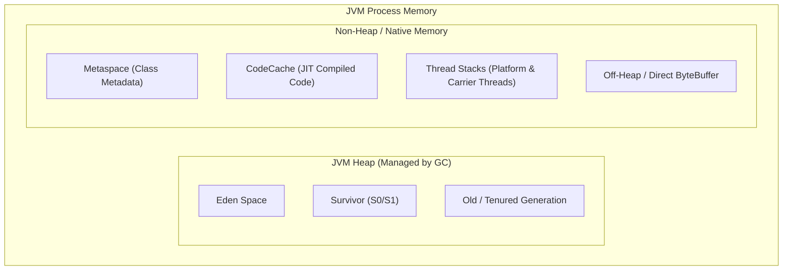

# Modern Java Knowledge Hub

> **Trọng tâm**: Kiến trúc JVM (JVM Internals), Mô hình bộ nhớ (Java Memory Model - JMM), Thuật toán Garbage Collection hiện đại, và Lập trình đồng thời (Concurrency & Virtual Threads).  
> **Phiên bản chuẩn**: Java 21 LTS+  
> **Tài liệu chính thức**: [docs.oracle.com/en/java/javase/21](https://docs.oracle.com/en/java/javase/21/) & [openjdk.org](https://openjdk.org/)

---

## 1. Bản Đồ Tri Thức JVM & Modern Java (Architectural Roadmap)



Kiến trúc Java hiện đại tập trung vào 4 khía cạnh cốt lõi:
1. **JVM Memory & Execution**: Cơ chế Just-In-Time (JIT) compilation (C1, C2 compiler), tiered compilation, On-Stack Replacement (OSR), và quản lý native memory.
2. **Java Memory Model (JMM)**: Nguyên lý *Happens-Before*, từ khóa `volatile`, bộ nhớ đệm CPU cache coherency (MESI protocol), memory barriers, và `java.util.concurrent.atomic`.
3. **Garbage Collection (GC) Algorithms**: Cơ chế thu gom rác từ Stop-The-World (G1GC) sang Concurrent low-latency (ZGC và Generational ZGC theo JEP 439).
4. **Project Loom & Virtual Threads**: Chuyển đổi mô hình xử lý I/O từ `1:1 Platform Thread per OS Thread` sang `M:N Virtual Threads on Carrier Threads`.

---

## 2. Danh Mục Chủ Đề Đang Phát Triển (Curated Topics)

### A. Project Loom: Virtual Threads & High-Throughput I/O
- **Platform Threads vs. Virtual Threads**: Phân biệt kích thước bộ nhớ call stack (1MB cố định vs vài KB tự co giãn trong Heap).
- **Scheduler & Carrier Threads**: Cách `ForkJoinPool` quản lý các carrier threads và unpark/park virtual threads khi gặp I/O blocking.
- **Thread Pinning Pitfall**: Hiện tượng Virtual Thread bị gắn chặt vào Carrier Thread khi gọi qua `synchronized` block hoặc native code (`JNI`), dẫn tới nghẽn scheduler. Giải pháp: chuyển sang `ReentrantLock`.

### B. Garbage Collection Tuning (G1GC vs. Generational ZGC)
- **G1GC Tuning**: Cách cấu hình `-XX:MaxGCPauseMillis`, `-XX:InitiatingHeapOccupancyPercent (IHOP)`.
- **Generational ZGC (Java 21+)**: Cơ chế Colored Pointers, Load Barriers, chia thế hệ (Young vs Old) giảm thiểu thời gian pause time xuống dưới 1 mili-giây trên heaps hàng Terabytes.

### C. Modern Java 21+ Language Features
- **Records & Pattern Matching**: Thay thế boilerplate POJO, bất biến (immutability) mặc định, và deconstruction patterns.
- **Sealed Classes & Exhaustiveness**: Kiểm soát cây kế thừa chặt chẽ cho Domain Modeling.
- **Foreign Function & Memory API (JEP 454)**: Truy cập an toàn vào off-heap memory thay thế `sun.misc.Unsafe`.

---

## 3. Quy Chuẩn Code Java Chuẩn Mực (Engineering Standard)

```java
// Ví dụ: Mô hình xử lý đồng thời với Virtual Threads (Java 21+)
public record OrderResult(String orderId, boolean success, String traceId) {}

public class OrderProcessingService {
    public OrderResult processOrderConcurrently(String orderId) {
        // Khởi tạo StructuredTaskScope để quản lý lifecycle của Virtual Threads
        try (var scope = new StructuredTaskScope.ShutdownOnFailure()) {
            Supplier<Boolean> inventoryCheck = scope.fork(() -> callInventoryService(orderId));
            Supplier<Boolean> paymentCheck = scope.fork(() -> callPaymentGateway(orderId));

            scope.join();           // Đợi cả 2 tác vụ I/O hoàn thành
            scope.throwIfFailed();  // Ném ngoại lệ nếu bất kỳ tác vụ nào thất bại

            boolean approved = inventoryCheck.get() && paymentCheck.get();
            return new OrderResult(orderId, approved, ScopedValue.isBound(TRACE_ID) ? TRACE_ID.get() : "N/A");
        } catch (Exception e) {
            Thread.currentThread().interrupt();
            throw new OrderProcessingException("Lỗi xử lý đơn hàng: " + orderId, e);
        }
    }
}
```

---

## 4. Tài Liệu Kiểm Chứng (Official References)

- [JEP 444: Virtual Threads (Java 21)](https://openjdk.org/jeps/444)
- [JEP 439: Generational ZGC (Java 21)](https://openjdk.org/jeps/439)
- *Java Concurrency in Practice* (Brian Goetz)
- *Effective Java, 3rd Edition* (Joshua Bloch)
