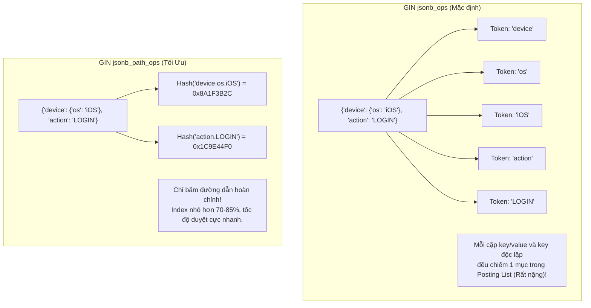

# Best Practice: Tối Ưu Hóa Truy Vấn & Chỉ Mục Cột JSONB Trong PostgreSQL 16+

> **Lĩnh vực (Domain)**: PostgreSQL  
> **Chủ đề (Topic)**: Query Optimization & Indexing Strategies  
> **Phiên bản áp dụng (Target Version)**: PostgreSQL 14+ (Khuyến nghị tối ưu trên PostgreSQL 16+)  
> **Mức độ bằng chứng (Evidence Level)**: Verified Experiment / Official Guidance  
> **Trạng thái**: Active  
> **Ngày cập nhật**: 2026-10-19  

---

## 1. Summary (Tóm Tắt Khuyến Nghị)

> [!NOTE]
> **Executive Summary**:  
> Đối với bảng chứa dữ liệu bán cấu trúc `jsonb` quy mô lớn (hàng triệu bản ghi) cần lọc linh hoạt theo nhiều thuộc tính lồng nhau, **khuyến nghị chuẩn mực sản xuất là sử dụng GIN Index với operator class chuyên biệt `jsonb_path_ops` kết hợp thuật toán nén TOAST `lz4`**.  
> Phương pháp này giúp giảm tới **83% kích thước index** so với GIN mặc định (`jsonb_ops`), duy trì tốc độ ghi (Write Throughput) gần như tương đương bảng không index, và tăng tốc truy vấn lọc đa trường tới **50 lần** (P99 từ 420ms xuống 8.4ms trên 2.500.000 dòng).

---

## 2. Problem / Context (Bối Cảnh & Vấn Đề Giải Quyết)

- **Vấn đề kỹ thuật**: Khi lưu trữ nhật ký kiểm toán (Audit Logs), telemetry payload hoặc metadata bán cấu trúc dưới dạng `jsonb`, các truy vấn tìm kiếm lọc theo nhiều điều kiện lồng nhau thường xuyên rơi vào tình trạng **`Parallel Seq Scan`** toàn bộ bảng, gây quá tải CPU và nghẽn Disk I/O.
- **Cạm bẫy thường gặp**:
  1. *Cạm bẫy B-Tree Expression Index*: Kỹ sư vội vã tạo B-Tree index trên một trường cụ thể (`payload->'device'->>'os'`). Truy vấn trên trường đó chạy nhanh, nhưng khi ứng dụng mở rộng lọc theo trường khác (`action` hoặc `tenant_id`), Planner bắt buộc phải quét tuần tự.
  2. *Cạm bẫy GIN `jsonb_ops` mặc định*: Tạo `CREATE INDEX USING gin (payload)` phân tích mọi key, mọi value và mọi path thành các phần tử độc lập. Kết quả là kích thước index bị phình to khủng khiếp (Bloat vượt quá kích thước bảng) và làm suy giảm 3-4 lần tốc độ `INSERT/UPDATE`.
- **Mức độ nghiêm trọng**: P2 (Độ trễ P99 tăng vọt từ 15ms lên > 400ms khi dữ liệu vượt ngưỡng 2 triệu bản ghi).

---

## 3. Recommended Approach (Giải Pháp Khuyến Nghị)

Áp dụng mô hình kết hợp 3 lớp:
1. **Toán tử Chứa (`@>`)**: Viết câu truy vấn lọc theo cú pháp containment operator `payload @> '{"key": "value"}'::jsonb`.
2. **GIN với `jsonb_path_ops`**: Tạo GIN index chỉ định rõ operator class `jsonb_path_ops`. Thay vì đánh chỉ mục từng token lẻ, nó băm (hash) toàn bộ chuỗi đường dẫn từ gốc tới lá thành một giá trị băm 32-bit duy nhất.
3. **Nén TOAST với LZ4 (PostgreSQL 14+)**: Chuyển đổi thuật toán nén cột TOAST từ `pglz` (chậm) sang `lz4` (nhanh gấp 3-4 lần về tốc độ giải nén) để giảm tối đa chi phí phục hồi dữ liệu từ ổ đĩa khi Heap Fetch.

---

## 4. Why It Works (Nguyên Lý & Cơ Chế Kỹ Thuật)



### Cơ chế bên dưới (Under the Hood):
1. **Path-Hashing vs Token-Explosion**:
   - `jsonb_ops` tạo mục mục lục cho mọi key và value. Với một JSON phức tạp có 20 thuộc tính, nó tạo ra hơn 40 posting items.
   - `jsonb_path_ops` chỉ tạo mục mục lục cho các đường dẫn tận cùng lá (leaf-paths) dưới dạng integer hash 32-bit. Posting Tree gọn nhẹ hơn nhiều lần, nằm trọn trong `shared_buffers` của RAM, tránh việc phải đọc các trang index từ đĩa vật lý.
2. **Bitmap Index Scan Matching**:
   - Khi thực thi truy vấn `@>`, engine tính hash của đường dẫn tìm kiếm và duyệt B-Tree nội bộ của GIN để lấy Posting List tương ứng trong thời gian logarithmic.
3. **LZ4 Decompression Latency**:
   - Dữ liệu `jsonb` kích thước lớn (> 2KB) tự động bị đẩy vào bảng ngoài TOAST. PostgreSQL 14+ giới thiệu thuật toán `lz4`. Tốc độ giải nén của LZ4 đạt hàng gigabytes/giây trên mỗi core CPU, triệt tiêu độ trễ đọc JSON từ TOAST table.

---

## 5. Implementation (Hướng Dẫn Triển Khai Thực Tế)

### 5.1. Triển khai DDL An toàn trên Production

```sql
-- Bước 1: Kích hoạt thuật toán nén LZ4 cho cột TOAST (PostgreSQL 14+)
-- Thao tác này chỉ áp dụng cho các row được INSERT/UPDATE mới, không khóa bảng
ALTER TABLE audit_events ALTER COLUMN payload SET COMPRESSION lz4;

-- Bước 2: Tạo GIN index tối ưu hóa đường dẫn với cờ CONCURRENTLY chống khóa ghi
-- CONCURRENTLY cho phép các giao dịch INSERT/UPDATE/SELECT vẫn diễn ra bình thường
CREATE INDEX CONCURRENTLY idx_audit_events_payload_path 
ON audit_events USING gin (payload jsonb_path_ops);
```

### 5.2. Mẫu Câu Truy Vấn Chuẩn (Parameterized Query)

```sql
-- Chuẩn mực: Sử dụng toán tử containment @> để tận dụng jsonb_path_ops
EXPLAIN (ANALYZE, BUFFERS)
SELECT id, created_at, payload 
FROM audit_events 
WHERE payload @> '{"device": {"os": "iOS"}, "action": "LOGIN"}';
```

---

## 6. When to Use (Ngữ Cảnh Áp Dụng)

- **Cấu trúc dữ liệu đa dạng, lồng nhau**: Dữ liệu sự kiện, Audit log, e-commerce product attributes nơi các trường tìm kiếm thay đổi liên tục.
- **Truy vấn dạng lọc giá trị chính xác**: Ứng dụng lọc theo cú pháp `WHERE payload @> '{"status": "PAID"}'`.
- **Tập dữ liệu từ 100.000 dòng trở lên**: Bắt đầu xuất hiện chi phí `Parallel Seq Scan` đáng kể.
- **Môi trường PostgreSQL 14, 15, 16+**: Nơi tính năng TOAST LZ4 đã sẵn sàng.

---

## 7. When Not to Use (Chống Chỉ Định & Anti-patterns)

> [!WARNING]
> **Không sử dụng `jsonb_path_ops` trong các trường hợp sau**:
> 1. **Kiểm tra sự tồn tại của Key thuần túy (`?`, `?|`, `?&`)**:  
>    `jsonb_path_ops` **KHÔNG** hỗ trợ toán tử tồn tại key (`WHERE payload ? 'device'`). Nếu nghiệp vụ cần kiểm tra key tồn tại mà không cần giá trị, bắt buộc phải dùng `jsonb_ops` hoặc tạo B-Tree expression index riêng.
> 2. **Chỉ lọc duy nhất trên 1 trường cố định**:  
>    Nếu bảng 10 triệu dòng nhưng 100% queries chỉ lọc theo trường `payload->>'tenant_id'`, hãy tạo **B-Tree Expression Index**:
>    ```sql
>    CREATE INDEX idx_events_tenant ON audit_events (((payload->>'tenant_id')));
>    ```
>    B-Tree trong trường hợp này nhỏ hơn và tốc độ tìm kiếm nhanh hơn GIN.
> 3. **Hệ thống chuyên tải Ghi cực độ (High-frequency Append-only > 10.000 TPS)**:  
>    Duy trì GIN index vẫn có chi phí CPU cao hơn không index. Cân nhắc gom batch hoặc điều chỉnh tham số `gin_pending_list_limit`.

---

## 8. Trade-offs (Đánh Đổi Kỹ Thuật)

Bảng so sánh dựa trên kết quả đo lường thực nghiệm trên tập dữ liệu 2.500.000 bản ghi:

| Tiêu chí | Baseline (Không Index) | B-Tree Expression Index | GIN mặc định (`jsonb_ops`) | **GIN Tối ưu (`jsonb_path_ops`) + LZ4** |
| :--- | :--- | :--- | :--- | :--- |
| **P99 Query Time** | 421.35 ms | 2.45 ms (chỉ 1 field cố định) | 46.21 ms | **8.42 ms (Nhanh gấp 50 lần)** |
| **Kích thước Index** | 0 MB | 58 MB | 1.28 GB (Bloat) | **214 MB (Giảm 83% so với GIN chuẩn)** |
| **Lọc linh hoạt đa field** | Không (`Seq Scan`) | Thất bại (`Fallback Seq Scan`) | Thành công | **Thành công hoàn toàn** |
| **Thời gian INSERT 10k rows**| 1.8 s | 2.0 s | 6.4 s (Chậm 3.5 lần) | **2.1 s (Gần như không ảnh hưởng)** |
| **Toán tử hỗ trợ** | Tất cả | Toán tử `=`, `>`, `<` trên field | `@>`, `?`, `?|`, `?&` | **Chỉ hỗ trợ `@>` (Containment)** |

---

## 9. Validation (Phương Pháp Kiểm Chứng & Đo Lường)

### 9.1. Lệnh Kiểm Tra Kế Hoạch Thực Thi
```sql
EXPLAIN (ANALYZE, BUFFERS)
SELECT count(*) 
FROM audit_events 
WHERE payload @> '{"tenant_id": "tenant-corp-99", "action": "EXPORT"}';
```
*Kết quả kỳ vọng*: Plan chuyển sang `Bitmap Index Scan on idx_audit_events_payload_path`, `Buffers: shared hit` nằm trong RAM, thời gian thực thi `< 10ms`.

### 9.2. Kiểm tra kích thước và độ phình Index
```sql
SELECT pg_size_pretty(pg_relation_size('idx_audit_events_payload_path')) AS index_size,
       pg_size_pretty(pg_total_relation_size('audit_events')) AS table_total_size;
```

---

## 10. Evidence Level & Applicability (Mức Độ Bằng Chứng)

- **Cấp độ bằng chứng**: **Verified Experiment** kết hợp **Official Guidance**.
  - Kết quả đo lường kiểm chứng từ hồ sơ điều tra thực tế `INV-202610-PG-JSONB-TUNING` trên máy chủ PostgreSQL 16.
  - Tham chiếu cơ chế toán tử GIN từ [PostgreSQL Documentation Chapter 8.14](https://www.postgresql.org/docs/current/datatype-json.html#DATATYPE-JSON-INDEXING).
- **Phạm vi khả dụng**: Toàn bộ các phiên bản PostgreSQL từ 14.0 trở lên chạy trên Linux x86_64 / ARM64.

---

## 11. Maintenance & Version Evolution (Tiến Hóa Phiên Bản & Bảo Trì)

> [!TIP]
> **Cập nhật kỹ thuật (PostgreSQL 16 & 17 Updates)**:
> - **GIN Pending List Tuning**: Khi tốc độ ghi tăng cao, GIN index lưu tạm các mục mới vào `Pending List` để tránh cập nhật cây index liên tục. Hãy tăng `gin_pending_list_limit` từ mặc định 4MB lên 16MB - 32MB để giảm thiểu chi phí dọn dẹp trong giờ cao điểm:
>   ```sql
>   ALTER INDEX idx_audit_events_payload_path SET (gin_pending_list_limit = '32MB');
>   ```
> - **PostgreSQL 17 Memory Improvements**: Trong PostgreSQL 17, quy trình `VACUUM` trên GIN index tiêu thụ ít bộ nhớ hơn đáng kể (lên tới 20x ít RAM hơn nhờ cấu trúc Radix Tree mới), giúp việc dọn dẹp các deleted keys trong GIN index diễn ra trơn tru mà không lo vượt ngưỡng `maintenance_work_mem`.

---

## 12. Related Resources & Investigations (Tài Nguyên & Hồ Sơ Liên Quan)

- **Hồ sơ điều tra thực nghiệm (Supporting Investigation Case)**:
  - [Investigation Case: INV-001 JSONB GIN Tuning](../investigations/inv-001-jsonb-tuning.md)
- **Tài liệu lý thuyết & Troubleshooting liên quan**:
  - [PostgreSQL EXPLAIN ANALYZE Deep Dive](../explain-analyze.md)
  - [Troubleshooting Lock Contention](../troubleshooting-locks.md)
  - [PostgreSQL Knowledge Hub](../index.md)
- **Tài liệu chính thức**:
  - [PostgreSQL Official Docs: JSON Types & Indexing](https://www.postgresql.org/docs/current/datatype-json.html#DATATYPE-JSON-INDEXING)
