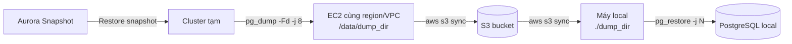

!!! abstract "Ý tưởng chính"
Với những dữ liệu lớn, tận dụng cơ chế backup/restore bằng **directory format** (`-Fd`) sẽ nhanh hơn,
vì cả `pg_dump` và `pg_restore` đều chạy **song song** được (`-j`), dữ liệu được nén sẵn từng bảng.

## Tổng quan luồng xử lý



## Cheat sheet nhanh

??? tip "Chỉ cần nhớ lệnh? Mở phần này"

    ```bash title="Trên EC2 (cùng VPC với cluster tạm)"
    tmux new -s dump
    pg_dump -h <tmp-cluster-endpoint> -U <user> -d <dbname> \
      -Fd -j 8 -Z 6 --no-owner --no-privileges \
      -f /data/dump_dir 2>&1 | tee /data/dump.log
    aws s3 sync /data/dump_dir s3://<bucket>/dump_dir/
    ```

    ```bash title="Trên máy local"
    aws s3 sync s3://<bucket>/dump_dir/ ./dump_dir/
    # (chỉnh postgresql.conf cho restore nhanh rồi restart)
    createdb -U postgres mydb
    pg_restore -U postgres -d mydb -j $(nproc) --no-owner --no-privileges \
      -v ./dump_dir 2>&1 | tee restore.log
    # (trả lại cấu hình bình thường, restart, rồi ANALYZE)
    vacuumdb -U postgres -d mydb --analyze-in-stages -j $(nproc)
    ```

---

## I. Restore file snapshot Aurora PostgreSQL trên AWS về local

### Phần 1: Tạo file backup trên AWS

#### Bước 1: Restore snapshot thành cluster tạm

Từ file snapshot trên hệ thống (có thể là thủ công hoặc tự động), chọn **Restore snapshot** → tạo **DB cluster identifier** mới.

=== "AWS Console"

    1. Vào **RDS → Snapshots** → chọn snapshot (tab *Manual* hoặc *System*).
    2. **Actions → Restore snapshot**.
    3. Đặt **DB cluster identifier** mới, ví dụ `tmp-dump-cluster`.
    4. Chọn **VPC / Subnet group / Security group** sao cho EC2 dùng để dump kết nối được (port `5432`).
    5. Chờ trạng thái cluster và instance là **Available**, ghi lại **Writer endpoint**.

=== "AWS CLI"

    ```bash
    # 1. Restore cluster từ snapshot (lệnh này CHƯA tạo instance)
    aws rds restore-db-cluster-from-snapshot \
      --db-cluster-identifier tmp-dump-cluster \
      --snapshot-identifier <snapshot-id> \
      --engine aurora-postgresql \
      --db-subnet-group-name <subnet-group> \
      --vpc-security-group-ids <sg-id>

    # 2. Tạo instance cho cluster
    aws rds create-db-instance \
      --db-instance-identifier tmp-dump-instance-1 \
      --db-cluster-identifier tmp-dump-cluster \
      --db-instance-class db.r6g.xlarge \
      --engine aurora-postgresql

    # 3. Chờ sẵn sàng và lấy endpoint
    aws rds wait db-instance-available --db-instance-identifier tmp-dump-instance-1
    aws rds describe-db-clusters --db-cluster-identifier tmp-dump-cluster \
      --query 'DBClusters[0].Endpoint' --output text
    ```

!!! tip "Mẹo" - Cluster tạm không phục vụ traffic nào khác, nên có thể dump với `-j` cao mà không ảnh hưởng production. - Chọn instance class đủ CPU/RAM nếu muốn tăng `-j`.

!!! warning "Nhớ xóa cluster tạm sau khi dump xong để tránh phát sinh chi phí"
`bash
    aws rds delete-db-instance --db-instance-identifier tmp-dump-instance-1
    aws rds delete-db-cluster --db-cluster-identifier tmp-dump-cluster --skip-final-snapshot
    `

#### Bước 2: Dump trên EC2 cùng region/VPC

Dump file backup từ một EC2 instance trong **cùng VPC** với Aurora PostgreSQL để tốc độ được tối ưu.

```bash
pg_dump \
  -h <tmp-cluster-endpoint> -U <user> -d <dbname> \
  -Fd -j 8 -Z 6 \
  --no-owner --no-privileges \
  -f /data/dump_dir 2>&1 | tee /data/dump.log
```

| Tham số             | Ý nghĩa                                                                |
| ------------------- | ---------------------------------------------------------------------- |
| `-Fd`               | Format directory (nén sẵn, hỗ trợ dump/restore song song)              |
| `-j 8`              | Số worker song song (tăng theo CPU và khả năng chịu tải của Aurora)    |
| `-Z 6`              | Mức nén (0–9). Cao hơn → file nhỏ hơn nhưng tốn CPU hơn                |
| `--no-owner`        | Không ghi lệnh `ALTER ... OWNER`, tránh lỗi role không tồn tại ở local |
| `--no-privileges`   | Không dump `GRANT/REVOKE`                                              |
| `-f /data/dump_dir` | Thư mục output (pg_dump tự tạo, **không được tồn tại sẵn**)            |
| `2>&1 \| tee`       | Vừa hiện log ra màn hình vừa ghi vào file                              |

!!! info "Chạy trong `tmux` hoặc `nohup` để không bị mất khi rớt SSH"
Với **70GB**, bước này thường mất khoảng **20–60 phút**.

=== "tmux"

    ```bash
    tmux new -s dump               # chạy lệnh pg_dump trong tmux, thoát bằng Ctrl+B rồi D
    tmux attach -t dump            # vào lại session
    watch -n 10 'du -sh /data/dump_dir'   # theo dõi tiến độ
    tail -f /data/dump.log         # log chi tiết (từng bảng đang dump)
    ```

=== "nohup"

    ```bash
    nohup pg_dump -h <tmp-cluster-endpoint> -U <user> -d <dbname> \
      -Fd -j 8 -Z 6 --no-owner --no-privileges -v \
      -f /data/dump_dir > /data/dump.log 2>&1 &

    tail -f /data/dump.log
    ```

??? note "Chuẩn bị trước khi dump (nên kiểm tra)"

    **1. Phiên bản `pg_dump` phải ≥ phiên bản server**

    ```bash
    pg_dump --version
    psql -h <tmp-cluster-endpoint> -U <user> -d <dbname> -c "SELECT version();"
    ```

    **2. Không để `pg_dump` hỏi mật khẩu** (quan trọng khi chạy nền/tmux) – dùng file `~/.pgpass`:

    ```bash
    echo "<tmp-cluster-endpoint>:5432:<dbname>:<user>:<password>" >> ~/.pgpass
    chmod 600 ~/.pgpass
    ```

    **3. Đủ dung lượng đĩa** cho thư mục `/data` (thường ~20–40% dung lượng DB sau khi nén):

    ```bash
    df -h /data
    ```

    **4. `-j 8` mở 9 kết nối** (1 leader + 8 worker), đảm bảo `max_connections` của cluster đủ.

#### Bước 3: Đẩy lên S3 và tải về

Nén thành file trước khi upload lên S3 (tuỳ chọn):

```bash
tar -czvf ten_file_nen.tar.gz /duong/dan/den/thu_muc
```

Đồng bộ thư mục lên S3 và tải về local:

```bash
aws s3 sync /data/dump_dir s3://<bucket>/dump_dir/

# trên máy local
aws s3 sync s3://<bucket>/dump_dir/ ./dump_dir/
```

!!! success "Nên dùng `sync` thay vì `tar` một file lớn"
Nếu bị đứt kết nối, chạy lại `aws s3 sync` sẽ **tiếp tục phần còn thiếu** thay vì upload/download lại từ đầu.

!!! tip "Lưu ý khi dùng tar"
Các file `*.dat.gz` trong dump đã được nén bởi `-Z 6`, nên `tar -z` gần như không giảm thêm dung lượng mà tốn CPU.
Nếu chỉ muốn gom thành 1 file, dùng `tar -cvf ten_file.tar ...` (không `-z`).

??? note "Kiểm tra sau khi upload"

````bash # Tổng số file và dung lượng trên S3
aws s3 ls s3://<bucket>/dump_dir/ --recursive --summarize --human-readable | tail -n 2

    # So sánh với local
    find /data/dump_dir -type f | wc -l
    du -sh /data/dump_dir
    ```
    EC2 cần có **IAM role** (hoặc credentials) được quyền `s3:PutObject`, `s3:ListBucket` trên bucket.

---

### Phần 2: Restore file backup sau khi đã đẩy lên S3

#### Bước 1: Download backup từ S3 và giải nén

Download backup từ S3 về, giải nén sao cho **bên trong thư mục có file `toc.dat` + nhiều file `*.dat.gz`**.

```bash
# Nếu đã upload dạng thư mục
aws s3 sync s3://<bucket>/dump_dir/ ./dump_dir/

# Nếu đã upload dạng file tar
tar -xzvf ten_file_nen.tar.gz      # hoặc: tar -xvf ten_file.tar

# Kiểm tra cấu trúc
ls ./dump_dir | head
# toc.dat  4012.dat.gz  4013.dat.gz  ...
````

!!! warning "Đường dẫn khi giải nén tar"
Nếu lúc nén dùng đường dẫn tuyệt đối (`/data/dump_dir`), tar sẽ giải nén thành `./data/dump_dir`.
Đường dẫn đưa vào `pg_restore` phải là thư mục **trực tiếp chứa `toc.dat`**.

#### Bước 2: Tối ưu PostgreSQL local tạm thời

Sửa `postgresql.conf`, rồi **restart** PostgreSQL:

```ini title="postgresql.conf (chỉ dùng trong lúc restore)"
shared_buffers = 2GB
maintenance_work_mem = 2GB
max_wal_size = 32GB
checkpoint_timeout = 30min
wal_level = minimal
max_wal_senders = 0
archive_mode = off
synchronous_commit = off
fsync = off
full_page_writes = off
autovacuum = off
max_parallel_maintenance_workers = 4
```

!!! danger "Cảnh báo"
`fsync = off` và `full_page_writes = off` **chỉ dùng khi restore**. Nếu mất điện giữa chừng thì phải restore lại.
**Bật lại sau khi xong.**

??? info "Giải thích từng tham số"

    | Tham số | Tác dụng khi restore |
    | ------- | -------------------- |
    | `shared_buffers` | Bộ nhớ đệm chung (thường ~25% RAM máy) |
    | `maintenance_work_mem` | RAM cho `CREATE INDEX`, `ADD FOREIGN KEY` → tạo index nhanh hơn |
    | `max_wal_size`, `checkpoint_timeout` | Giảm số lần checkpoint trong lúc ghi lượng lớn |
    | `wal_level = minimal` | Giảm lượng WAL ghi ra (bắt buộc đi kèm `max_wal_senders = 0`) |
    | `archive_mode = off` | Không archive WAL |
    | `synchronous_commit = off` | Không chờ WAL flush xuống đĩa khi commit |
    | `fsync`, `full_page_writes = off` | Bỏ đảm bảo an toàn dữ liệu khi crash → ghi nhanh hơn nhiều |
    | `autovacuum = off` | Không để autovacuum tranh tài nguyên trong lúc nạp dữ liệu |
    | `max_parallel_maintenance_workers` | Số worker song song khi tạo index B-tree |

    Các tham số `shared_buffers`, `wal_level`, `max_wal_senders`, `archive_mode` **bắt buộc restart** mới có hiệu lực.

??? tip "Cách khác: dùng `ALTER SYSTEM` thay vì sửa tay `postgresql.conf`"
Đăng nhập `psql -U postgres` rồi chạy (giá trị được ghi vào `postgresql.auto.conf`):

    ```sql
    ALTER SYSTEM SET shared_buffers = '2GB';
    ALTER SYSTEM SET maintenance_work_mem = '2GB';
    ALTER SYSTEM SET max_wal_size = '32GB';
    ALTER SYSTEM SET checkpoint_timeout = '30min';
    ALTER SYSTEM SET wal_level = 'minimal';
    ALTER SYSTEM SET max_wal_senders = 0;
    ALTER SYSTEM SET archive_mode = 'off';
    ALTER SYSTEM SET synchronous_commit = 'off';
    ALTER SYSTEM SET fsync = 'off';
    ALTER SYSTEM SET full_page_writes = 'off';
    ALTER SYSTEM SET autovacuum = 'off';
    ALTER SYSTEM SET max_parallel_maintenance_workers = 4;
    ```

    Tìm vị trí file cấu hình: `SHOW config_file;`

Restart PostgreSQL:

=== "Linux (systemd)"

    ```bash
    sudo systemctl restart postgresql
    ```

=== "Windows"

    ```powershell
    # Tên service tuỳ phiên bản, ví dụ postgresql-x64-16
    Restart-Service postgresql-x64-16
    # hoặc
    pg_ctl restart -D "C:\Program Files\PostgreSQL\16\data"
    ```

=== "Docker"

    ```bash
    docker restart <container_name>
    ```

#### Bước 3: Tạo DB và restore song song

```bash
createdb -U postgres mydb

pg_restore -U postgres -d mydb \
  -j 8 --no-owner --no-privileges \
  -v /path/to/dump_dir 2>&1 | tee restore.log
```

- `-j`: bằng **số core CPU** của máy (kiểm tra bằng `nproc` trên Linux, `echo %NUMBER_OF_PROCESSORS%` trên Windows).
- Nên chạy trong **tmux** để không mất khi rớt SSH.
- Lần này có `-v` và `tee`, nên xem tiến độ được bằng `tail -f restore.log`.

!!! note "Lưu ý" - Mỗi bảng chỉ được nạp bởi **1 worker**, nên bảng lớn nhất sẽ quyết định thời gian tối thiểu dù `-j` cao. - Nếu DB nguồn dùng extension (`postgis`, `pg_trgm`, `uuid-ossp`, ...) thì máy local phải **cài sẵn** extension đó. - `pg_restore` mặc định gặp lỗi vẫn chạy tiếp và báo `errors ignored on restore: N` ở cuối. Kiểm tra:
`bash
      grep -iE "error|warning" restore.log
      `
Thêm `--exit-on-error` nếu muốn dừng ngay khi có lỗi (không dùng được cùng lúc với ý định bỏ qua lỗi role/extension của Aurora).

#### Sau khi restore xong

Trả lại cấu hình bình thường trong `postgresql.conf`.

Nên cấu hình trong `postgresql.auto.conf` bằng lệnh `ALTER SYSTEM` sau khi đăng nhập `psql`:

```sql title="Trả lại cấu hình mặc định"
ALTER SYSTEM RESET fsync;
ALTER SYSTEM RESET full_page_writes;
ALTER SYSTEM RESET synchronous_commit;
ALTER SYSTEM RESET autovacuum;
ALTER SYSTEM RESET wal_level;
ALTER SYSTEM RESET max_wal_senders;
ALTER SYSTEM RESET archive_mode;
ALTER SYSTEM RESET max_wal_size;
ALTER SYSTEM RESET checkpoint_timeout;
-- giữ lại shared_buffers / maintenance_work_mem nếu phù hợp với RAM máy
-- hoặc reset toàn bộ những gì đã ALTER SYSTEM:
-- ALTER SYSTEM RESET ALL;
```

!!! warning "Nếu đã sửa tay trong `postgresql.conf`"
`ALTER SYSTEM RESET` chỉ xóa giá trị trong `postgresql.auto.conf`. Giá trị sửa tay trong `postgresql.conf`
phải **sửa lại tay** (comment dòng đó hoặc đặt lại giá trị cũ). Sau đó **restart**.

Chạy `ANALYZE` để planner có thống kê (vì `autovacuum` đã tắt trong lúc restore, nếu bỏ qua bước này query có thể rất chậm):

```bash
vacuumdb -U postgres -d mydb --analyze-in-stages -j 8
```

Checklist kiểm tra:

- [ ] `fsync`, `full_page_writes`, `autovacuum` đã bật lại (`SHOW fsync;` → `on`)
- [ ] Đã restart PostgreSQL
- [ ] Đã chạy `ANALYZE` / `vacuumdb --analyze-in-stages`
- [ ] `restore.log` không có lỗi nghiêm trọng
- [ ] Số lượng bản ghi các bảng quan trọng khớp với nguồn
- [ ] Đã xóa cluster tạm trên AWS

```sql title="Kiểm tra nhanh dữ liệu"
-- Dung lượng DB
SELECT pg_size_pretty(pg_database_size('mydb'));

-- Top bảng theo số dòng (ước lượng, chính xác sau khi ANALYZE)
SELECT schemaname, relname, n_live_tup
FROM pg_stat_user_tables
ORDER BY n_live_tup DESC
LIMIT 20;

-- Đếm chính xác bảng quan trọng
SELECT count(*) FROM schema_name.ten_bang;
```

---

## II. Một số xử lý liên quan

### 1. Restore một hoặc nhiều bảng chỉ định của schema bất kỳ

Chỉ lấy dữ liệu hoặc chỉ cấu trúc:

=== "Windows"

    ```powershell
    # Chỉ cấu trúc bảng (không có dữ liệu)
    pg_restore -U postgres -d mydb -n schema_name -t ten_bang --schema-only -v "D:\restore\dump_dir"

    # Chỉ dữ liệu (bảng phải đã tồn tại ở DB đích)
    pg_restore -U postgres -d mydb -n schema_name -t ten_bang --data-only -v "D:\restore\dump_dir"
    ```

=== "Linux / macOS"

    ```bash
    # Chỉ cấu trúc bảng (không có dữ liệu)
    pg_restore -U postgres -d mydb -n schema_name -t ten_bang --schema-only -v /path/to/dump_dir

    # Chỉ dữ liệu (bảng phải đã tồn tại ở DB đích)
    pg_restore -U postgres -d mydb -n schema_name -t ten_bang --data-only -v /path/to/dump_dir
    ```

!!! tip "Nhiều bảng cùng lúc"
Lặp lại tham số `-t`: `-t bang_1 -t bang_2 -t bang_3`.
`-t` chỉ nhận **tên bảng** (không ghi `schema.bang`), schema chỉ định bằng `-n`.

!!! warning "Lưu ý"
`-t` chỉ restore **bảng và dữ liệu** – không kéo theo index, primary key, foreign key, sequence.
Nếu có khóa ngoại hoặc sequence, xem cách bên dưới sẽ đầy đủ hơn.

### 2. Restore đủ bảng + sequence + PK + dữ liệu một lần

Dùng **TOC list** (`-l` để xuất danh sách, `-L` để restore theo danh sách):

```bash
pg_restore -l /path/to/dump_dir | grep -i "airbnb_property_listings" > list_airbnb.txt
cat list_airbnb.txt   # kiểm tra có đủ TABLE, SEQUENCE, OWNED BY, SEQUENCE SET, TABLE DATA, CONSTRAINT
pg_restore -U postgres -d mydb -L list_airbnb.txt --no-owner --no-privileges -v /path/to/dump_dir
```

??? example "Ví dụ nội dung `list_airbnb.txt`"
`text
    245; 1259 16390 TABLE public airbnb_property_listings admin
    246; 1259 16389 SEQUENCE public airbnb_property_listings_id_seq admin
    4321; 0 0 SEQUENCE OWNED BY public airbnb_property_listings_id_seq admin
    4120; 0 16390 TABLE DATA public airbnb_property_listings admin
    4330; 0 0 SEQUENCE SET public airbnb_property_listings_id_seq admin
    3980; 2606 16395 CONSTRAINT public airbnb_property_listings airbnb_property_listings_pkey admin
    3990; 1259 16400 INDEX public idx_airbnb_property_listings_city admin
    `

!!! tip "Mẹo khi làm việc với TOC list" - Nhiều bảng: `grep -iE "bang_1|bang_2"`. - Bỏ qua một dòng: thêm dấu `;` ở đầu dòng đó trong file list. - `pg_restore -L` restore **theo đúng thứ tự trong file**, `grep` giữ nguyên thứ tự gốc nên an toàn. - `grep` theo tên bảng có thể **bỏ sót** những object có tên khác (index đặt tên tùy ý, trigger, sequence không theo quy tắc `<bang>_<cot>_seq`) hoặc **lấy thừa** bảng có tên chứa chuỗi đó (`airbnb_property_listings_history`). Luôn `cat` kiểm tra lại. - `FK CONSTRAINT` tham chiếu tới bảng khác sẽ lỗi nếu bảng kia chưa tồn tại ở DB đích – restore bảng cha trước hoặc bỏ dòng đó.

---

## III. Lệnh bổ sung hữu ích

### Xem nội dung một bản dump

```bash
pg_restore -l /path/to/dump_dir | less                       # toàn bộ TOC
pg_restore -l /path/to/dump_dir | grep "TABLE DATA" | wc -l  # số bảng có dữ liệu
```

### Dump một phần database

```bash
# Chỉ một schema
pg_dump -h <host> -U <user> -d <dbname> -Fd -j 4 -n schema_name -f ./dump_schema

# Chỉ một số bảng (dạng schema.bang)
pg_dump -h <host> -U <user> -d <dbname> -Fd -j 4 \
  -t 'public.bang_1' -t 'public.bang_2' -f ./dump_tables

# Bỏ dữ liệu các bảng log/audit lớn nhưng vẫn giữ cấu trúc
pg_dump -h <host> -U <user> -d <dbname> -Fd -j 8 \
  --exclude-table-data='public.audit_log*' -f ./dump_dir
```

### Export / import CSV nhanh một bảng

```sql
-- Trong psql (chạy phía client, không cần quyền superuser)
\copy schema_name.ten_bang TO 'ten_bang.csv' WITH (FORMAT csv, HEADER)
\copy schema_name.ten_bang FROM 'ten_bang.csv' WITH (FORMAT csv, HEADER)

-- Export theo câu query
\copy (SELECT * FROM orders WHERE created_at >= '2026-01-01') TO 'orders_2026.csv' WITH (FORMAT csv, HEADER)
```

### DB nhỏ: dump ra file SQL thuần

```bash
pg_dump -h <host> -U <user> -d <dbname> --no-owner --no-privileges -f dump.sql
psql -U postgres -d mydb -f dump.sql
```

### Xử lý lỗi thường gặp

| Lỗi                                                        | Nguyên nhân / cách xử lý                                                                                              |
| ---------------------------------------------------------- | --------------------------------------------------------------------------------------------------------------------- |
| `unsupported version (x.y) in file header`                 | `pg_restore` cũ hơn `pg_dump` đã tạo bản dump → nâng cấp client PostgreSQL ở local                                    |
| `server version mismatch` khi dump                         | `pg_dump` cũ hơn server Aurora → cài client đúng hoặc mới hơn phiên bản server                                        |
| `role "xxx" does not exist`                                | Thiếu `--no-owner` / `--no-privileges`                                                                                |
| `extension "xxx" is not available`                         | Cài extension tương ứng ở máy local trước khi restore                                                                 |
| `out of shared memory` + gợi ý `max_locks_per_transaction` | DB có rất nhiều bảng, `pg_dump` khóa từng bảng → tăng `max_locks_per_transaction` qua parameter group của cluster tạm |
| `too many clients already`                                 | Giảm `-j` hoặc tăng `max_connections`                                                                                 |
| `directory "/data/dump_dir" exists`                        | Thư mục output của `pg_dump -Fd` phải chưa tồn tại → xóa hoặc đổi tên                                                 |
| Restore xong nhưng query rất chậm                          | Chưa chạy `ANALYZE` / `vacuumdb --analyze-in-stages`                                                                  |

---

??? info "Cấu hình `mkdocs.yml` cần cho trang này"

````yaml
theme:
name: material
features: - content.code.copy - content.tabs.link

    plugins:
      - search
      - tags

    markdown_extensions:
      - admonition
      - attr_list
      - md_in_html
      - tables
      - toc:
          permalink: true
      - pymdownx.details
      - pymdownx.highlight:
          anchor_linenums: true
      - pymdownx.inlinehilite
      - pymdownx.snippets
      - pymdownx.tabbed:
          alternate_style: true
      - pymdownx.tasklist:
          custom_checkbox: true
      - pymdownx.superfences:
          custom_fences:
            - name: mermaid
              class: mermaid
              format: !!python/name:pymdownx.superfences.fence_code_format
    ```
````
