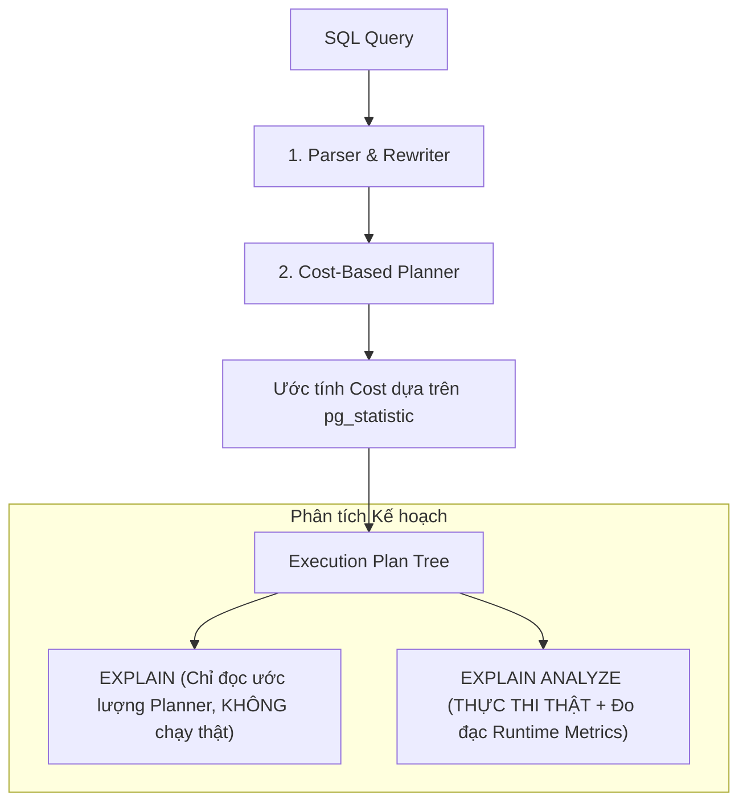
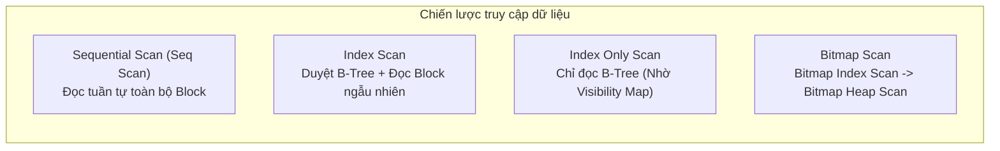

# PostgreSQL EXPLAIN ANALYZE: Giải Mã Execution Plan Từ Bản Chất

> **Phân loại**: PostgreSQL Internals & Performance Tuning  
> **Phiên bản áp dụng**: PostgreSQL 14, 15, 16+  
> **Nguồn tài liệu chính thức**:  
> - [PostgreSQL Documentation: Using EXPLAIN](https://www.postgresql.org/docs/current/using-explain.html)  
> - [PostgreSQL Documentation: EXPLAIN SQL Command](https://www.postgresql.org/docs/current/sql-explain.html)  
> - [PostgreSQL Documentation: Planner Cost Constants](https://www.postgresql.org/docs/current/runtime-config-query.html#RUNTIME-CONFIG-QUERY-CONSTANTS)  
> **Mã nguồn thực nghiệm (Hands-on Lab)**: [`labs/postgresql/explain-analyze/`](https://github.com/vinh-nt/developer-knowledge-base/tree/main/labs/postgresql/explain-analyze)  

---

## 1. Bản Chất Của EXPLAIN vs. EXPLAIN ANALYZE

Trong quy trình xử lý câu truy vấn của PostgreSQL, sau khi đi qua **Parser** và **Rewriter**, câu lệnh SQL được chuyển đến **Query Planner (Optimizer)**. Planner sẽ đánh giá hàng loạt phương án thực thi (Execution Plans) và chọn ra phương án có tổng chi phí tính toán (Estimated Cost) thấp nhất.



### Sự khác biệt cốt tử
- **`EXPLAIN`**: Chỉ hiển thị kế hoạch dự kiến của Optimizer dựa trên bảng thống kê dữ liệu (`pg_statistic`). Câu truy vấn **KHÔNG** được thực thi.
- **`EXPLAIN ANALYZE`**: Optimizer lập kế hoạch, sau đó **Execution Engine THỰC SỰ CHẠY câu truy vấn đó**, đếm số dòng thực tế, đo thời gian CPU/I/O, và ghi nhận dung lượng bộ đệm (Buffers) sử dụng.

> [!CAUTION]
> **Cạm bẫy phá hủy dữ liệu (Production Hazard)**:  
> Vì `EXPLAIN ANALYZE` thực sự chạy câu lệnh, nếu bạn thực hiện trên câu lệnh `INSERT`, `UPDATE`, hoặc `DELETE`, dữ liệu trong database **sẽ bị thay đổi thật**!  
> Để kiểm tra các câu lệnh ghi dữ liệu an toàn, **luôn bọc trong một Transaction và ROLLBACK**:
> ```sql
> BEGIN;
> EXPLAIN ANALYZE DELETE FROM orders WHERE status = 'CANCELLED';
> ROLLBACK; -- Hủy bỏ toàn bộ thay đổi, bảo toàn dữ liệu
> ```

---

## 2. Cú Pháp Khuyến Nghị Cho Senior Engineer

Để có đầy đủ thông tin nhất nhằm chẩn đoán nghẽn cổ chai (bottlenecks), hãy luôn sử dụng tổ hợp cờ (flags) sau:

```sql
EXPLAIN (ANALYZE, BUFFERS, TIMING, COSTS, VERBOSE, SUMMARY)
SELECT * FROM orders 
WHERE customer_id = 4289 
  AND created_at >= '2026-01-01' 
ORDER BY total_amount DESC 
LIMIT 20;
```

### Ý nghĩa của các tham số
- **`ANALYZE`** *(boolean)*: Kích hoạt thực thi thật để thu thập `actual time` và `actual rows`.
- **`BUFFERS`** *(boolean)*: Hiển thị thống kê sử dụng bộ đệm (Shared Buffers, Local Buffers, Temp Buffers). Đây là chỉ số quan trọng nhất để đánh giá I/O.
- **`TIMING`** *(boolean, mặc định on)*: Đo lường thời gian xuất hiện dòng đầu tiên (startup time) và hoàn thành node (total time).
- **`VERBOSE`** *(boolean)*: Hiển thị thêm danh sách các cột (output columns), schema name và alias.
- **`SUMMARY`** *(boolean)*: Tổng hợp thời gian lập kế hoạch (`Planning Time`) và thời gian chạy (`Execution Time`).

---

## 3. Mổ Xẻ Cấu Trúc Một Node Trong Execution Plan

Xét một kết quả kế hoạch thực thi điển hình:

```text
Limit  (cost=12.45..12.50 rows=20 width=85) (actual time=0.082..0.086 rows=20 loops=1)
  Buffers: shared hit=8
  ->  Sort  (cost=12.45..12.48 rows=14 width=85) (actual time=0.081..0.083 rows=20 loops=1)
        Sort Key: total_amount DESC
        Sort Method: top-N heapsort  Memory: 27kB
        Buffers: shared hit=8
        ->  Index Scan using idx_orders_customer_id on orders  (cost=0.42..12.18 rows=14 width=85) (actual time=0.024..0.045 rows=25 loops=1)
              Index Cond: (customer_id = 4289)
              Filter: (created_at >= '2026-01-01 00:00:00'::timestamp)
              Rows Removed by Filter: 5
              Buffers: shared hit=8
Planning Time: 0.185 ms
Execution Time: 0.121 ms
```

### 3.1. Phân giải Cost Estimation: `(cost=12.45..12.50 rows=20 width=85)`
Đây là ước tính toán học từ Planner:
- **`12.45` (Startup Cost)**: Chi phí ước lượng để node sẵn sàng xuất ra dòng đầu tiên. Đối với node `Sort`, startup cost rất cao vì phải nạp và sắp xếp toàn bộ tập dữ liệu trước khi trả về dòng đầu tiên. Đối với `Index Scan`, startup cost thường gần bằng `0.00` hoặc `0.42` (chỉ cần duyệt từ root xuống leaf node).
- **`12.50` (Total Cost)**: Chi phí tích lũy ước tính để node xử lý xong tất cả các dòng dữ liệu.
- **`rows=20`**: Số lượng dòng dự kiến node sẽ trả về.
- **`width=85`**: Kích thước trung bình ước tính của mỗi dòng (tính bằng bytes).

#### Công thức tính Cost cơ bản trong PostgreSQL
Chi phí không tính bằng giây hay mili-giây, mà tính bằng **đơn vị cost tương đối (arbitrary cost units)** chuẩn hóa theo:
- `seq_page_cost = 1.0` (Chi phí đọc 1 page tuần tự từ đĩa).
- `random_page_cost = 4.0` (Chi phí đọc 1 page ngẫu nhiên từ đĩa trên HDD truyền thống, với NVMe SSD nên cấu hình xuống `1.1`).
- `cpu_tuple_cost = 0.01` (Chi phí CPU xử lý 1 dòng dữ liệu).
- `cpu_operator_cost = 0.0025` (Chi phí CPU tính toán 1 biểu thức điều kiện WHERE).

$$\text{Estimated Total Cost} = (\text{Pages} \times \text{page\_cost}) + (\text{Tuples} \times \text{cpu\_tuple\_cost}) + (\text{Filters} \times \text{cpu\_operator\_cost})$$

### 3.2. Phân giải Runtime Metrics: `(actual time=0.082..0.086 rows=20 loops=1)`
- **`0.082` (Actual Startup Time)**: Thời gian thực tế (mili-giây) từ khi bắt đầu cho đến khi node sẵn sàng xuất dòng đầu tiên.
- **`0.086` (Actual Total Time)**: Thời gian thực tế (mili-giây) để node hoàn thành việc xuất toàn bộ dữ liệu.
- **`rows=20`**: Số dòng thực tế được trả về trong 1 vòng lặp (loop).
- **`loops=1`**: Số lần node này được thực thi lại.

> [!IMPORTANT]
> **Quy tắc Loops**:  
> Nếu `loops > 1` (thường gặp trong `Nested Loop Join`), các chỉ số `actual time` và `rows` hiển thị là **giá trị trung bình cho MỖI loop**.  
> **Tổng thời gian thực tế của node** = $\text{actual total time} \times \text{loops}$.  
> **Tổng số dòng thực tế được quét** = $\text{actual rows} \times \text{loops}$.

---

## 4. Các Chiến Lược Quét Dữ Liệu (Scan Strategies Under The Hood)

PostgreSQL sử dụng 4 cơ chế quét dữ liệu chính:



### 1. Sequential Scan (`Seq Scan`)
- **Cơ chế**: Đọc tuần tự tất cả các data blocks (heap pages) của bảng từ đầu đến cuối.
- **Khi nào chọn**:
  - Bảng nhỏ (vài chục đến vài trăm pages): Chi phí đọc tuần tự nhanh hơn rất nhiều so với duyệt cây B-Tree.
  - Câu truy vấn lấy tỷ lệ dòng lớn (> 10-20% tổng số dòng trong bảng). Lúc này, `random_page_cost` của Index Scan sẽ đắt hơn nhiều so với việc scan hàng loạt page liên tục.

### 2. Index Scan
- **Cơ chế**: Duyệt cây B-Tree từ Root node -> Internal nodes -> Leaf nodes để tìm con trỏ tuple (`ItemPointer / TID`: gồm Block Number và Offset). Sau đó, lập tức nhảy vào Heap page trên đĩa để lấy toàn bộ dữ liệu của tuple đó.
- **Đánh đổi**: Tốn chi phí Random I/O cho mỗi dòng tìm thấy. Nếu câu truy vấn cần lấy 50.000 dòng, việc nhảy ngẫu nhiên vào 50.000 vị trí khác nhau trên ổ đĩa sẽ gây thắt cổ chai I/O nghiêm trọng.

### 3. Index Only Scan
- **Cơ chế**: Tất cả các cột được yêu cầu trong câu `SELECT` đều đã nằm sẵn trong cấu trúc của Index (ví dụ composite index hoặc index có mệnh đề `INCLUDE`), VÀ các trang dữ liệu tương ứng được đánh dấu là "sạch" trong **Visibility Map (VM)**.
- **Lợi ích**: Không cần chạm vào Heap pages. Đây là chiến lược quét nhanh nhất trong cơ sở dữ liệu quan hệ.

### 4. Bitmap Index Scan kết hợp Bitmap Heap Scan
- **Cơ chế 2 bước**:
  1. `Bitmap Index Scan`: Duyệt index và dựng một mảng bit trong bộ nhớ (TID Bitmap). Mỗi bit đại diện cho một trang dữ liệu chứa dòng thỏa mãn điều kiện.
  2. `Bitmap Heap Scan`: Sắp xếp các địa chỉ trang theo thứ tự vật lý liên tục trên đĩa, sau đó đọc các trang heap một lần theo thứ tự tuần tự đó.
- **Giải quyết bài toán**: Chuyển đổi các thao tác Random I/O rời rạc của Index Scan thành Sequential I/O gom cụm, cực kỳ hiệu quả khi cần lấy từ 1% đến 10% dữ liệu của bảng lớn.

---

## 5. Giải Mã Thống Kê Bộ Đệm (Buffer Cache Breakdown)

Khi kích hoạt cờ `BUFFERS`, PostgreSQL xuất ra chi tiết về hành vi đọc ghi bộ nhớ:

```text
Buffers: shared hit=42 read=15 dirtied=2 written=0, temp read=120 written=120
```

| Thuộc tính bộ đệm | Ý nghĩa kỹ thuật | Phân tích hiệu năng |
| :--- | :--- | :--- |
| **`shared hit`** | Số page 8KB tìm thấy sẵn trong `shared_buffers` của PostgreSQL. | **Tốt nhất**: Dữ liệu nằm trong RAM, độ trễ truy xuất chỉ vài micro-giây. |
| **`shared read`** | Số page phải đọc từ OS Page Cache hoặc ổ cứng vật lý. | **Có độ trễ**: Nếu số này lớn liên tục, hệ thống đang thiếu RAM hoặc thiếu index phù hợp, dẫn tới Disk I/O bottleneck. |
| **`shared dirtied`** | Số page bị sửa đổi dữ liệu trong RAM trong quá trình thực thi. | Xuất hiện khi chạy câu lệnh DML hoặc khi câu lệnh SELECT kích hoạt hint bit cập nhật visibility. |
| **`shared written`** | Số page bị đẩy từ shared_buffers xuống đĩa. | Do checkpoint hoặc background writer xử lý khi bộ đệm đầy. |
| **`temp read / written`** | Số page tạm phải ghi ra đĩa do tràn bộ nhớ `work_mem`. | **Báo động đỏ**: Node `Sort` hoặc `Hash Join` bị tràn RAM, phải dùng `external merge sort` trên đĩa. Cần tăng `work_mem`. |

---

## 6. Cạm Bẫy Thực Tế Trong Production (Production Pitfalls)

### Cạm bẫy 1: JIT (Just-In-Time) Compilation Overhead
- **Hiện tượng**: Trên PostgreSQL 12+, cơ chế JIT (LLVM) được bật mặc định. Khi tổng estimated cost vượt quá `jit_above_cost` (mặc định 100.000), PostgreSQL sẽ kích hoạt JIT compiler để dịch biểu thức truy vấn sang mã máy native code.
- **Vấn đề**: Quá trình biên dịch JIT mất từ 20ms đến 100ms. Đối với các câu truy vấn OLTP chỉ cần chạy trong 2ms, JIT khiến câu lệnh chạy chậm hơn 50 lần!
- **Dấu hiệu nhận biết**: Trong plan xuất hiện khối:
  ```text
  JIT:
    Functions: 12
    Options: Inlining true, Optimization true, Expressions true, Deforming true
    Timing: Generation 1.250 ms, Inlining 23.410 ms, Optimization 45.210 ms, Emission 18.230 ms, Total 88.100 ms
  ```
- **Giải pháp**: Đối với hệ thống OLTP hoặc transaction ngắn, hãy tắt JIT:
  ```sql
  SET jit = off;
  ```

### Cạm bẫy 2: Lệch pha giữa Estimated Rows và Actual Rows (Estimation Skew)
- **Hiện tượng**: Planner ước lượng `rows=1`, nhưng thực tế `actual rows=125.000`.
- **Hậu quả**: Do nghĩ rằng chỉ có 1 dòng, Planner đã chọn `Nested Loop Join` (thích hợp với tập dữ liệu nhỏ). Khi gặp 125.000 dòng, phép toán phải loop 125.000 lần, khiến query bị treo hàng chục phút!
- **Nguyên nhân**: Dữ liệu bị phân mảnh, cột có correlation cao giữa nhiều trường (ví dụ: `make = 'Audi'` và `model = 'A6'`), hoặc `ANALYZE` chưa được chạy sau khi nạp khối lượng lớn dữ liệu.
- **Giải pháp**:
  - Chạy `ANALYZE table_name;`
  - Tạo Extended Statistics (PostgreSQL 10+):
    ```sql
    CREATE STATISTICS stat_orders_cust_date ON customer_id, created_at FROM orders;
    ANALYZE orders;
    ```

---

## 7. Môi Trường Thí Nghiệm Độc Lập (Reproducible Lab)

Để trực tiếp chạy thực nghiệm trên 1.000.000 bản ghi và quan sát trực quan sự chuyển dịch từ `Seq Scan` sang `Index Scan` và `Bitmap Heap Scan`, vui lòng truy cập thư mục lab độc lập:

👉 **Source Code Lab**: [`labs/postgresql/explain-analyze/`](https://github.com/vinh-nt/developer-knowledge-base/tree/main/labs/postgresql/explain-analyze)

### Hướng dẫn chạy nhanh:
```bash
cd labs/postgresql/explain-analyze
docker compose up -d
docker compose exec postgres psql -U postgres -d knowledgedb -f /scripts/queries.sql
```

---

## 8. Bài Viết Liên Quan (Related Knowledge)

- 🛠️ **[Troubleshooting: Chẩn đoán & Xử lý Lock Contention / Blocking Queries](troubleshooting-locks.md)**: Xử lý sự cố tranh chấp khóa khi query bị block bởi DDL hoặc long-running transactions.
- 📚 **[PostgreSQL Knowledge Hub](index.md)**: Tổng quan kiến trúc PostgreSQL, B-Tree indexing, MVCC, và tối ưu hóa bộ nhớ.

