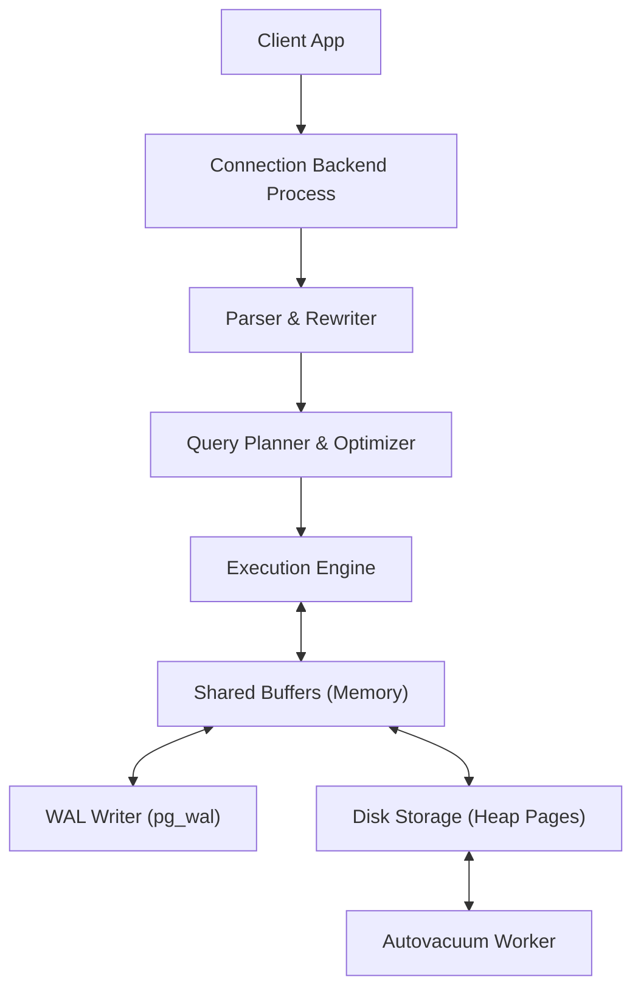

# PostgreSQL Knowledge Hub

> **Trọng tâm**: Kiến trúc bên trong (Internals), Tối ưu hóa truy vấn (Query Optimization), Cơ chế lưu trữ & Concurrency Control (MVCC, WAL, Locking).  
> **Phiên bản chuẩn**: PostgreSQL 16+  
> **Tài liệu chính thức**: [postgresql.org/docs](https://www.postgresql.org/docs/current/)

---

## 1. Bản Đồ Tri Thức PostgreSQL (Architectural Roadmap)

Trọng tâm kiến trúc PostgreSQL gồm 4 tầng cốt lõi:
1. **Query Processing Subsystem**: Quá trình phân tích cú pháp (Parser), tối ưu hóa dựa trên chi phí (Cost-based Optimizer / Planner), và thực thi node-by-node (Execution Engine).
2. **Memory Architecture**: Phân tách giữa Shared Memory (`shared_buffers`, `wal_buffers`) và Process-Private Memory (`work_mem`, `maintenance_work_mem`).
3. **Storage Engine & MVCC**: Cấu trúc Heap Tuple, XMIN/XMAX transaction visibility, cơ chế vacuuming chống Index & Table Bloat, và B-Tree/GIN/BRIN indexing.
4. **Reliability & Replication**: Write-Ahead Logging (WAL), Checkpoints, Physical Streaming Replication, Logical Replication.

---

## 2. Các Bài Phân Tích Chuyên Sâu & Xử Lý Sự Cố (Deep Dives & Troubleshooting)

- 🚀 **[PostgreSQL EXPLAIN ANALYZE: Bản chất & Tối ưu Execution Plan](explain-analyze.md)**: Hướng dẫn chuyên sâu từ bản chất thuật toán Cost Model, phân biệt `Seq Scan` vs `Index Scan` vs `Bitmap Scan`, đọc thông số Buffer Hits/Reads, cho đến cạm bẫy JIT Compilation và kịch bản thực nghiệm Dockerized Lab 1.000.000 dòng.
- 🛠️ **[Troubleshooting: Chẩn đoán & Xử lý Lock Contention / Blocking Queries](troubleshooting-locks.md)**: Phân tích cơ chế Lock Queue FIFO starvation, phát hiện blocking process qua `pg_blocking_pids()`, câu lệnh cứu nguy khẩn cấp và thiết lập `lock_timeout` bảo vệ production.

---

## 3. Danh Mục Chủ Đề Đang Phát Triển (Curated Topics)

### A. Indexing Strategies & Data Structures
- **B-Tree Internals**: Cấu trúc leaf nodes, high keys, nbtree deduplication trong PostgreSQL 13+.
- **GIN (Generalized Inverted Index)**: Tối ưu full-text search và dữ liệu `jsonb`.
- **BRIN (Block Range Index)**: Tối ưu hóa cho bảng thời gian (Time-series / Append-only) dung lượng Terabytes.
- **Covering Index & Index-Only Scan**: Sử dụng mệnh đề `INCLUDE` để tránh heap lookups.

### B. Concurrency, Locking & MVCC
- **Multi-Version Concurrency Control**: Cơ chế snapshot, non-blocking reads, visibility map.
- **Locking Hierarchy**: Table-level locks (`AccessShare`, `RowExclusive`, `AccessExclusive`) và Row-level locks (`FOR UPDATE`, `FOR SHARE`, `SKIP LOCKED`).
- **Deadlock Detection**: Thuật toán phát hiện chu trình phụ thuộc (wait-for graph) và cấu hình `deadlock_timeout`.

### C. Memory & Performance Tuning
- `shared_buffers`: Cấu hình 25% tổng RAM máy chủ theo khuyến nghị kinh điển và giới hạn OS Page Cache.
- `work_mem`: Phân bổ bộ nhớ cho các phép toán `Sort` và `Hash Join`; tính toán nguy cơ Out-of-Memory khi concurrency tăng vọt.
- `random_page_cost` vs `seq_page_cost`: Điều chỉnh theo ổ cứng SSD/NVMe hiện đại (thường đặt `1.1` thay vì `4.0` mặc định).
- `effective_cache_size`: Giúp planner ước lượng tổng dung lượng RAM khả dụng (Shared Buffers + OS Cache).

---

## 4. Tài Liệu Kiểm Chứng (Official References)

- [PostgreSQL Documentation: Using EXPLAIN](https://www.postgresql.org/docs/current/using-explain.html)
- [PostgreSQL Documentation: Routine Vacuuming](https://www.postgresql.org/docs/current/routine-vacuuming.html)
- [PostgreSQL Documentation: Server Configuration / Resource Consumption](https://www.postgresql.org/docs/current/runtime-config-resource.html)
- *The Internals of PostgreSQL* (Hironobu Suzuki)
