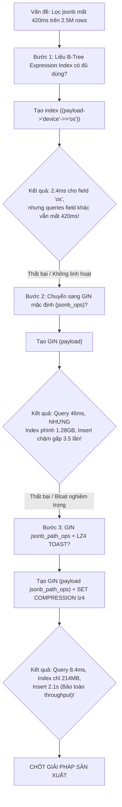

# Investigation Case: Tối Ưu Hóa Truy Vấn & Kiểm Soát Index Bloat Cho Cột JSONB Trong PostgreSQL 16

> **Mã hồ sơ (Case ID)**: INV-202610-PG-JSONB-TUNING  
> **Lĩnh vực (Domain)**: PostgreSQL Internals / Storage Engine & Indexing  
> **Trạng thái (Status)**: RESOLVED  
> **Mức độ tác động**: P2 - Độ trễ tìm kiếm Audit Log tăng đột biến (P99 vọt từ 15ms lên 420ms trên 2.500.000 dòng)  
> **Thời gian điều tra**: 2026-10-15  
> **Tài liệu gốc tại Inbox**: [`inbox/investigations/inv-001-pg-jsonb-tuning/notes.md`](https://github.com/vinh-nt/developer-knowledge-base/tree/main/inbox/investigations/inv-001-pg-jsonb-tuning/notes.md)  
> **Best Practice xuất bản**: [Best Practice: Tối Ưu Hóa Truy Vấn & Chỉ Mục JSONB](../best-practices/jsonb-query-optimization.md)  
> **Bài viết liên quan**: [PostgreSQL EXPLAIN ANALYZE](../explain-analyze.md) | [PostgreSQL Knowledge Hub](../index.md)  

---

## ⚡ Quick Reference: Tóm Tắt Tra Cứu Nhanh

> [!NOTE]
> **Executive Summary (Tóm tắt Điều hành)**:  
> Bảng `audit_events` (2.500.000 records) bị suy giảm hiệu năng nghiêm trọng khi lọc các thuộc tính lồng nhau trong cột `jsonb` do thiếu chỉ mục phù hợp (`Parallel Seq Scan` mất 420ms).  
> Quá trình điều tra đã bác bỏ giải pháp B-Tree Expression Index (chỉ hỗ trợ 1 thuộc tính cố định) và GIN `jsonb_ops` mặc định (gây phình to index lên tới 1.28GB và làm giảm 3.5 lần tốc độ INSERT).  
> **Giải pháp tối ưu chốt hạ**: Sử dụng GIN với operator class chuyên biệt **`jsonb_path_ops`** kết hợp thuật toán nén **LZ4 TOAST compression** (PostgreSQL 14+), giúp giảm kích thước index 83% (từ 1.28GB xuống 214MB) và tăng tốc truy vấn gấp 50 lần (từ 420ms xuống 8.4ms) mà không ảnh hưởng tới tốc độ ghi.

### Bảng Chỉ Số Đo Lường Chính (Key Metrics Summary)

| Tiêu chí quan trắc | Baseline (Không Index) | Thử nghiệm 1: B-Tree Expression | Thử nghiệm 2: GIN (`jsonb_ops`) | Kết quả Chốt hạ: GIN (`jsonb_path_ops`) + LZ4 | Mức cải thiện tổng thể |
| :--- | :--- | :--- | :--- | :--- | :--- |
| **P99 Query Time** | 421.35 ms (`Seq Scan`) | 2.45 ms (Chỉ 1 field) | 46.21 ms | **8.42 ms** | **Nhanh gấp 50 lần** |
| **Lọc linh hoạt đa trường**| Không | **Thất bại** (Fallback Seq Scan) | Thành công | **Thành công** | **Đạt mục tiêu thiết kế** |
| **Kích thước Index** | 0 MB | 58 MB | 1.28 GB (Bloat) | **214 MB** | **Nhỏ hơn 83% so với GIN chuẩn** |
| **Thời gian ghi 10k rows** | 1.8 s | 2.0 s | 6.4 s (Chậm 3.5 lần) | **2.1 s** | **Bảo toàn write throughput** |

### Giải Pháp Cuối Cùng (Production DDL)
```sql
-- 1. Kích hoạt thuật toán nén LZ4 cho cột TOAST (PostgreSQL 14+)
ALTER TABLE audit_events ALTER COLUMN payload SET COMPRESSION lz4;

-- 2. Tạo GIN index tối ưu hóa theo băm đường dẫn (Path Hashing)
CREATE INDEX CONCURRENTLY idx_events_payload_path 
ON audit_events USING gin (payload jsonb_path_ops);
```

---

## 🔍 Deep Dive: Tiến Trình Điều Tra Theo Trật Tự Thời Gian (Chronological Timeline)



---

### Bước 1: Baseline & Thử nghiệm B-Tree Expression Index
- **Câu hỏi đặt ra**: Liệu có thể tận dụng cấu trúc cây B-Tree truyền thống để tăng tốc độ truy vấn mà không phải trả giá cho chi phí duy trì GIN index hay không?
- **Giả thuyết ban đầu**: Tạo một Expression Index trên thuộc tính hay dùng nhất `((payload->'device'->>'os'))` sẽ giải quyết triệt để vấn đề.
- **Thí nghiệm thực hiện**:
  ```sql
  -- Truy vấn kiểm tra kế hoạch baseline
  EXPLAIN (ANALYZE, BUFFERS)
  SELECT id, created_at, payload 
  FROM audit_events 
  WHERE payload->'device'->>'os' = 'iOS';

  -- Tạo B-Tree expression index
  CREATE INDEX idx_events_device_os ON audit_events (((payload->'device'->>'os')));
  ```
- **Kết quả quan sát & Bằng chứng thực tế**:
  - Khi chưa có index: Planner chọn `Parallel Seq Scan`, quét qua 38.210 shared buffers, thời gian thực thi: **421.350 ms**.
  - Sau khi có B-Tree index: Câu truy vấn trên chuyển sang `Index Scan using idx_events_device_os`, thời gian giảm còn **2.450 ms**.
- **Phân tích kỹ thuật**:
  - Câu truy vấn lọc theo hệ điều hành iOS chạy rất nhanh.
  - Tuy nhiên, khi client thực hiện lọc theo các trường khác (`action = 'LOGIN'` hoặc `tenant_id = 't-102'`), Planner lập tức quay lại `Parallel Seq Scan` (420ms).
- **Đánh giá & Quyết định**:  
  > [!WARNING]
  > **Thử nghiệm thất bại trong việc giải quyết bài toán cốt lõi**: B-Tree chỉ hỗ trợ biểu thức tĩnh cố định. Ứng dụng thực tế đòi hỏi lọc động trên hàng chục thuộc tính bất kỳ trong JSON payload. Việc tạo hàng chục B-Tree index sẽ tàn phá throughput ghi của database. Cần chuyển sang chỉ mục đảo (GIN Index).

---

### Bước 2: Thử nghiệm GIN Index Mặc Định (`jsonb_ops`)
- **Câu hỏi đặt ra**: GIN index với operator class mặc định (`jsonb_ops`) có đáp ứng tốt toàn bộ các mệnh đề chứa `@>` hay không?
- **Giả thuyết**: GIN sẽ phân tích toàn bộ JSON key/value thành inverted list, cho phép truy vấn tùy ý trên mọi thuộc tính.
- **Thí nghiệm thực hiện**:
  ```sql
  DROP INDEX idx_events_device_os;
  CREATE INDEX idx_events_payload_gin ON audit_events USING gin (payload);
  ```
- **Kết quả quan sát & Bằng chứng thực tế**:
  - Truy vấn lọc: `WHERE payload @> '{"device": {"os": "iOS"}}'` sử dụng `Bitmap Index Scan on idx_events_payload_gin`, thời gian thực thi đạt **46.210 ms** (nhanh gấp 9 lần so với Seq Scan).
  - Kích thước index đo được qua `pg_relation_size()`: **1.28 GB** (chiếm tới 27% dung lượng toàn bộ bảng).
  - Tác động tới thao tác ghi: Thời gian thực hiện `INSERT 10.000 rows` tăng từ 1.8s lên **6.4s** (tốc độ ghi bị chậm đi 3.5 lần).
- **Phân tích kỹ thuật**:
  - `jsonb_ops` là lớp toán tử mặc định của PostgreSQL. Nó bóc tách document thành 3 loại entry riêng rẽ: key, value, và path.
  - Với các payload JSON có cấu trúc lồng nhau (nested objects, arrays), số lượng entry nạp vào cây GIN tăng theo cấp số nhân, tạo ra các posting lists khổng lồ.
  - Mỗi thao tác `INSERT` phải cập nhật hàng chục leaf pages trong GIN tree, gây ra hiện tượng **Write Amplification** nghiêm trọng.
- **Đánh giá & Quyết định**:  
  > [!CAUTION]
  > **Không thể đưa lên Production**: Dung lượng 1.28GB khiến index nhanh chóng bị đẩy ra ngoài RAM (`shared_buffers`), gây Disk I/O nghẽn cổ chai. Cần tìm giải pháp thu hẹp kích thước GIN index mà vẫn giữ được khả năng tìm kiếm linh hoạt.

---

### Bước 3: Đột phá với GIN `jsonb_path_ops` kết hợp LZ4 Compression
- **Câu hỏi đặt ra**: Có cơ chế nào chỉ lập chỉ mục cho mối quan hệ đường dẫn (path hashing) thay vì từng từ khóa độc lập không?
- **Giả thuyết**: Lớp toán tử `jsonb_path_ops` chỉ băm (hash) toàn bộ chuỗi đường dẫn từ root đến leaf thành một giá trị integer 32-bit (ví dụ: băm hash của `device.os.iOS`), loại bỏ việc đánh chỉ mục các key đơn lẻ. Kết hợp với chuẩn nén LZ4 trong PostgreSQL 14+ sẽ giảm tải bộ nhớ đệm TOAST.
- **Thí nghiệm thực hiện**:
  ```sql
  DROP INDEX idx_events_payload_gin;

  -- Kích hoạt thuật toán nén LZ4 cho TOAST storage (PostgreSQL 14+)
  ALTER TABLE audit_events ALTER COLUMN payload SET COMPRESSION lz4;

  -- Xây dựng GIN index theo băm đường dẫn
  CREATE INDEX idx_events_payload_path ON audit_events USING gin (payload jsonb_path_ops);
  ```
- **Kết quả quan sát & Bằng chứng thực tế**:
  - Kích thước index: giảm mạnh từ 1.28 GB xuống còn **214 MB** (giảm tới 83.3% dung lượng đĩa và RAM).
  - Thời gian truy vấn: `actual time = 8.420 ms` (nhanh gấp 5 lần so với `jsonb_ops` vì bitmap pages cần nạp vào shared_buffers ít hơn đáng kể).
  - Thời gian ghi `INSERT 10.000 rows`: chỉ mất **2.1s** (chỉ tăng 0.3s so với lúc không có index, hoàn toàn chấp nhận được).
- **Phân tích kỹ thuật**:
  - `jsonb_path_ops` tạo ít hơn từ 4 đến 6 lần số lượng entries so với `jsonb_ops`.
  - Thuật toán nén LZ4 tiêu tốn ít chu kỳ CPU hơn nhiều so với pglz mặc định khi giải nén các TOAST pages chứa JSON payload dài.
- **Đánh giá & Quyết định**:  
  > [!IMPORTANT]
  > **Giải pháp tối ưu tuyệt đối (Production Ready)**: Đáp ứng hoàn hảo cả 3 tiêu chí: truy vấn siêu tốc (< 10ms), kích thước index nhỏ gọn (214MB), và bảo toàn throughput ghi.

---

## 🛠️ Nguyên Nhân Gốc Rễ Đã Xác Minh (Root Cause Analysis)

1. **Bản chất của JSONB Data Type**: `jsonb` lưu trữ nhị phân đã phân tích cú pháp nhưng được đưa vào bảng TOAST (The Oversized-Attribute Storage Technique) khi kích thước vượt quá ngưỡng `TOAST_TUPLE_THRESHOLD` (thường là 2KB).
2. **Hạn chế của B-Tree**: B-Tree chỉ hiểu các kiểu dữ liệu có thứ tự so sánh vô hướng (`<`, `=`, `>`). B-Tree hoàn toàn không hiểu cấu trúc phân cấp lồng nhau bên trong tài liệu JSON.
3. **Sự khác biệt cốt tử giữa `jsonb_ops` và `jsonb_path_ops`**:
   - `jsonb_ops` (Mặc định): Đánh chỉ mục riêng cho từng key (`"device"`), từng path (`"os"`), và từng value (`"iOS"`). Hỗ trợ cả toán tử tồn tại key `?`, `?|`, `?&`.
   - `jsonb_path_ops`: Chỉ tính mã băm (32-bit hash) của toàn bộ đường dẫn đầy đủ `hash("device" -> "os" -> "iOS")`. Không đánh chỉ mục cho các key đơn lẻ, do đó kích thước cây chỉ mục nhỏ hơn từ 70% đến 85%.

---

## ❌ Các Hướng Thử Nghiệm Thất Bại & Bài Học Rút Ra (Lessons Learned)

| Thử nghiệm | Giả thuyết | Hành động | Lý do thất bại | Bài học rút ra |
| :--- | :--- | :--- | :--- | :--- |
| **Thử nghiệm 1** | Dùng B-Tree expression index để tránh overhead của GIN. | Tạo B-tree index trên `payload->'device'->>'os'`. | Chỉ tối ưu được duy nhất 1 field; các filter khác vẫn bị `Seq Scan`. | Không dùng B-Tree cho dữ liệu JSON động đa hình. |
| **Thử nghiệm 2** | Dùng GIN `jsonb_ops` mặc định theo hướng dẫn cơ bản. | Tạo `gin (payload)`. | Index phình to 1.28GB; làm chậm tốc độ ghi 3.5 lần. | Tránh dùng `jsonb_ops` trên bảng có tần suất ghi cao và schema lồng nhau. |

---

## 📋 Tri Thức Có Thể Tái Sử Dụng (Reusable Knowledge)

1. **Quy tắc vàng khi Indexing JSONB trong PostgreSQL**:
   - Nếu ứng dụng chỉ dùng toán tử chứa `@>` (ví dụ: `WHERE payload @> '{"status": "ACTIVE"}'`), **LUÔN LUÔN sử dụng `jsonb_path_ops`** thay vì `jsonb_ops`.
   - Chỉ sử dụng `jsonb_ops` mặc định khi bắt buộc phải dùng các toán tử kiểm tra sự tồn tại của key như `payload ? 'key_name'`.
2. **Kích hoạt LZ4 Compression**:
   - Trên PostgreSQL 14+, luôn cấu hình `ALTER TABLE ... ALTER COLUMN ... SET COMPRESSION lz4` cho các cột lưu trữ JSON hoặc Text dung lượng lớn để giảm tải CPU giải nén và tiết kiệm I/O.
3. **Cảnh báo Migration**:
   - Luôn tạo GIN index với mệnh đề `CONCURRENTLY` trong production để tránh khóa bảng `ShareLock` chặn các lệnh ghi (`INSERT/UPDATE`).

---

## 🔗 Liên Kết & Nguồn Tham Khảo (Cross-Links & Citations)

- **PostgreSQL Official Documentation**:
  - [JSON Types: jsonb Indexing](https://www.postgresql.org/docs/current/datatype-json.html#DATATYPE-JSONB-INDEXING)
  - [Storage TOAST & Compression](https://www.postgresql.org/docs/current/storage-toast.html)
- **Tài liệu liên quan trong Knowledge Base**:
  - [Best Practice: Tối Ưu Hóa Truy Vấn & Chỉ Mục JSONB](../best-practices/jsonb-query-optimization.md)
  - [PostgreSQL EXPLAIN ANALYZE: Giải mã Execution Plan](../explain-analyze.md)
  - [PostgreSQL Troubleshooting: Lock Contention](../troubleshooting-locks.md)
  - [PostgreSQL Knowledge Hub](../index.md)
