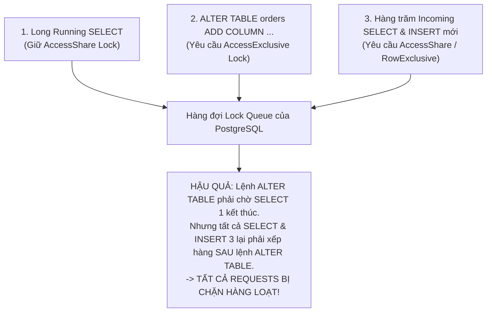

# Troubleshooting: Chẩn Đoán & Xử Lý Lock Contention / Blocking Queries Trong PostgreSQL 16+

> **Phân loại**: PostgreSQL Internals & Production Incident Response  
> **Mức độ nghiêm trọng**: P1 / P2 - Nguy cơ làm cạn kiệt Connection Pool và tê liệt toàn bộ ứng dụng  
> **Phiên bản áp dụng**: PostgreSQL 12, 13, 14, 15, 16+  
> **Tài liệu chính thức**:  
> - [PostgreSQL Documentation: Explicit Locking](https://www.postgresql.org/docs/current/explicit-locking.html)  
> - [PostgreSQL Documentation: pg_stat_activity](https://www.postgresql.org/docs/current/monitoring-stats.html#MONITORING-PG-STAT-ACTIVITY-VIEW)  
> - [PostgreSQL Documentation: pg_locks System View](https://www.postgresql.org/docs/current/view-pg-locks.html)  
> **Bài viết liên quan**: [PostgreSQL EXPLAIN ANALYZE](explain-analyze.md) | [PostgreSQL Knowledge Hub](index.md)  

---

## 1. Tóm Tắt Hiện Tượng & Tác Động (Symptom & Impact)

Trong môi trường Production có lưu lượng truy cập cao, một trong những sự cố nghiêm trọng nhất là hiện tượng **Lock Contention** (Tranh chấp khóa).

### Triệu chứng điển hình
- **API Timeout hàng loạt**: Toàn bộ các API liên quan đến một hoặc nhiều bảng đồng loạt trả về HTTP `504 Gateway Timeout`.
- **Connection Pool Exhaustion**: Ứng dụng Backend (Spring Boot / Node.js) báo lỗi cạn kiệt pool:
  ```text
  org.postgresql.util.PSQLException: Connection is not available, request timed out after 30005ms.
  ```
- **CPU Database cực thấp**: CPU Server Database chỉ chạy dưới 10%, Disk I/O không cao, nhưng số lượng `active connections` tăng vọt chạm trần `max_connections`.

---

## 2. Quy Trình Chẩn Đoán Khẩn Cấp (Emergency Diagnostic Workflow)

Khi hệ thống bị treo do khóa, hãy mở `psql` và thực thi các câu truy vấn sau:

### 2.1. Kiểm tra các câu truy vấn đang phải chờ Lock
```sql
SELECT 
    pid, 
    usename, 
    client_addr, 
    application_name, 
    state, 
    wait_event_type, 
    wait_event, 
    now() - query_start AS duration, 
    query
FROM pg_stat_activity
WHERE wait_event_type = 'Lock'
ORDER BY duration DESC;
```
> [!NOTE]
> Nếu thấy `wait_event_type = 'Lock'` và `wait_event = 'relation'`, câu truy vấn đang bị chặn ở cấp độ Table Lock.

### 2.2. Tìm chính xác PID của tiến trình gây nghẽn (Blocking PID)
PostgreSQL cung cấp hàm tích hợp `pg_blocking_pids()` cực kỳ mạnh mẽ để truy vết cây phụ thuộc khóa:

```sql
SELECT 
    blocked_activity.pid AS blocked_pid,
    blocked_activity.usename AS blocked_user,
    blocking_pids.blocking_pid,
    blocking_activity.usename AS blocking_user,
    blocking_activity.query AS blocking_statement,
    blocking_activity.state AS blocking_state,
    now() - blocking_activity.xact_start AS blocking_xact_duration,
    blocked_activity.query AS blocked_statement
FROM pg_stat_activity blocked_activity
CROSS JOIN LATERAL unnest(pg_blocking_pids(blocked_activity.pid)) AS blocking_pids(blocking_pid)
JOIN pg_stat_activity blocking_activity ON blocking_activity.pid = blocking_pids.blocking_pid
WHERE NOT blocked_activity.state = 'idle'
ORDER BY blocking_xact_duration DESC;
```

---

## 3. Phân Tích Nguyên Nhân Gốc Rễ (Root Cause Analysis - RCA)

### Cơ chế hàng đợi khóa (Lock Queue FIFO Starvation)
PostgreSQL quản lý khóa theo cơ chế hàng đợi FIFO (First-In, First-Out). Đây là nguyên nhân khiến một lệnh DDL tưởng chừng đơn giản có thể đánh sập cả hệ thống:



### Tại sao lại xảy ra?
1. **Lệnh số 1 (SELECT dài)**: Đang chạy một báo cáo thống kê mất 30 giây, giữ khóa `AccessShareLock`.
2. **Lệnh số 2 (DDL - `ALTER TABLE`)**: Kỹ sư chạy thêm cột hoặc đổi kiểu dữ liệu. Lệnh này yêu cầu `AccessExclusiveLock`. Do xung đột với `AccessShareLock`, lệnh số 2 bị đưa vào hàng đợi chờ.
3. **Lệnh số 3 (Các request của user)**: Hàng trăm query `SELECT` và `INSERT` mới tiếp tục đổ về. Mặc dù `SELECT` không xung đột với `SELECT`, nhưng theo luật FIFO của PostgreSQL, **không một query nào được phép vượt mặt lệnh số 2 đang chờ `AccessExclusiveLock`**!
4. **Kết quả**: Toàn bộ ứng dụng bị tê liệt cho tới khi lệnh số 1 kết thúc.

---

## 4. Biện Pháp Khắc Phục Tức Thời (Immediate Mitigation)

Để cứu vãn hệ thống trong lúc sự cố đang diễn ra:

### Lựa chọn 1: Hủy câu lệnh gây nghẽn (Graceful Cancel)
```sql
-- Hủy query hiện tại nhưng giữ lại connection
SELECT pg_cancel_backend(12345); -- Thay 12345 bằng blocking_pid tìm được ở Mục 2
```

### Lựa chọn 2: Ngắt kết nối tiến trình ngay lập tức (Force Terminate)
Nếu `pg_cancel_backend` không có tác dụng (ví dụ tiến trình đang bị kẹt I/O hoặc deadlock):
```sql
-- Buộc đóng kết nối TCP của tiến trình gây nghẽn
SELECT pg_terminate_backend(12345);
```

---

## 5. Giải Pháp Phòng Ngừa Triệt Để (Long-Term Prevention)

> [!IMPORTANT]
> **Production Safety Checklist khi chạy DDL hoặc Migration**:

### 1. Luôn thiết lập `lock_timeout` trước khi chạy DDL
Tuyệt đối không để một câu lệnh DDL chờ đợi vô hạn định:
```sql
-- Chỉ cho phép lệnh ALTER TABLE chờ lấy lock tối đa 2 giây. 
-- Nếu quá 2 giây, PostgreSQL tự hủy lệnh DDL thay vì làm nghẽn toàn bộ hệ thống!
SET lock_timeout = '2s';
ALTER TABLE orders ADD COLUMN is_priority BOOLEAN DEFAULT FALSE;
```

### 2. Thiết lập giới hạn giao dịch nhàn rỗi (`idle_in_transaction_session_timeout`)
Một trong những nguyên nhân hàng đầu gây lock contention là lập trình viên mở transaction bằng `BEGIN` nhưng quên `COMMIT`/`ROLLBACK`:
```sql
-- Cấu hình trong postgresql.conf hoặc cho từng user:
-- Tự động hủy connection nếu nhàn rỗi trong transaction quá 30 giây
ALTER SYSTEM SET idle_in_transaction_session_timeout = '30s';
SELECT pg_reload_conf();
```

### 3. Tạo Index với từ khóa `CONCURRENTLY`
Lệnh `CREATE INDEX` thông thường yêu cầu `ShareLock`, chặn toàn bộ thao tác ghi (`INSERT`, `UPDATE`, `DELETE`).  
**Luôn sử dụng `CONCURRENTLY` trong production**:
```sql
-- Không chặn ghi vào bảng trong suốt quá trình build index
CREATE INDEX CONCURRENTLY idx_orders_customer_vip ON orders (customer_id) WHERE is_priority = true;
```

---

## 6. Liên Kết Chéo & Tài Liệu Liên Quan

- **Phân tích chi phí truy vấn**: [PostgreSQL EXPLAIN ANALYZE: Giải mã Execution Plan](explain-analyze.md)
- **Kiến trúc tổng quan**: [PostgreSQL Knowledge Hub](index.md)
- **Hands-on Lab kiểm chứng**: [`labs/postgresql/explain-analyze/`](https://github.com/vinh-nt/developer-knowledge-base/tree/main/labs/postgresql/explain-analyze)
