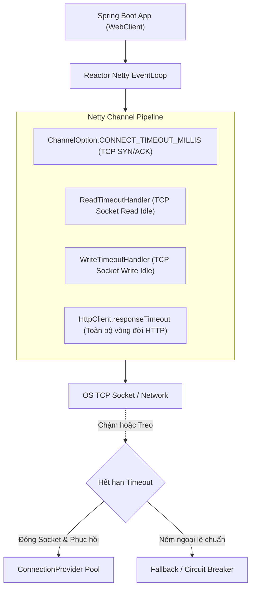

# Best Practice: Cấu Hình WebClient Kháng Lỗi Trong Spring Boot (Resilient WebClient)

> **Lĩnh vực (Domain)**: Spring Boot  
> **Chủ đề (Topic)**: Resilient HTTP Communication & Microservices  
> **Phiên bản áp dụng (Target Version)**: Spring Boot 3.3+ (Spring Framework 6.1+ & Reactor Netty)  
> **Mức độ bằng chứng (Evidence Level)**: Official Guidance (Spring & Reactor Netty Documentation)  
> **Trạng thái**: Active  
> **Ngày cập nhật**: 2026-10-19  

---

## 1. Summary (Tóm Tắt Khuyến Nghị)

> [!NOTE]
> **Executive Summary**:  
> Mặc định trong Spring WebFlux, `WebClient` sử dụng Reactor Netty **hoàn toàn KHÔNG có Response Timeout hoặc Read Timeout**. Khi một downstream service gặp sự cố hoặc phản hồi chậm chạp, các kết nối TCP sẽ bị treo vô hạn, nhanh chóng làm cạn kiệt Connection Pool và khiến toàn bộ ứng dụng sụp đổ theo dây chuyền (Cascading Failure).  
> **Khuyến nghị chuẩn sản xuất**: Luôn cấu hình tường minh **4 tầng Timeout** (Connect, Response, Read, Write Idle) ở cấp độ Netty `HttpClient`, kết hợp **ConnectionProvider tùy biến** (giới hạn `maxConnections` và `pendingAcquireTimeout`), và chỉ áp dụng **Retry có Exponential Backoff & Jitter** cho các yêu cầu có tính lũy thừa (Idempotent requests).

---

## 2. Problem / Context (Bối Cảnh & Vấn Đề Giải Quyết)

- **Vấn đề kỹ thuật**: Trong kiến trúc Microservices, một service thường phải gọi đồng thời nhiều dịch vụ bên ngoài (Payment Gateways, Notification Service, Core Banking). Khi một dịch vụ đối tác gặp sự cố (Latency tăng từ 100ms lên 30 giây hoặc không bao giờ đóng kết nối):
  1. *Connection Pool Exhaustion*: Toàn bộ connections trong `ConnectionProvider` bị giữ chặt để chờ dữ liệu. Các request mới vào hàng đợi (Pending queue) và bị lỗi `PoolAcquireTimeoutException`.
  2. *Thread Starvation / Socket Exhaustion*: Hệ thống cạn kiệt File Descriptors của hệ điều hành (`java.io.IOException: Too many open files`).
  3. *Ngộ nhận về `.timeout()` của Project Reactor*: Nhiều lập trình viên chỉ gắn toán tử `.timeout(Duration.ofSeconds(5))` trên Mono/Flux. Toán tử này chỉ hủy đăng ký (cancel subscription) ở tầng Reactive, nhưng **không ngắt socket TCP bên dưới của Netty**, dẫn tới socket vẫn tiếp tục chiếm dụng tài nguyên ngầm.
- **Mức độ nghiêm trọng**: P1 (Dẫn tới nghẽn toàn bộ dịch vụ và mất khả năng phục vụ lưu lượng mới).

---

## 3. Recommended Approach (Giải Pháp Khuyến Nghị)

Áp dụng cấu trúc phòng vệ 4 tầng:
1. **Connect Timeout**: Giới hạn thời gian thiết lập TCP handshake (SYN/ACK). Khuyến nghị: 2.000ms - 3.000ms.
2. **Response Timeout**: Giới hạn tổng thời gian nhận phản hồi đầy đủ từ khi request được gửi đi trọn vẹn. Khuyến nghị: 5.000ms - 10.000ms tùy SLA.
3. **Read / Write Idle Timeout**: Giám sát dữ liệu qua socket; ngắt kết nối nếu không có byte dữ liệu nào được đọc/ghi trong một khoảng thời gian.
4. **Tùy biến ConnectionProvider**: Không sử dụng `ConnectionProvider.create("elastic")` không giới hạn; chỉ định `maxConnections`, `maxIdleTime`, `maxLifeTime`, và `pendingAcquireTimeout` cụ thể.
5. **Idempotent Retry with Jitter**: Chỉ retry các HTTP methods an toàn (`GET`, `PUT`, `DELETE` hoặc `POST` có `Idempotency-Key`), kết hợp giãn cách hàm mũ và độ lệch ngẫu nhiên (Jitter) để tránh gây bão request (Retry Storm).

---

## 4. Why It Works (Nguyên Lý & Cơ Chế Kỹ Thuật)



### Cơ chế hoạt động của Reactor Netty:
1. **Netty Channel Pipeline**: Khi gắn `ReadTimeoutHandler` vào pipeline, Netty kích hoạt một timer trong `HashedWheelTimer`. Nếu không có inbound packet nào đến socket trong khoảng thời gian chỉ định, Netty tự động kích hoạt sự kiện `userEventTriggered` với `ReadTimeoutException` và chủ động gửi gói tin `TCP FIN/RST` để đóng kết nối sạch sẽ.
2. **Response Timeout vs Reactive Operator Timeout**:
   - `HttpClient.responseTimeout()` can thiệp trực tiếp vào state machine của HTTP Client tại tầng giao vận Netty, đảm bảo hủy request và trả connection về pool hoặc đóng socket.
3. **Exponential Backoff & Full Jitter**:
   - Khi hàng ngàn request cùng gặp lỗi tạm thời (503 Service Unavailable), nếu tất cả cùng retry sau đúng 1 giây, downstream service sẽ bị đánh sập hoàn toàn (Thundering Herd). Thêm Jitter ngẫu nhiên phân tán lưu lượng đều theo thời gian, giúp downstream có cơ hội phục hồi.

---

## 5. Implementation (Hướng Dẫn Triển Khai Thực Tế)

### 5.1. Spring Configuration Bean Hoàn Chỉnh

```java
package com.knowledgebase.config;

import io.netty.channel.ChannelOption;
import io.netty.handler.timeout.ReadTimeoutHandler;
import io.netty.handler.timeout.WriteTimeoutHandler;
import org.springframework.context.annotation.Bean;
import org.springframework.context.annotation.Configuration;
import org.springframework.http.client.reactive.ReactorClientHttpConnector;
import org.springframework.web.reactive.function.client.WebClient;
import reactor.netty.http.client.HttpClient;
import reactor.netty.resources.ConnectionProvider;

import java.time.Duration;
import java.util.concurrent.TimeUnit;

@Configuration(proxyBeanMethods = false)
public class ResilientWebClientConfig {

    @Bean
    public WebClient paymentGatewayWebClient(WebClient.Builder builder) {
        
        // 1. Cấu hình Connection Pool chuyên biệt
        ConnectionProvider connectionProvider = ConnectionProvider.builder("payment-gateway-pool")
                .maxConnections(50)                                // Giới hạn kết nối tối đa
                .maxIdleTime(Duration.ofSeconds(20))               // Đóng kết nối nhàn rỗi sau 20s
                .maxLifeTime(Duration.ofMinutes(5))                // Tối đa 5 phút để refresh DNS
                .pendingAcquireTimeout(Duration.ofSeconds(3))      // Tối đa chờ lấy connection từ pool
                .evictInBackground(Duration.ofSeconds(30))         // Dọn dẹp ngầm các kết nối chết
                .build();

        // 2. Cấu hình HttpClient với 4 tầng Timeout
        HttpClient httpClient = HttpClient.create(connectionProvider)
                // Tầng 1: TCP Handshake Connect Timeout
                .option(ChannelOption.CONNECT_TIMEOUT_MILLIS, 3000)
                // Tầng 2: Tổng thời gian nhận trọn vẹn HTTP Response
                .responseTimeout(Duration.ofSeconds(5))
                // Tầng 3 & 4: Socket-level Read/Write Idle Timeout
                .doOnConnected(conn -> conn
                        .addHandlerLast(new ReadTimeoutHandler(5000, TimeUnit.MILLISECONDS))
                        .addHandlerLast(new WriteTimeoutHandler(5000, TimeUnit.MILLISECONDS)))
                // Kích hoạt TCP Keep-Alive
                .option(ChannelOption.SO_KEEPALIVE, true);

        // 3. Khởi tạo WebClient Bean
        return builder
                .baseUrl("https://api.payment-partner.com")
                .clientConnector(new ReactorClientHttpConnector(httpClient))
                .build();
    }
}
```

### 5.2. Mẫu Gọi API với Retry & Jitter An Toàn

```java
package com.knowledgebase.client;

import org.slf4j.Logger;
import org.slf4j.LoggerFactory;
import org.springframework.stereotype.Service;
import org.springframework.web.reactive.function.client.WebClient;
import org.springframework.web.reactive.function.client.WebClientResponseException;
import reactor.core.publisher.Mono;
import reactor.util.retry.Retry;

import java.time.Duration;

@Service
public class PaymentGatewayClient {
    private static final Logger log = LoggerFactory.getLogger(PaymentGatewayClient.class);
    private final WebClient webClient;

    public PaymentGatewayClient(WebClient paymentGatewayWebClient) {
        this.webClient = paymentGatewayWebClient;
    }

    public Mono<PaymentStatusResponse> getTransactionStatus(String txnId) {
        return webClient.get()
                .uri("/v1/transactions/{id}", txnId)
                .retrieve()
                .bodyToMono(PaymentStatusResponse.class)
                // Chỉ Retry cho các lỗi có khả năng tự phục hồi (5xx hoặc Timeout)
                .retryWhen(Retry.backoff(3, Duration.ofMillis(500))
                        .jitter(0.5) // 50% Jitter ngẫu nhiên
                        .filter(this::isRetryable)
                        .doBeforeRetry(signal -> log.warn("Thử lại lần {} truy vấn giao dịch {}. Lý do: {}", 
                                signal.totalRetries() + 1, txnId, signal.failure().getMessage())))
                .onErrorMap(ex -> new RuntimeException("Gọi Payment Gateway thất bại sau các lần thử", ex));
    }

    private boolean isRetryable(Throwable ex) {
        // Chỉ retry khi lỗi 5xx Server Error hoặc lỗi Timeout tầng giao vận
        if (ex instanceof WebClientResponseException webEx) {
            return webEx.getStatusCode().is5xxServerError();
        }
        return ex instanceof io.netty.handler.timeout.TimeoutException
                || ex instanceof java.net.ConnectException;
    }
}
```

---

## 6. When to Use (Ngữ Cảnh Áp Dụng)

- **Mọi HTTP Client trong Production**: Bất kỳ ứng dụng Spring Boot nào giao tiếp với bên thứ ba hoặc gọi internal microservices qua REST.
- **High-throughput API Gateways / BFF (Backend for Frontend)**: Nơi hàng ngàn kết nối được duy trì đồng thời và cần fail-fast kịp thời để bảo vệ tài nguyên máy chủ.

---

## 7. When Not to Use (Chống Chỉ Định & Anti-patterns)

> [!WARNING]
> **Tuyệt đối tránh các hành vi sau**:
> 1. **Gọi `.block()` trên Reactor EventLoop Thread**:  
>    Việc gọi `.block()` bên trong Controller của Spring WebFlux sẽ ném `IllegalStateException: block()/blockFirst()/blockLast() are blocking, which is not supported in thread reactor-http-nio-X`. (Nếu dùng Spring MVC thường, `.block()` chấp nhận được nhưng nên cân nhắc dùng `RestClient` mới trong Spring 6.1+).
> 2. **Retry không có Idempotency Key cho POST**:  
>    Nếu gọi `POST /v1/charge` bị timeout, không bao giờ được tự động retry nếu phía đối tác không hỗ trợ `Idempotency-Key`. Timeout chỉ có nghĩa là client không nhận được phản hồi, rất có thể server đối tác **đã trừ tiền thành công**.
> 3. **Cấu hình Connection Pool quá lớn (`maxConnections > 500`)**:  
>    Quá nhiều kết nối đồng thời sẽ làm quá tải hệ thống tường lửa (Stateful Firewall / NAT Gateway conntrack table) và gây nghẽn CPU của downstream.

---

## 8. Trade-offs (Đánh Đổi Kỹ Thuật)

| Tiêu chuẩn | WebClient Mặc Định | WebClient Kháng Lỗi (Resilient WebClient) |
| :--- | :--- | :--- |
| **Response Timeout** | Vô hạn (Treo kết nối khi downstream lag) | **5 giây (Fail-fast, giải phóng tài nguyên)** |
| **Bảo vệ Bộ nhớ & Sockets** | Kém (Nguy cơ rò rỉ File Descriptors) | **Cao (Tự động đóng socket chết qua Netty Timer)** |
| **Xử lý Downstream chập chờn**| Sụp đổ dây chuyền (Cascading Outage) | **Hấp thụ lỗi, retry có kiểm soát kèm Jitter** |
| **Độ phức tạp cấu hình** | Rất thấp (`WebClient.create()`) | Trung bình (Cần khai báo Netty HttpClient và Pool) |

---

## 9. Validation (Phương Pháp Kiểm Chứng & Đo Lường)

### 9.1. Kiểm Thử với WireMock Giả Lập Downstream Chậm
```java
@Test
void shouldTimeoutWhenDownstreamTakesTooLong() {
    // Giả lập đối tác phản hồi sau 8 giây (vượt ngưỡng responseTimeout 5s)
    wireMockServer.stubFor(get(urlEqualTo("/v1/transactions/TXN-100"))
        .willReturn(aResponse()
            .withFixedDelay(8000)
            .withBody("{\"status\": \"SUCCESS\"}")));

    StepVerifier.create(client.getTransactionStatus("TXN-100"))
        .expectErrorMatches(throwable -> 
            throwable.getCause() instanceof io.netty.handler.timeout.ReadTimeoutException 
            || throwable.getMessage().contains("thất bại sau các lần thử"))
        .verify();
}
```

### 9.2. Giám Sát Telemetry qua Micrometer & Prometheus
Kiểm tra metric `reactor.netty.connection.provider.active.connections` và `reactor.netty.connection.provider.pending.connections` trong Prometheus Actuator để phát hiện sớm nguy cơ nghẽn pool.

---

## 10. Evidence Level & Applicability (Mức Độ Bằng Chứng)

- **Cấp độ bằng chứng**: **Official Guidance**.
  - Dựa trên tài liệu chính thức [Spring Framework WebClient Reference](https://docs.spring.io/spring-framework/reference/web/webflux-webclient.html).
  - Khuyến nghị cấu hình Netty từ [Reactor Netty Reference Guide: Connection Pool & Timeouts](https://projectreactor.io/docs/netty/release/reference/index.html#_connection_pool).
- **Phạm vi khả dụng**: Toàn bộ dự án Spring Boot 3.0+ (Dựa trên Reactor Netty và Spring 6).

---

## 11. Related Resources & Investigations (Tài Nguyên Liên Quan)

- **Bài viết trong Knowledge Base**:
  - [Spring Boot Ecosystem Hub: Architecture, JPA & HikariCP](../index.md)
  - [Spring Boot Best Practices Hub](index.md)
  - [Modern Java Best Practices: Exception Handling](../../java/best-practices/exception-handling.md)
  - [System Design: Resilience & Idempotency](../../system-design/best-practices/idempotency-and-resilience.md)
- **Tài liệu chính thức**:
  - [Spring WebClient Documentation](https://docs.spring.io/spring-boot/reference/io/rest-client.html#io.rest-client.webclient)
