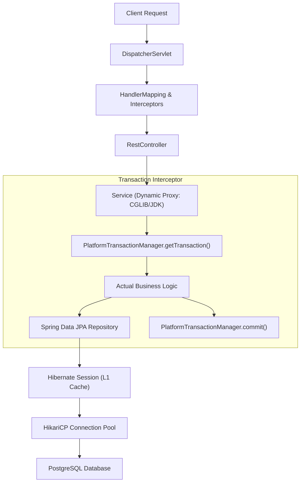

# Spring Boot Ecosystem Knowledge Hub

> **Trọng tâm**: Nội tại Spring Core (IoC, AOP, Bean Lifecycle), Tối ưu hóa tầng dữ liệu (Spring Data JPA / Hibernate / HikariCP), và Kiến trúc Microservices hiệu năng cao.  
> **Phiên bản chuẩn**: Spring Boot 3.3+ (Dựa trên Spring Framework 6.1+ và Java 21)  
> **Tài liệu chính thức**: [docs.spring.io/spring-boot/reference](https://docs.spring.io/spring-boot/reference/) & [docs.spring.io/spring-framework/reference](https://docs.spring.io/spring-framework/reference/)

---

## 1. Bản Đồ Tri Thức Spring Boot (Architectural Roadmap)



Trọng tâm kiến trúc Spring Boot gồm 4 khối nền tảng:
1. **Spring Core & Bean Container**: Vòng đời khởi tạo Bean (`BeanPostProcessor`, `InitializingBean`), cơ chế Auto-configuration (`@ConditionalOnClass`, `@ConditionalOnMissingBean`), và AOP Proxies.
2. **Data Access & ORM Tuning**: Tối ưu hóa Hibernate, phân tích chi phí Dirty Checking, triệt tiêu lỗi N+1 Query, và cấu hình HikariCP.
3. **Reactive vs. Virtual Threads**: So sánh giữa Spring WebFlux (Project Reactor - Non-blocking event loop) và Spring MVC tích hợp Java 21 Virtual Threads (`spring.threads.virtual.enabled=true`).
4. **Production Observability**: Micrometer, OpenTelemetry distributed tracing, Actuator endpoints, và Prometheus metrics.

---

## 2. Danh Mục Chủ Đề Đang Phát Triển (Curated Topics)

### A. Spring AOP & Cạm bẫy `@Transactional`
- **Self-Invocation Pitfall**: Khi một method trong cùng class gọi method khác có `@Transactional`, proxy bị bỏ qua dẫn tới giao dịch không được quản lý. Giải pháp: tách service hoặc dùng `TransactionTemplate`.
- **Transaction Rollback Rules**: Mặc định Spring chỉ rollback khi gặp `RuntimeException` hoặc `Error`. Muốn bắt cả Checked Exception phải khai báo tường minh: `@Transactional(rollbackFor = Exception.class)`.

### B. Hibernate & Spring Data JPA Performance Tuning
- **N+1 Problem**: Giải quyết triệt để thông qua `JOIN FETCH` trong JPQL hoặc `@EntityGraph`.
- **Anti-pattern OSIV (Open Session in View)**: `spring.jpa.open-in-view=true` giữ kết nối Database connection trong suốt thời gian render response view/JSON, dẫn tới cạn kiệt Connection Pool. **Luôn đặt `false` trong production**.
- **Batch Processing**: Cấu hình `hibernate.jdbc.batch_size=50` kết hợp `hibernate.order_inserts=true` và sequence `allocationSize` lớn hơn 1 để tối ưu ghi dữ liệu hàng loạt.

### C. HikariCP Connection Pool Tuning
- **Công thức tính toán kích thước Pool**:
  $$\text{Pool Size} = T_n \times (C_m - 1) + 1$$
  *(Trong đó $T_n$ là số worker threads tối đa, $C_m$ là số connections tối đa mà 1 thread yêu cầu cùng lúc).*
- **Cấu hình quan trọng**:
  - `connectionTimeout`: Thời gian tối đa chờ kết nối từ pool (khuyến nghị 30.000ms).
  - `maximumPoolSize`: Tránh đặt quá lớn gây lock contention tại CPU database server.
  - `leakDetectionThreshold`: Phát hiện connection không được đóng kịp thời (khuyến nghị 2000 - 5000ms).

---

## 3. Quy Chuẩn Cấu Hình Chuẩn Production (Production Settings)

```yaml
# application-production.yml
spring:
  threads:
    virtual:
      enabled: true # Kích hoạt Tomcat sử dụng Virtual Threads cho I/O blocking (Spring Boot 3.2+)
  jpa:
    open-in-view: false # Tắt OSIV ngăn chặn rò rỉ connection pool
    properties:
      hibernate:
        jdbc:
          batch_size: 50
        order_inserts: true
        order_updates: true
  datasource:
    hikari:
      pool-name: AppProductionHikariCP
      maximum-pool-size: 20
      minimum-idle: 10
      connection-timeout: 30000
      idle-timeout: 600000
      max-lifetime: 1800000
      leak-detection-threshold: 3000
```

---

## 4. Tài Liệu Kiểm Chứng (Official References)

- [Spring Boot Reference Documentation: Data Access](https://docs.spring.io/spring-boot/reference/data/sql.html)
- [Spring Framework Reference: Transaction Management](https://docs.spring.io/spring-framework/reference/data-access/transaction.html)
- [HikariCP Official Wiki: About Pool Sizing](https://github.com/brettwooldridge/HikariCP/wiki/About-Pool-Sizing)
- *High-Performance Java Persistence* (Vlad Mihalcea)
