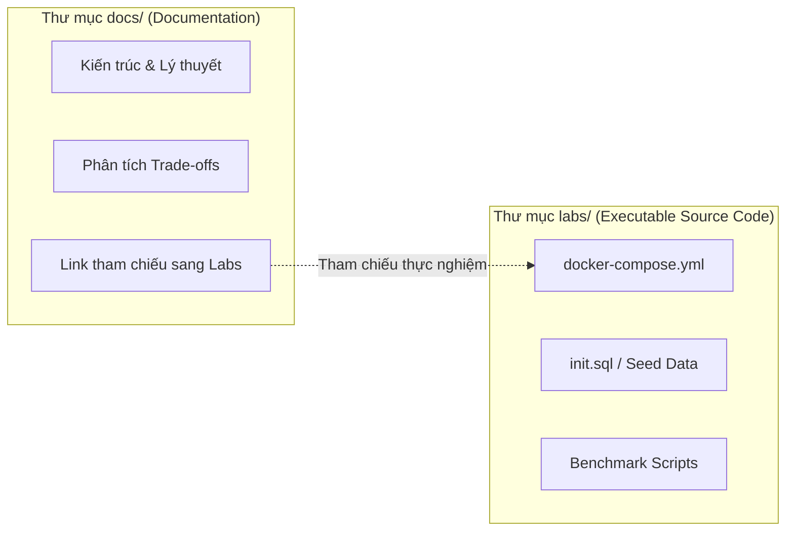

# Tiêu Chuẩn Kỹ Thuật & Quản Trị AI Agent (Agent Governance)

Tài liệu này công bố hệ thống quy chuẩn kỹ thuật và nguyên tắc vận hành cho toàn bộ nội dung được biên soạn trong **Developer Knowledge Base**, áp dụng cho cả kỹ sư phần mềm và các AI Coding Assistants (Antigravity, Gemini).

---

## 1. Nguyên tắc Không Thỏa hiệp: Zero Hallucination

> [!CAUTION]
> **Quy định nghiêm ngặt**: Tuyệt đối không tự suy diễn hoặc bịa đặt các số liệu benchmark, tham số cấu hình hệ thống, method signatures hoặc trích dẫn kỹ thuật. Mọi khẳng định kỹ thuật đều phải có khả năng kiểm chứng (verifiable).

1. **Version Specificity**: Kiến thức phải luôn được neo theo phiên bản cụ thể (ví dụ: PostgreSQL 16+, Java 21 LTS, Spring Boot 3.3+, AWS IAM v2).
2. **Official Citations**: Bắt buộc đính kèm liên kết tới tài liệu chính thức (Official Documentation), JEP (Java Enhancement Proposals), hoặc RFCs liên quan.
3. **Caveat Disclosures**: Những hành vi phụ thuộc vào cấu hình môi trường phần cứng, optimizer heuristics hoặc race conditions phải được phân tích rõ ràng kèm các giả định (assumptions).

---

## 2. Ngôn ngữ & Văn phong Kỹ thuật (Language Conventions)

- **Tiếng Việt kết hợp Thuật ngữ Kỹ thuật tiếng Anh**:
  - Diễn đạt bản chất bài toán, cơ chế tư duy và lập luận phân tích bằng tiếng Việt rõ ràng, chuẩn mực.
  - Giữ nguyên các thuật ngữ kỹ thuật chuyên ngành tiếng Anh chuẩn quốc tế nhằm đảm bảo tính chính xác và thuận tiện cho việc tra cứu log, code hoặc tài liệu gốc.
  - *Ví dụ mẫu*: "Khi dung lượng bộ nhớ vượt quá `work_mem`, PostgreSQL sẽ chuyển thuật toán sắp xếp từ `quicksort` trong RAM sang `external merge sort` trên ổ đĩa (Disk I/O)."

---

## 3. Kiến trúc Tách biệt: Tài liệu vs. Thí nghiệm (Docs vs. Labs)

- **Thư mục `docs/`**: Nơi lưu trữ kiến thức cô đọng, bài viết phân tích sâu và tài liệu hướng dẫn. Hoàn toàn là Markdown thuần và media hiển thị.
- **Thư mục `labs/`**: Môi trường thực nghiệm hoàn toàn độc lập, chứa toàn bộ Docker Compose, mã nguồn Java, SQL migration, và kịch bản tái lập lỗi production. Tuyệt đối không nhồi nhét mã nguồn thực thi dự án lớn vào trong `docs/`.

---

## 4. Bảo mật Môi trường (Security Protocol)

- Tuyệt đối không lưu trữ bí mật (Secrets, Passwords, Access Tokens) trong kho lưu trữ Git.
- Sử dụng biến môi trường mẫu (`.env.example`) và cơ chế quản lý danh tính IAM role an toàn.
- Các câu lệnh SQL và code mẫu phải phản ánh đúng tiêu chuẩn an toàn (chống SQL Injection, Resource Leak, Memory Leak).
