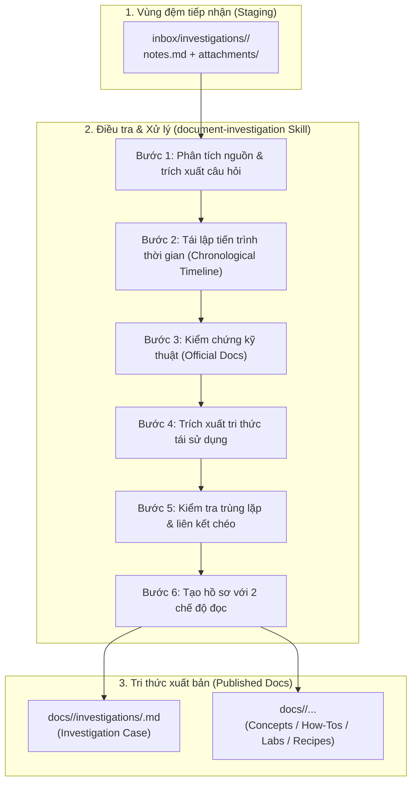

# Quy Trình Quản Trị Hồ Sơ Điều Tra Kỹ Thuật (Engineering Investigation Management)

Trong quá trình vận hành hệ thống thực tế, các sự cố khó khăn hoặc các bài toán tối ưu hóa phức tạp hiếm khi được giải quyết ngay trong một bước. Kỹ sư phải đặt ra hàng loạt câu hỏi, đưa ra nhiều giả thuyết, thử nghiệm các giải pháp khác nhau và đối mặt với nhiều lần thử thất bại trước khi tìm ra nguyên nhân gốc rễ.

Tài liệu này công bố kiến trúc và quy trình quản trị **Hồ sơ Điều tra Kỹ thuật (Engineering Investigation Management)**, biến nhật ký điều tra thô thành tài liệu tri thức có cấu trúc và có thể kế thừa cho toàn đội ngũ.

---

## 1. Sơ Đồ Quy Trình Điều Tra (The Investigation Lifecycle)



---

## 2. Hai Chế Độ Đọc Tối Ưu (Dual Reading Modes)

Một hồ sơ điều tra chuẩn mực (`templates/investigation-case.md`) được thiết kế nhằm phục vụ đồng thời hai đối tượng người đọc:

| Chế độ đọc | Đối tượng phục vụ | Thời gian đọc | Trọng tâm nội dung |
| :--- | :--- | :--- | :--- |
| **Mode 1: Quick Reference** | Tech Lead, On-call Engineer, Management | < 2 phút | **Executive Summary**, Bảng so sánh chỉ số trước/sau, Đoạn mã giải pháp chốt hạ (Final Resolution). |
| **Mode 2: Deep Investigation** | Kỹ sư trực tiếp điều tra, R&D, Reviewer | 10 - 20 phút | **Tiến trình thời gian chi tiết**, Từng câu hỏi, giả thuyết, lệnh thực thi, execution plans, bằng chứng số liệu và phân tích lý do thất bại. |

---

## 3. Nguyên Tắc Bảo Tồn Lịch Sử & Thí Nghiệm Thất Bại

> [!IMPORTANT]
> **Không bao giờ rút gọn cuộc điều tra chỉ còn giải pháp cuối cùng**:
> - Các thử nghiệm thất bại (Failed attempts) mang giá trị tri thức cực kỳ lớn: chúng chỉ ra những "ngõ cụt" mà các kỹ sư tương lai không nên bước vào lại.
> - Phải phân biệt rạch ròi giữa **Bằng chứng khách quan thu được tại thời điểm đó (Observations)** và **Nhận định chủ quan sau này (Analysis & Interpretations)**.
> - Tuyệt đối không bịa đặt số liệu hay tự vẽ benchmark nếu không có trong nhật ký gốc. Trường hợp thiếu bằng chứng, phải gắn nhãn: `[Unverified]`, `[Not Recorded]`, hoặc `[Unresolved]`.

---

## 4. Cơ Chế Cập Nhật Lũy Tiến (Incremental Updates for Ongoing Investigations)

Nhiều cuộc điều tra kéo dài nhiều ngày hoặc nhiều tuần. Quy trình hỗ trợ bổ sung bằng chứng mới vào hồ sơ đang mở:

1. **Nhận diện Hồ sơ Hiện có**: Agent đối chiếu Case ID và đọc trạng thái hiện tại (`IN PROGRESS`, `PARTIALLY RESOLVED`, `RESOLVED`, `UNRESOLVED`).
2. **Nạp Bằng chứng Mới**: Đọc các bước mới được kỹ sư bổ sung vào `notes.md`.
3. **Chèn theo Thứ tự Thời gian**: Bổ sung `Bước N+1`, `Bước N+2` vào Timeline.
4. **Minh bạch Hóa Sự Thay đổi Giả thuyết**: Nếu dữ liệu mới bác bỏ kết luận của ngày hôm trước, **không xóa kết luận cũ** mà ghi chú sửa đổi:
   > *Cập nhật ngày [YYYY-MM-DD]: Thí nghiệm 4 với mẫu dữ liệu 5 triệu dòng đã bác bỏ Giả thuyết 2.*
5. **Cập nhật Quick Reference**: Cập nhật Executive Summary và trạng thái hoàn tất.

---

## 5. Bốn Ví Dụ Kích Hoạt Thực Tế (Practical Usage Examples)

Dưới đây là 4 câu lệnh mẫu thể hiện trọn vẹn năng lực của skill `document-investigation`:

### Ví dụ 1: Tối ưu hóa Truy vấn PostgreSQL (Query Optimization)
*Tình huống: Điều tra truy vấn chậm qua nhiều execution plans, thay đổi index và đo đạc buffer hits.*

```text
Input:
inbox/investigations/inv-202610-pg-jsonb-tuning/notes.md

Hãy dùng skill 'document-investigation' để tổng hợp hồ sơ điều tra này:
1. Tái lập trình tự thời gian 3 bước: B-Tree expression index (thất bại), GIN jsonb_ops (bloat 1.28GB), và GIN jsonb_path_ops + LZ4 compression (thành công).
2. Trích xuất bảng so sánh 4 chỉ số: P99 Latency, Dynamic Filtering, Index Size, và Insert Throughput.
3. Tạo liên kết chéo với docs/postgresql/explain-analyze.md và docs/postgresql/index.md.
4. Lưu bài viết vào docs/postgresql/investigations/inv-001-jsonb-tuning.md và chạy mkdocs build --strict.
```

### Ví dụ 2: Xử lý Sự cố Spring Boot (Connection Timeout & Rollback)
*Tình huống: Điều tra hiện tượng transaction rollback không mong muốn hoặc cạn kiệt HikariCP connection pool.*

```text
Input:
inbox/investigations/inv-202610-spring-tx-rollback/notes.md
Đính kèm: attachments/thread-dump.txt, attachments/application.yml

Hãy dùng skill 'document-investigation' để phân tích:
1. Bóc tách hiện tượng: Tại sao method có @Transactional gọi nội bộ (self-invocation) lại không được rollback khi gặp exception.
2. Ghi nhận thử nghiệm 1 thất bại khi cố gắng inject chính service đó (Circular dependency).
3. Ghi nhận thử nghiệm 2 thành công khi chuyển sang dùng TransactionTemplate.
4. Xuất bản hồ sơ vào docs/spring-boot/investigations/inv-001-self-invocation-rollback.md.
```

### Ví dụ 3: Nghiên cứu Kiến trúc Hạ tầng AWS (Aurora Export Strategy)
*Tình huống: Thử nghiệm các chiến lược export dữ liệu lớn từ Amazon Aurora PostgreSQL sang Amazon S3.*

```text
Input:
inbox/investigations/inv-202610-aws-aurora-export/notes.md

Hãy dùng skill 'document-investigation' để xây dựng case study:
1. Tái lập so sánh giữa: pg_dump thông thường qua EC2 (tốn CPU, network egress cao), AWS DMS task (phức tạp), và aws_s3.query_export_to_s3() tích hợp sẵn của Aurora.
2. Ghi nhận chi tiết các lệnh SQL, quyền IAM policy và thời gian export đo được trên dataset 100GB.
3. Rút ra khuyến nghị kiến trúc cho đội ngũ DevOps.
4. Xuất bản vào docs/aws/investigations/inv-001-aurora-s3-export.md.
```

### Ví dụ 4: Cập nhật Lũy tiến Cho Điều Tra Đang Diễn Ra (Incremental Update)
*Tình huống: Bổ sung thử nghiệm mới vào một cuộc điều tra chưa hoàn tất mà không ghi đè lịch sử.*

```text
Hồ sơ hiện có: docs/postgresql/investigations/inv-001-jsonb-tuning.md
Dữ liệu mới bổ sung: inbox/investigations/inv-202610-pg-jsonb-tuning/notes.md (Mục "Bước 4: Kiểm tra hành vi Autovacuum trên GIN index")

Hãy dùng skill 'document-investigation' để cập nhật lũy tiến:
1. Đọc trạng thái hiện tại của hồ sơ đã xuất bản.
2. Nối tiếp Bước 4 vào Chronological Timeline, ghi nhận các quan sát mới về pg_stat_user_indexes.
3. Cập nhật bảng chỉ số tổng hợp tại phần Quick Reference.
4. Giữ nguyên toàn bộ lịch sử Thí nghiệm 1, 2, 3 và kiểm tra strict build.
```
