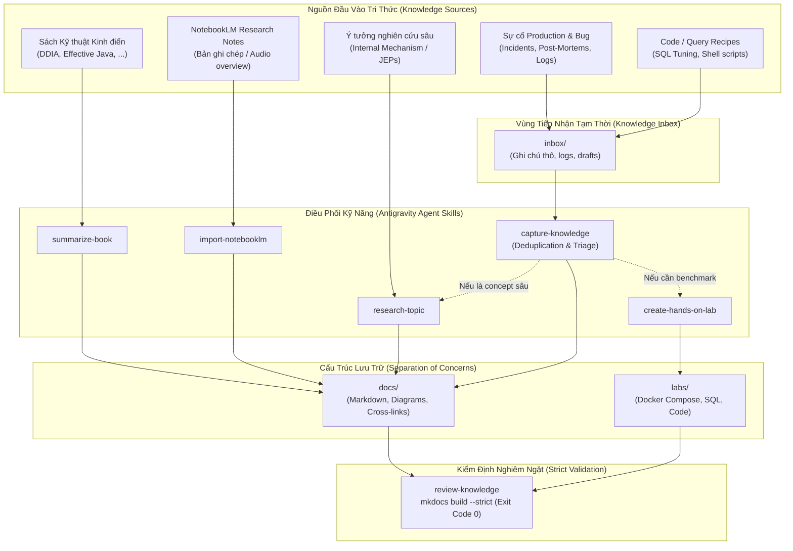

# Quy Trình Quản Trị Tri Thức Hợp Nhất (Unified Knowledge Management)

Hệ thống **Developer Knowledge Base** áp dụng một quy trình vận hành hợp nhất (Unified Pipeline) kết hợp giữa:
1. **Sách & Nghiên cứu hàn lâm (Academic & Books)**: Chắt lọc tinh hoa từ các tác phẩm kinh điển.
2. **Nghiên cứu Độc lập (Official Deep Dives)**: Nghiên cứu bản chất kỹ thuật từ tài liệu chính hãng.
3. **Thực chiến Production (Real-World Work)**: Sự cố thực tế (Troubleshooting), hướng dẫn thực hành (How-To), và các đoạn mã tối ưu (SQL/Code Recipes).

---

## 1. Sơ Đồ Quy Trình Hợp Nhất (End-to-End Pipeline)

---

## 2. Các Dạng Tri Thức & Biểu Mẫu Chuẩn (Standardized Types)

| Dạng tri thức | Mục đích & Ngữ cảnh sử dụng | Biểu mẫu áp dụng (Template) | Thư mục đích |
| :--- | :--- | :--- | :--- |
| **Knowledge Note** | Phân tích sâu kiến trúc, cơ chế hoạt động bên dưới (Under the hood) và trade-offs. | [`knowledge-note-template.md`](../starter-templates/knowledge-note.md) | `docs/<pillar>/<topic>.md` |
| **Book Note** | Đúc kết mô hình tư duy, nguyên lý thiết kế và bài học từ sách kinh điển. | [`book-note-template.md`](../starter-templates/book-note.md) | `docs/<pillar>/<book>.md` |
| **Troubleshooting Case** | Ghi lại sự cố thực tế, các câu query chẩn đoán, nguyên nhân gốc rễ và bài học phòng ngừa. | [`troubleshooting-template.md`](../starter-templates/troubleshooting.md) | `docs/<pillar>/troubleshooting-<topic>.md` |
| **How-To Guide** | Hướng dẫn từng bước thao tác kỹ thuật, migration, hoặc cấu hình chuẩn. | [`how-to-template.md`](../starter-templates/how-to.md) | `docs/<pillar>/how-to-<topic>.md` |
| **SQL / Code Recipe** | Tập hợp các câu query hoặc đoạn code đã qua kiểm chứng hiệu năng, sẵn sàng tái sử dụng. | [`code-recipe-template.md`](../starter-templates/code-recipe.md) | `docs/<pillar>/recipe-<topic>.md` |
| **Hands-on Lab** | Môi trường thử nghiệm độc lập dùng Docker để tái lập hoặc đo lường benchmark. | [`hands-on-lab-template.md`](../starter-templates/hands-on-lab.md) | Code: `labs/<pillar>/<lab>/` Docs: `docs/<pillar>/...` |

---

## 3. Nguyên Tắc Chống Trùng Lặp & Liên Kết Chéo (Deduplication & Cross-Linking)

### 3.1. Chống Trùng Lặp (Zero Redundancy)
Trước khi tạo tài liệu mới, Agent hoặc Kỹ sư luôn quét toàn bộ kho lưu trữ:
- Nếu nội dung mới chỉ là một góc nhìn bổ sung (ví dụ: thêm một Gotcha vào bài viết hiện có), **ưu tiên cập nhật bài viết hiện tại**.
- Chỉ tạo bài viết mới khi nội dung đại diện cho một chủ đề độc lập hoặc một sự cố kỹ thuật riêng biệt.

### 3.2. Liên Kết Chéo Hai Chiều (Bi-directional Cross-Linking)
Mọi tài liệu không tồn tại độc lập mà tạo thành một mạng lưới tri thức (Knowledge Graph):
- Bài **Troubleshooting** phải trỏ tới bài **Lý thuyết nền tảng** (ví dụ: bài sự cố Lock trỏ tới bài EXPLAIN ANALYZE).
- Bài **Lý thuyết** phải có mục liên kết tới các **Sự cố thực tế** hoặc **Hands-on Lab** liên quan.
- Trang **Tổng quan trụ cột (Index)** luôn là mục lục dẫn lối tới toàn bộ các tài liệu con.
