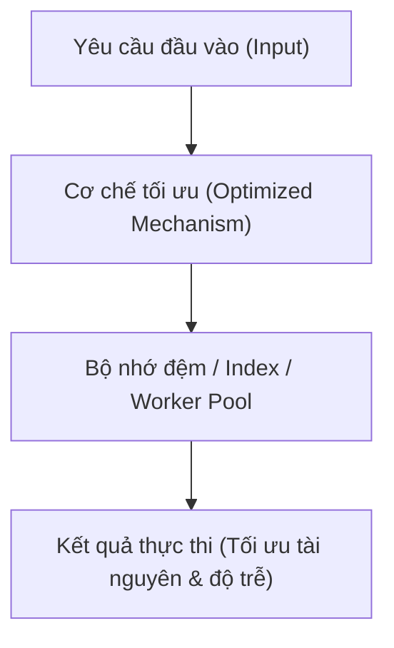

# Biểu Mẫu: Thực Hành Chuẩn Mực Theo Lĩnh Vực (Best Practice Template)

Tài liệu này cung cấp biểu mẫu chuẩn để ghi nhận và hệ thống hóa các thực hành chuẩn mực (**Best Practices**) cho từng lĩnh vực công nghệ (PostgreSQL, Java, Spring Boot, AWS, System Design). 

Các bài viết Best Practice tập trung vào **giải pháp tái sử dụng được**, có **mức độ bằng chứng rõ ràng (Evidence Level)**, phân tích thấu đáo **Why It Works (Cơ chế bên dưới)**, và chỉ rõ **When NOT to Use (Chống chỉ định)** để tránh áp dụng rập khuôn.

Hãy sao chép nội dung bên dưới khi bắt đầu biên soạn một chủ đề Best Practice mới.

---

````markdown
# Best Practice: [Tên Khuyến Nghị / Topic Title]

> **Lĩnh vực (Domain)**: [PostgreSQL / Java / Spring Boot / AWS / System Design]  
> **Chủ đề (Topic)**: [e.g., Query Optimization, Concurrency, Connection Pooling, Network Isolation]  
> **Phiên bản áp dụng (Target Version)**: [e.g., PostgreSQL 16+, Java 21 LTS, Spring Boot 3.3+, AWS Architecture 2024+]  
> **Mức độ bằng chứng (Evidence Level)**: [Official Guidance / Verified Experiment / Context-specific / Candidate]  
> **Trạng thái**: [Active / Superseded / Deprecated]  
> **Ngày cập nhật**: YYYY-MM-DD  

---

## 1. Summary (Tóm Tắt Khuyến Nghị)

> [!NOTE]
> **Executive Summary**:  
> [Mô tả ngắn gọn trong 2-3 câu: Khuyến nghị cốt lõi là gì? Mang lại lợi ích gì về hiệu năng, độ tin cậy hoặc chi phí? Điểm then chốt cần ghi nhớ khi triển khai.]

---

## 2. Problem / Context (Bối Cảnh & Vấn Đề Giải Quyết)

- **Vấn đề kỹ thuật**: [Mô tả bài toán, hiện tượng suy giảm hiệu năng, nghẽn tài nguyên hoặc lỗi phổ biến trong môi trường production khi không áp dụng khuyến nghị.]
- **Nguyên nhân gốc rễ (Root Cause)**: [Giải thích tại sao cách tiếp cận thông thường hoặc cấu hình mặc định lại dẫn đến vấn đề này.]
- **Mức độ nghiêm trọng**: [P1 - System Outage / P2 - Performance Degradation / P3 - Architectural Debt / P4 - Best Practice Cleanliness]

---

## 3. Recommended Approach (Giải Pháp Khuyến Nghị)

Trình bày giải pháp chuẩn được khuyến nghị:
- **Nguyên tắc cốt lõi**: [Quy tắc hoặc mẫu thiết kế được áp dụng.]
- **Kiến trúc / Giải pháp**: [Mô tả tổng quan cách thức triển khai giải pháp để thay thế anti-pattern.]

---

## 4. Why It Works (Nguyên Lý & Cơ Chế Kỹ Thuật)

Giải thích cơ chế hoạt động bên dưới (Under the hood) chứng minh tại sao giải pháp này tối ưu:
- **Cơ chế Runtime / Engine Internals**: [Luồng thực thi, cấu trúc bộ nhớ, giải thuật hoặc cơ chế tương tác phần cứng.]
- **Heuristics / Cost Optimization**: [Cách Optimizer, Garbage Collector hoặc Cloud Subsystem phản ứng với cấu hình/mã nguồn mới.]



---

## 5. Implementation (Hướng Dẫn Triển Khai Thực Tế)

Cung cấp mã nguồn, cấu hình hoặc script hoàn chỉnh, đạt chuẩn production-grade:

### 5.1. Mã nguồn / Cấu hình Chuẩn (Production-Ready Implementation)

```sql
-- Ví dụ: Câu lệnh SQL / DDL / Query chuẩn
```

hoặc

```java
// Ví dụ: Mã nguồn Java 21+ idioms
```

hoặc

```yaml
# Ví dụ: Cấu hình application.yml / Docker / Terraform
```

### 5.2. Các bước triển khai (Step-by-Step Procedure)
1. **Bước 1**: [Thao tác chuẩn bị hoặc điều kiện tiên quyết.]
2. **Bước 2**: [Thực hiện thay đổi an toàn trong production (ví dụ: tạo index CONCURRENTLY, zero-downtime rolling update).]
3. **Bước 3**: [Xác nhận hoạt động ổn định.]

---

## 6. When to Use (Ngữ Cảnh Áp Dụng)

Áp dụng giải pháp này trong các trường hợp sau:
- [Tình huống 1: Mẫu truy vấn, ngưỡng kích thước dữ liệu, hoặc mức độ concurrency.]
- [Tình huống 2: Môi trường có yêu cầu khắt khe về SLA/Latency.]
- [Tiền đề kỹ thuật: Yêu cầu về phiên bản phần mềm hoặc hạ tầng tương thích.]

---

## 7. When Not to Use (Chống Chỉ Định & Giới Hạn)

> [!WARNING]
> **Không áp dụng khuyến nghị này khi**:
> - [Ngữ cảnh phản tác dụng: Ví dụ tập dữ liệu quá nhỏ gây lãng phí overhead.]
> - [Workload không phù hợp: Ví dụ tải ghi nặng (Write-heavy) đối với giải pháp tối ưu đọc.]
> - [Anti-patterns liên quan: Hành vi lạm dụng giải pháp sai mục đích.]

---

## 8. Trade-offs (Đánh Đổi Kỹ Thuật)

Mọi quyết định kiến trúc đều có đánh đổi. Đánh giá đa chiều về tác động của giải pháp:

| Khía cạnh (Dimension) | Lợi ích thu được (Pros) | Chi phí / Rủi ro đánh đổi (Cons / Costs) |
| :--- | :--- | :--- |
| **Hiệu năng (Performance)** | Giảm độ trễ P99, tối ưu Throughput | Chi phí CPU/RAM khi khởi tạo hoặc duy trì |
| **Lưu trữ & Bộ nhớ** | Giảm kích thước dữ liệu / bộ nhớ | Tăng không gian lưu trữ cho cấu trúc phụ trợ |
| **Độ phức tạp (Complexity)** | Kiến trúc minh bạch, dễ bảo trì | Đòi hỏi kỹ sư hiểu sâu cơ chế runtime |
| **Vận hành & An toàn** | Ngăn chặn downtime, fail-safe | Cần giám sát bổ sung và runbook dự phòng |

---

## 9. Validation (Phương Pháp Kiểm Chứng & Đo Lường)

Cách thức đo lường và xác nhận giải pháp đã mang lại hiệu quả thực tế:

### 9.1. Câu lệnh / Metric kiểm chứng
```bash
# Lệnh đo đạc, benchmark hoặc telemetry query
```

### 9.2. Tiêu chí thành công (Acceptance Metrics)
- **Độ trễ (Latency)**: [e.g., P99 giảm xuống dưới X ms]
- **Tài nguyên**: [e.g., CPU load giảm Y%, Memory ổn định không rò rỉ]
- **Log / Telemetry**: [e.g., Không xuất hiện cảnh báo timeout, thread starvation hoặc slow query logs]

---

## 10. Evidence Level & Applicability (Mức Độ Bằng Chứng)

- **Cấp độ bằng chứng**:
  - [x] **Official Guidance**: Khuyến nghị từ tài liệu chính hãng của nhà phát triển nền tảng (PostgreSQL, Oracle, Spring, AWS).
  - [ ] **Verified Experiment**: Đã qua thử nghiệm thực tế với số liệu đo lường cụ thể trong môi trường kiểm thử / hands-on lab.
  - [ ] **Context-specific Finding**: Đã giải quyết thành công một sự cố cụ thể nhưng phụ thuộc vào cấu hình / phần cứng nhất định.
  - [ ] **Candidate**: Khuyến nghị đang trong giai đoạn theo dõi, cần thêm dữ liệu trước khi chuẩn hóa.
- **Phạm vi khả dụng**: [Mô tả chi tiết phiên bản, hệ điều hành hoặc giới hạn môi trường áp dụng.]

---

## 11. Related Resources & Investigations (Tài Nguyên & Hồ Sơ Liên Quan)

- **Hồ sơ điều tra gốc (Investigation Case)**:
  - [INV-ID: Tên hồ sơ điều tra liên quan](../investigations/inv-xxx.md)
- **Khái niệm & Hướng dẫn liên quan (Related Concepts & Guides)**:
  - [Tên bài viết nền tảng](../topic.md)
  - [Mã nguồn thực nghiệm (Hands-on Lab)](../../labs/...)
- **Tài liệu chính thức (Official Documentation)**:
  - [Vendor Reference Title](https://...)
````
