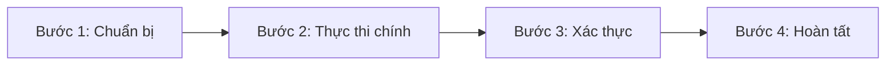

# Biểu Mẫu: Hướng Dẫn Tác Vụ Thực Tế (How-To Template)

Biểu mẫu chuẩn để viết các bài hướng dẫn quy trình kỹ thuật, thiết lập cấu hình, migration và thao tác vận hành thực tế.

---

````markdown
# How-To: [Tên Tác Vụ / Quy Trình Kỹ Thuật Thực Tế]

> **Phân loại**: [PostgreSQL / Java / Spring Boot / AWS / System Design]  
> **Mục tiêu**: [Mục tiêu cụ thể cần đạt được sau khi hoàn thành hướng dẫn]  
> **Thời gian thực hiện**: [10 - 30 phút]  
> **Mức độ phức tạp**: [Cơ bản / Nâng cao / Chuyên gia]  
> **Phiên bản áp dụng**: [e.g., PostgreSQL 16+, Spring Boot 3.3+, AWS CLI v2]  

---

## 1. Bối Cảnh & Khi Nào Cần Áp Dụng (Context & Use Cases)

- **Bài toán thực tế**: Tại sao cần quy trình này?
- **Điều kiện tiền đề (Prerequisites)**:
  - Công cụ cài đặt sẵn (CLI, Docker, SDK).
  - Quyền hạn cần thiết (Admin DB, IAM permissions).

---

## 2. Kiến Trúc Tổng Thể (Architecture Overview)



---

## 3. Các Bước Thực Hiện Chi Tiết (Step-by-Step Instructions)

### Bước 1: [Tên bước 1]
Mô tả hành động và lý do thực hiện.
```bash
# Lệnh thực thi bước 1
```

### Bước 2: [Tên bước 2]
```sql
-- Lệnh SQL hoặc code cấu hình
```

### Bước 3: [Tên bước 3]
...

---

## 4. Xác Thực Kết Quả (Verification & Testing)

Làm sao để biết quy trình đã thành công 100% và không phát sinh lỗi tiềm ẩn?

```bash
# Lệnh kiểm tra kết quả (Smoke test / Healthcheck)
```

**Kết quả kỳ vọng (Expected Output)**:
```text
Trạng thái: HEALTHY / OK / MIGRATED
```

---

## 5. Kế Hoạch Rollback Khi Gặp Sự Cố (Rollback Strategy)

> [!CAUTION]
> Nếu quy trình gặp lỗi ở bất kỳ bước nào, hãy thực hiện ngay các bước hoàn tác sau để tránh gián đoạn dịch vụ:
> ```bash
> # Các lệnh rollback an toàn
> ```

---

## 6. Liên Kết Chéo & Tài Liệu Tham Khảo (References)

- **Tài liệu chính thức**: [Official Docs Link](https://...)
- **Deep Dive liên quan**: `docs/<topic>/<related-article>.md`
````
