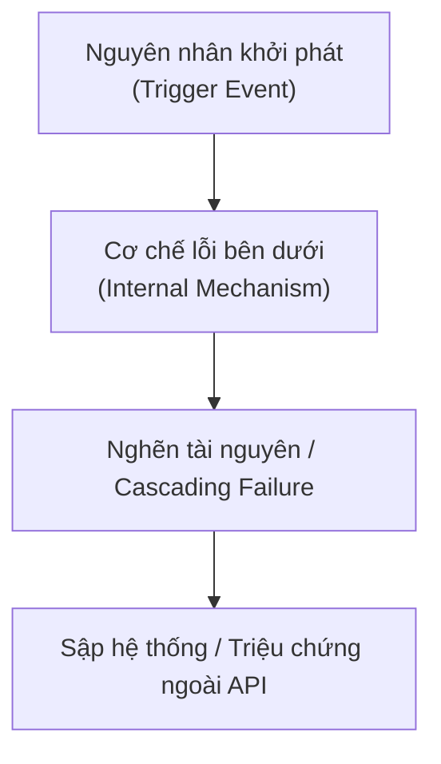

# Biểu Mẫu: Xử Lý Sự Cố & Post-Mortem (Troubleshooting Template)

Biểu mẫu chuẩn để ghi chép các sự cố kỹ thuật thực tế, quy trình chẩn đoán (Diagnostic workflow), phân tích nguyên nhân gốc rễ (Root Cause Analysis - RCA), và biện pháp phòng ngừa lâu dài.

---

````markdown
# Troubleshooting: [Tên Sự Cố / Vấn Đề Kỹ Thuật]

> **Phân loại**: [PostgreSQL / Java / Spring Boot / AWS / System Design]  
> **Mức độ nghiêm trọng (Severity)**: [P1 - Critical Outage / P2 - Major Degradation / P3 - Minor Issue]  
> **Môi trường bị ảnh hưởng**: [Production / Staging / Kubernetes Cluster / Local Lab]  
> **Phiên bản liên quan**: [e.g., PostgreSQL 16, Java 21, Spring Boot 3.3]  
> **Ngày xảy ra / Ghi nhận**: YYYY-MM-DD  

---

## 1. Tóm Tắt Hiện Tượng & Tác Động (Symptom & Impact)

- **Hiện tượng quan sát được (Symptoms)**: Mô tả các triệu chứng cảnh báo từ hệ thống giám sát (Alerts), log ngoại lệ (Exception logs), hoặc hành vi người dùng (e.g., HTTP 504 Gateway Timeout, CPU spike 100%, OOM crash).
- **Mức độ tác động (Business / System Impact)**: Số lượng request bị ảnh hưởng, thời gian gián đoạn (Downtime), hoặc nguy cơ tiềm ẩn về tính toàn vẹn dữ liệu.

---

## 2. Quy Trình Chẩn Đoán Từng Bước (Diagnostic Workflow)

Trình bày các câu lệnh hoặc công cụ đã sử dụng để khoanh vùng và xác định gốc rễ sự cố:

### Bước 1: Kiểm tra trạng thái tức thời
```bash
# Ví dụ câu lệnh CLI hoặc script kiểm tra
```

### Bước 2: Truy vết chuyên sâu (Deep Query / Telemetry)
```sql
-- Ví dụ câu lệnh SQL kiểm tra tiến trình hoặc trạng thái locks
SELECT ...
```

---

## 3. Phân Tích Nguyên Nhân Gốc Rễ (Root Cause Analysis - RCA)

Giải thích cơ chế kỹ thuật bên dưới khiến sự cố xảy ra (Under the hood):



- **Cơ chế dẫn tới lỗi**: Tại sao hệ thống lại hành xử như vậy?
- **Điểm mù trong giám sát**: Tại sao sự cố không được phát hiện sớm hơn?

---

## 4. Biện Pháp Khắc Phục Khẩn Cấp (Immediate Mitigation)

Các bước hành động tức thời để khôi phục hệ thống (Rollback, kill blocking processes, restart container, scale out):

```bash
# Câu lệnh xử lý nóng ngay trong lúc sự cố
```

---

## 5. Giải Pháp Phòng Ngừa Triệt Để (Long-term Prevention & Best Practices)

> [!IMPORTANT]
> **Production Hardening Checklist**:
> 1. Cấu hình tham số bảo vệ.
> 2. Bổ sung metrics cảnh báo sớm.
> 3. Cập nhật quy trình kiểm duyệt DDL / Code Review.

---

## 6. Liên Kết & Tài Liệu Tham Chiếu (Cross References)

- **Tài liệu chính thức**: [Official Docs Link](https://...)
- **Bài viết kiến trúc liên quan**: `docs/<topic>/<related-article>.md`
- **Hands-on Lab**: `labs/<topic>/<lab-name>/`
````
