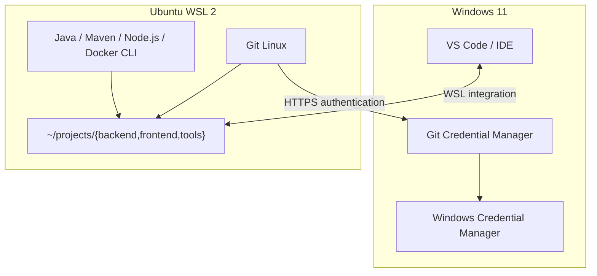

# Thiết lập Git tối ưu cho Ubuntu WSL 2

> **Phạm vi:** Windows 11 + Ubuntu WSL 2; phát triển Java/Spring Boot, Nuxt, Node.js và Docker. Tài liệu tập trung vào **Git và các công cụ hỗ trợ Git**, không bao gồm hướng dẫn cài đặt JDK, Node.js hay Docker.

## 1. Tổng quan và kiến trúc đề xuất

**Khuyến nghị:** Cài Git độc lập trong Ubuntu, lưu source code trong filesystem Linux nếu build/chạy ứng dụng bằng công cụ Linux, sử dụng VS Code WSL để chỉnh sửa và xử lý merge conflict. Với remote **HTTPS**, có thể gọi **Git Credential Manager (GCM)** trên Windows để dùng chung thông tin đăng nhập.



| Thành phần | Cách tổ chức | Lý do |
|---|---|---|
| Git | Git Linux trong Ubuntu | Dùng Git native trên filesystem Linux |
| Source code | `~/projects/` | Giảm chi phí I/O khi build bằng Linux tools |
| IDE | VS Code trên Windows + WSL extension | Editor trực quan, terminal/Git chạy trong WSL |
| Credential HTTPS | GCM Windows | Không cần lưu token plaintext trong Ubuntu |
| Git Windows | Cài riêng nếu cần | Tránh dùng chung executable và cấu hình toàn cục |

!!! tip "Chọn filesystem theo môi trường build"
    Nếu sử dụng **Eclipse Windows** để build và làm việc trực tiếp với dự án Java, có thể giữ repository trên NTFS và sử dụng Git Windows. Không bắt buộc chuyển mọi dự án sang WSL. Với Node.js/Nuxt hoặc Docker build chủ yếu trong Ubuntu, nên đặt source trong `~/projects`.

## 2. Cài Git và công cụ cơ bản

Mở **terminal Ubuntu WSL** (không chạy các lệnh `apt` trong PowerShell).

### 2.1. Cập nhật và cài đặt

```bash
sudo apt update
sudo apt upgrade -y

sudo apt install -y \
  git \
  git-lfs \
  curl \
  wget \
  ca-certificates \
  openssh-client \
  build-essential \
  unzip \
  zip \
  jq \
  tree \
  less
```

| Công cụ | Mục đích |
|---|---|
| `git` | Quản lý phiên bản, branch, merge, commit |
| `git-lfs` | Quản lý file lớn **nếu repository sử dụng Git LFS** |
| `openssh-client` | Xác thực remote bằng SSH nếu cần |
| `curl`, `wget` | Gọi API và tải tài nguyên |
| `build-essential` | Công cụ biên dịch native |
| `jq`, `tree`, `less` | Xử lý JSON, xem cấu trúc và log |

Nếu dùng Git LFS:

```bash
git lfs install
```

Kiểm tra:

```bash
git --version
git lfs version
command -v git
```

Đường dẫn Git cài từ Ubuntu `apt` thông thường là `/usr/bin/git`.

## 3. Cấu hình Git global

### 3.1. Danh tính commit

```bash
git config --global user.name "Your Name"
git config --global user.email "your.email@company.com"
```

!!! info "Commit identity khác với đăng nhập Git server"
    `user.name` và `user.email` chỉ ghi danh tính tác giả commit; chúng **không** xác thực tài khoản GitHub/GitLab. Xác thực HTTPS sử dụng GCM hoặc credential helper khác; xác thực SSH sử dụng SSH key/agent.

### 3.2. Cấu hình đề xuất

```bash
# Dùng main khi tạo repository mới (không đổi branch của repo hiện có)
git config --global init.defaultBranch main

# Chỉ chuẩn hóa CRLF -> LF khi Git add, không đổi LF thành CRLF khi checkout
git config --global core.autocrlf input

# Theo dõi thay đổi executable bit trên filesystem Linux
git config --global core.filemode true

# Dọn remote-tracking branch đã bị xóa trên server khi fetch
git config --global fetch.prune true

# Chỉ cho phép fast-forward khi git pull (không tự merge/rebase)
git config --global pull.ff only

# Tái sử dụng cách giải quyết conflict đã ghi nhận
git config --global rerere.enabled true

# Hiển thị màu và sắp xếp branch theo thời điểm commit gần nhất
git config --global color.ui auto
git config --global branch.sort -committerdate
```

| Tùy chọn | Ý nghĩa thực tế |
|---|---|
| `core.autocrlf=input` | Phù hợp Linux; hạn chế thay đổi line endings ngoài ý muốn |
| `core.filemode=true` | Theo dõi thay đổi quyền thực thi trên Linux |
| `fetch.prune=true` | Dọn tham chiếu remote-tracking branch đã xóa |
| `pull.ff=only` | Pull dừng khi không fast-forward được; phải chọn chiến lược tích hợp rõ ràng |
| `rerere.enabled=true` | Ghi nhớ và áp dụng lại các resolution tương đương |
| `init.defaultBranch=main` | Chỉ ảnh hưởng repository mới tạo bằng `git init` |

!!! warning "Không phải cấu hình nào cũng phù hợp mọi dự án"
    `pull.ff=only` không tự xử lý nhánh đã diverge. Khi đó có thể `git fetch` rồi merge/rebase một cách chủ động theo quy định nhóm. `rerere` có thể áp dụng lại resolution tự động, vì vậy luôn kiểm tra diff và chạy test.

### 3.3. Kiểm tra cấu hình hiệu lực

```bash
git config --global --list
git config --list --show-origin
```

`--show-origin` giúp xác định giá trị xuất phát từ file cấu hình nào (system, global, local).

## 4. Git Credential Manager giữa Windows và WSL (HTTPS)

Với HTTPS remote, **Git Ubuntu gọi GCM Windows** thông qua WSL interop. GCM có thể dùng Windows Credential Manager để lưu token an toàn và tái sử dụng thông tin đăng nhập.

!!! note "Chỉ dành cho HTTPS"
    Nếu `git remote -v` có dạng `git@github.com:org/repo.git`, repository đang sử dụng **SSH** và không cần GCM để xác thực remote này.

### 4.1. Kiểm tra GCM trên Windows

Mở **PowerShell**:

```powershell
git --version
git credential-manager --version
where.exe git-credential-manager
```

Nếu chưa có GCM, kiểm tra bản cài **Git for Windows**: [gitforwindows.org](https://gitforwindows.org/).

### 4.2. Kiểm tra GCM Windows từ Ubuntu

```bash
"/mnt/c/Program Files/Git/mingw64/bin/git-credential-manager.exe" --version
```

Nếu lệnh báo không tìm thấy file, kiểm tra lại đường dẫn cài Git for Windows trước khi tiếp tục.

### 4.3. Thiết lập credential helper trong WSL

```bash
# Kiểm tra helper hiện đang có
git config --show-origin --get-all credential.helper

# Xóa các helper trong global nếu có (không xóa system/local)
git config --global --unset-all credential.helper 2>/dev/null || true

# Dòng helper rỗng giúp bỏ qua helper đã đặt tại mức cấu hình thấp hơn
git config --global --add credential.helper ""

# Dùng GCM Windows
git config --global --add credential.helper \
  "/mnt/c/Program\ Files/Git/mingw64/bin/git-credential-manager.exe"

# Kiểm tra kết quả
git config --show-origin --get-all credential.helper
```

!!! important "Lưu ý thứ tự credential helper"
    Trong Git, `credential.helper` có thể xuất hiện nhiều lần. Một giá trị **rỗng** sẽ reset danh sách helper được tích lũy trước đó. Sau giá trị rỗng, thêm đường dẫn GCM để tránh chạy nhầm helper từ cấu hình cấp system. Tuy nhiên, cấu hình tại repository hoặc tham số lệnh vẫn có thể ghi đè.

Nếu dùng Azure DevOps, cấu hình thêm theo tài liệu GCM:

```bash
git config --global credential.https://dev.azure.com.useHttpPath true
```

### 4.4. Đăng nhập và kiểm tra

```bash
# Thay bằng URL repository HTTPS mà bạn có quyền truy cập
git ls-remote https://github.com/your-org/your-private-repo.git HEAD
```

Lần đầu, GCM có thể mở trình duyệt để đăng nhập hoặc hoàn tất xác thực. Những lần sau, credential đã lưu có thể được dùng lại cho tới khi token hết hạn, bị thu hồi hoặc cần xác thực lại.

!!! warning "Cấu hình proxy Windows/WSL có thể khác nhau"
    GCM chạy dưới dạng ứng dụng **Windows** nên mặc định đọc cấu hình Git từ môi trường Windows. Nếu Git WSL có cấu hình proxy riêng, chưa chắc GCM Windows sẽ sử dụng cấu hình đó.

## 5. Chuẩn hóa line endings và file permissions

### 5.1. Tạo `.gitattributes` tại root repository

```gitattributes
# Auto-detect text và chuẩn hóa khi lưu vào Git
* text=auto

# Source code
*.java text eol=lf
*.js text eol=lf
*.ts text eol=lf
*.vue text eol=lf
*.json text eol=lf
*.xml text eol=lf

# Shell, Docker
*.sh text eol=lf
Dockerfile text eol=lf

# Windows scripts
*.bat text eol=crlf
*.cmd text eol=crlf

# Binary files
*.png binary
*.jpg binary
*.jpeg binary
*.pdf binary
*.jar binary
*.zip binary
```

!!! tip "Vì sao nên dùng `.gitattributes`?"
    `core.autocrlf` là cấu hình cá nhân; `.gitattributes` được commit cùng repository để cả nhóm có quy tắc chung. Đây là cách ổn định hơn khi thành viên sử dụng cả Windows và Linux.

Nếu cập nhật quy tắc đối với repository đã tồn tại:

```bash
git add --renormalize .
git status
git diff --cached --check
```

!!! warning "Không chuẩn hóa hàng loạt một cách tự động"
    Chỉ commit sau khi kiểm tra danh sách file đổi. Thay đổi hàng loạt line endings có thể khiến diff lớn và ảnh hưởng các branch đang làm việc.

### 5.2. Một số lưu ý trên Linux

- Giữ `core.filemode=true` khi repository nằm trong Linux filesystem.
- Shell script cần quyền thực thi khi chạy trực tiếp: `chmod +x script.sh`.
- Tên file trên Linux thường phân biệt chữ hoa/chữ thường; tránh ép `core.ignorecase=true` trên toàn bộ WSL.

## 6. Workspace và IDE

### 6.1. Tạo workspace trên Linux filesystem

```bash
mkdir -p ~/projects/{backend,frontend,tools}
cd ~/projects/backend

# Thay URL bằng repository của bạn
git clone https://github.com/your-org/booking-service.git
cd booking-service
```

Cấu trúc gợi ý:

```text
/home/<user>/
├── .gitconfig
├── .ssh/
└── projects/
    ├── backend/
    │   └── booking-service/
    ├── frontend/
    │   └── booking-admin/
    └── tools/
```

Nếu muốn mở file bằng Windows Explorer:

```bash
explorer.exe .
```

### 6.2. VS Code kết nối WSL

Cài **Visual Studio Code** trên Windows và extension **WSL**, sau đó chạy trong Ubuntu:

```bash
cd ~/projects/backend/booking-service
code .
```

Kiểm tra cửa sổ VS Code đang kết nối đúng WSL. Khi đó terminal tích hợp và Git thường sử dụng môi trường Linux của workspace.

### 6.3. Merge conflict bằng VS Code

=== "Giao diện VS Code"

    Khi Git báo conflict, mở tab **Source Control** và sử dụng **Merge Editor** để kiểm tra *Current*, *Incoming* và *Result*. Sau đó stage file đã resolve và hoàn tất merge.

=== "Git CLI + mergetool"

    Có thể cấu hình VS Code làm Git mergetool trong Ubuntu nếu lệnh `code` hoạt động:

    ```bash
    git config --global merge.tool vscode
    git config --global mergetool.vscode.cmd \
      'code --wait --merge "$LOCAL" "$REMOTE" "$BASE" "$MERGED"'
    git config --global mergetool.keepBackup false
    ```

    Khi gặp conflict:

    ```bash
    git mergetool
    git status
    git add <file-da-resolve>
    git merge --continue
    ```

    `git mergetool` là **tùy chọn**, không bắt buộc nếu bạn xử lý conflict trực tiếp trong VS Code.

## 7. `.gitignore` gợi ý cho Spring Boot và Nuxt

Ví dụ cơ bản (điều chỉnh theo nhu cầu repository):

```gitignore
# Java / Maven
target/
*.class
*.log

# Node / Nuxt
node_modules/
.nuxt/
.output/
dist/

# Secrets
.env
.env.*
!.env.example

# IDE (chỉ ignore nếu nhóm không muốn versioning)
.idea/
.vscode/
.project
.classpath
.settings/

# OS
.DS_Store
Thumbs.db
```

!!! danger "`.gitignore` không xóa secret đã commit"
    Nếu token/mật khẩu đã được commit trước đó, cần **thu hồi hoặc thay thế secret**; việc thêm mẫu vào `.gitignore` không loại bỏ dữ liệu khỏi lịch sử Git.

## 8. Quy trình kiểm tra sau cài đặt

```bash
# Executable và version
command -v git
git --version

# Danh tính commit
git config --global user.name
git config --global user.email

# Chính sách về line endings, pull và conflict
git config --get core.autocrlf
git config --get pull.ff
git config --get rerere.enabled

# Xác nhận credential helpers
git config --show-origin --get-all credential.helper

# Toàn bộ cấu hình và vị trí khai báo
git config --list --show-origin

# Kiểm tra HTTPS remote (thay URL)
git ls-remote https://github.com/your-org/your-private-repo.git HEAD
```

Checklist:

- [ ] `git --version` hoạt động trong Ubuntu.
- [ ] `user.name` và `user.email` đã thiết lập.
- [ ] `core.autocrlf=input`, `pull.ff=only` và `fetch.prune=true`.
- [ ] `rerere.enabled=true` nếu muốn tái sử dụng conflict resolution.
- [ ] GCM Windows hoạt động với HTTPS remote, hoặc SSH đã cấu hình nếu dùng SSH.
- [ ] Source code nằm trong filesystem phù hợp với công cụ build.
- [ ] Repository có `.gitattributes` và `.gitignore` được kiểm tra.
- [ ] IDE chạy đúng Git executable và đúng working tree.
- [ ] Đã thử `fetch`, `status` và commit trên repository thử nghiệm.

## 9. Các cấu hình nên tránh

| Không nên đặt mặc định | Rủi ro |
|---|---|
| `credential.helper=store` | Token có thể được lưu plaintext |
| `http.sslVerify=false` | Vô hiệu xác thực TLS |
| `safe.directory=*` | Bỏ qua kiểm tra quyền sở hữu mọi repository |
| `core.filemode=false` | Có thể bỏ sót thay đổi executable bit |
| `core.ignorecase=true` | Có thể che khuất lỗi chữ hoa/chữ thường trên Linux |
| `pull.rebase=true` cho mọi repository | Có thể không phù hợp workflow và quy tắc nhóm |

!!! success "Kết luận"
    Với **Linux-first development**, tổ hợp **Git Linux + source trong `~/projects` + `.gitattributes` + VS Code WSL + GCM Windows cho HTTPS** là cấu hình hợp lý, ổn định và dễ bảo trì. Không cần chia sẻ Git executable hoặc toàn bộ `.gitconfig` giữa Windows và Ubuntu.

## Tài liệu tham khảo chính thức

- [Microsoft Learn — Get started using Git on WSL](https://learn.microsoft.com/en-us/windows/wsl/tutorials/wsl-git)
- [Microsoft Learn — Working across Windows and Linux file systems](https://learn.microsoft.com/en-us/windows/wsl/filesystems)
- [Git — git-config](https://git-scm.com/docs/git-config)
- [Git — gitattributes](https://git-scm.com/docs/gitattributes)
- [Git — gitcredentials](https://git-scm.com/docs/gitcredentials)
- [Git Credential Manager — WSL configuration](https://github.com/git-ecosystem/git-credential-manager/blob/main/docs/wsl.md)
- [Material for MkDocs — Admonitions](https://squidfunk.github.io/mkdocs-material/reference/admonitions/)
- [Material for MkDocs — Content tabs](https://squidfunk.github.io/mkdocs-material/reference/content-tabs/)
- [Material for MkDocs — Diagrams / Mermaid](https://squidfunk.github.io/mkdocs-material/reference/diagrams/)
