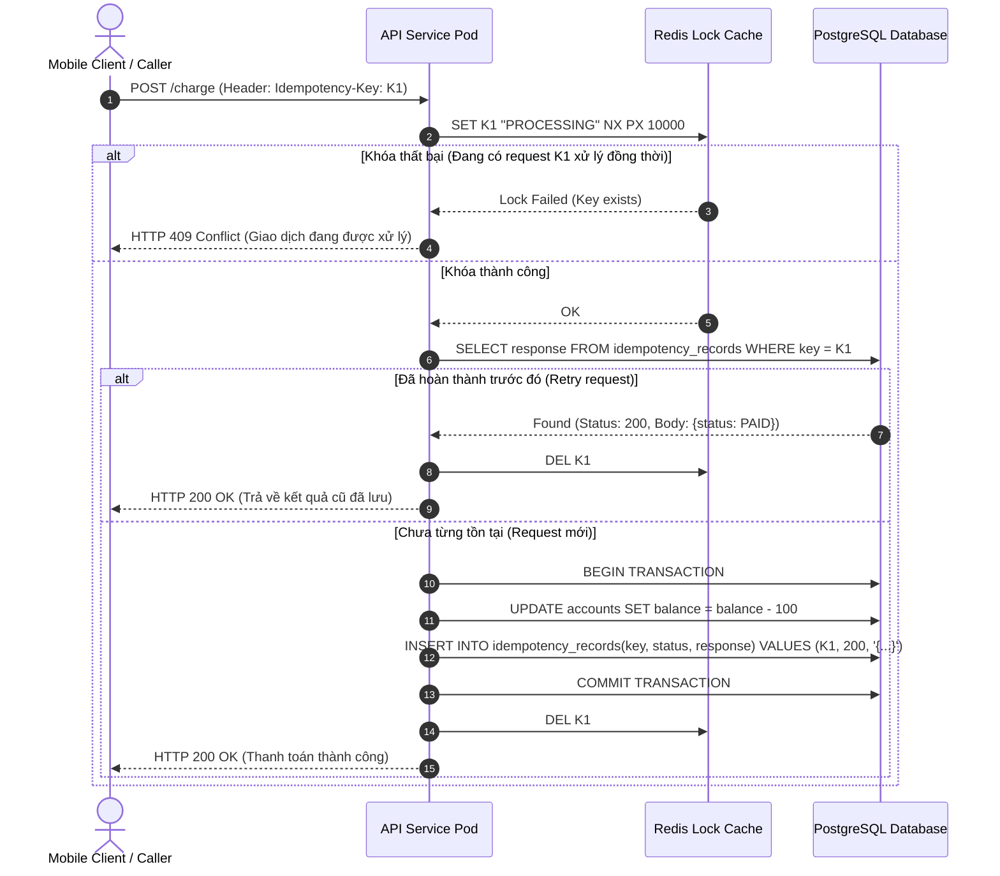

# Best Practice: Thiết Kế Idempotency & Phòng Vệ Sự Cố Trong Hệ Thống Phân Tán

> **Lĩnh vực (Domain)**: System Design  
> **Chủ đề (Topic)**: Distributed Transactions, Idempotency & Fault Tolerance  
> **Phiên bản áp dụng (Target Version)**: Microservices Architecture (REST APIs & Event Streams)  
> **Mức độ bằng chứng (Evidence Level)**: Official Guidance (Martin Kleppmann DDIA & IETF RFC)  
> **Trạng thái**: Active  
> **Ngày cập nhật**: 2026-10-19  

---

## 1. Summary (Tóm Tắt Khuyến Nghị)

> [!NOTE]
> **Executive Summary**:  
> Trong môi trường mạng phân tán, **giao vận thông điệp chính xác 1 lần (Exactly-Once Delivery) qua mạng là điều bất khả thi**; mọi mạng lưới chỉ có thể đảm bảo tối đa ít nhất 1 lần (At-Least-Once Delivery). Do đó, sự cố trừ tiền hai lần hoặc tạo trùng đơn hàng khi gặp Network Timeout bắt buộc phải được phòng ngừa bằng **Cơ chế Tính lũy thừa (Idempotency)** ở tầng ứng dụng.  
> **Khuyến nghị chuẩn sản xuất**: Kết hợp mô hình 2 lớp: **Khóa phân tán ngắn hạn (Redis Distributed Lock) để chặn race conditions đồng thời** và **Bảng cơ sở dữ liệu có Unique Constraint trên `idempotency_key` lưu kèm kết quả phản hồi**, đảm bảo các request gửi lại (retries) luôn nhận được cùng một kết quả mà không bị thực thi trùng lặp.

---

## 2. Problem / Context (Bối Cảnh & Vấn Đề Giải Quyết)

- **Vấn đề kỹ thuật**: Khi Client (Mobile App hoặc API Gateway) gửi lệnh `POST /api/v1/payments/charge`, gói tin đã đến Server và tiền đã bị trừ trong Database, nhưng gói phản hồi HTTP Response trên đường về bị rớt mạng (TCP Drop hoặc Gateway Timeout sau 5 giây).
- **Hậu quả khi thiếu Idempotency**:
  1. *Trừ tiền lặp lại (Double-Charge)*: Client hoặc HTTP Client tự động retry, dẫn tới phương thức thanh toán bị thực thi lần thứ hai.
  2. *Tranh chấp đồng thời (Concurrent Race Conditions)*: Người dùng nhấn nút "Thanh toán" 2 lần liên tiếp trong vài mili-giây. Cả 2 request đi vào 2 pod backend khác nhau cùng lúc, vượt qua các bước kiểm tra số dư và cùng ghi nhận giao dịch thành công.
- **Mức độ nghiêm trọng**: P1 (Gây thất thoát tài chính, sai lệch số liệu kế toán và vi phạm nghiêm trọng trải nghiệm khách hàng).

---

## 3. Recommended Approach (Giải Pháp Khuyến Nghị)

Áp dụng quy trình xử lý Idempotency chuẩn mực 2 tầng:
1. **Idempotency-Key Header**: Yêu cầu Client sinh UUID v4 duy nhất cho mỗi giao dịch và truyền qua header chuẩn `Idempotency-Key` (theo [IETF draft-ietf-httpapi-idempotency-key-header](https://datatracker.ietf.org/doc/draft-ietf-httpapi-idempotency-key-header/)).
2. **Tầng 1 - In-Flight Protection (Redis Lock)**: Sử dụng Redis `SET key value NX PX 10000` để khóa nhanh key này trong 10 giây. Nếu key đang tồn tại ở trạng thái `PROCESSING`, trả về ngay mã lỗi `HTTP 409 Conflict` (hoặc xếp hàng chờ).
3. **Tầng 2 - Persistence & Response Caching (RDBMS)**:
   - Lưu trữ bản ghi trong bảng `idempotency_records` với ràng buộc `UNIQUE (idempotency_key)` ngay trong cùng Local Database Transaction của nghiệp vụ chính.
   - Khi hoàn tất, lưu lại HTTP Status Code và Response Body JSON vào bản ghi này.
   - Khi có bất kỳ request retry nào đến sau, hệ thống chỉ việc đọc lại Response đã lưu và trả về ngay lập tức mà không chạy lại bất kỳ logic nghiệp vụ nào.

---

## 4. Why It Works (Nguyên Lý & Cơ Chế Kỹ Thuật)



### Cơ chế kỹ thuật sâu bên dưới:
1. **Giải quyết bài toán Hai vị tướng (Two Generals' Problem)**:
   - Trên kênh truyền không đáng tin cậy, người gửi không bao giờ biết chắc chắn bên nhận đã xử lý xong yêu cầu hay chưa khi gặp timeout. Bằng cách gán định danh duy nhất (Idempotency Key), ta chuyển bài toán từ "Cố gắng không gửi lại" sang "Thoải mái gửi lại an toàn".
2. **RDBMS ACID Atomicity**:
   - Việc ghi nhận giao dịch tài chính và lưu `idempotency_key` nằm trong cùng một Database Transaction. Nếu database crash giữa chừng, cả hai cùng bị `ROLLBACK`. Không bao giờ xảy ra trường hợp: Tiền bị trừ nhưng key không được ghi nhận, hoặc ngược lại.

---

## 5. Implementation (Hướng Dẫn Triển Khai Thực Tế)

### 5.1. Lược đồ Cơ Sở Dữ Liệu PostgreSQL Chuẩn

```sql
CREATE TABLE idempotency_records (
    idempotency_key VARCHAR(64) PRIMARY KEY,
    user_id VARCHAR(64) NOT NULL,
    request_hash VARCHAR(64) NOT NULL, -- SHA-256 của request body để chống sửa đổi payload
    http_status_code SMALLINT NOT NULL,
    response_body JSONB NOT NULL,
    created_at TIMESTAMPTZ NOT NULL DEFAULT CURRENT_TIMESTAMP,
    expires_at TIMESTAMPTZ NOT NULL DEFAULT (CURRENT_TIMESTAMP + INTERVAL '24 hours')
);

-- Index dọn dẹp các key hết hạn sau 24 giờ
CREATE INDEX idx_idempotency_expires ON idempotency_records (expires_at);
```

### 5.2. Mẫu Xử Lý Tầng Ứng Dụng (Spring Boot / Java)

```java
@Transactional
public PaymentResponse executeIdempotentPayment(String idempotencyKey, PaymentRequest request) {
    // 1. Kiểm tra trong DB xem key đã hoàn thành chưa
    Optional<IdempotencyRecord> existing = idempotencyRepository.findById(idempotencyKey);
    if (existing.isPresent()) {
        log.info("Phát hiện request gửi lại với Idempotency Key: {}. Trả về kết quả cũ.", idempotencyKey);
        return deserialize(existing.get().getResponseBody(), PaymentResponse.class);
    }

    // 2. Thực thi nghiệp vụ trừ tiền
    Account account = accountRepository.findByIdForUpdate(request.accountId())
            .orElseThrow(() -> new NotFoundException("Tài khoản không tồn tại"));
    
    account.deduct(request.amount());
    PaymentTransaction txn = paymentRepository.save(new PaymentTransaction(request));

    PaymentResponse response = new PaymentResponse(txn.getId(), "SUCCESS", txn.getAmount());

    // 3. Lưu kết quả vào idempotency_records trong cùng transaction
    IdempotencyRecord record = new IdempotencyRecord(
            idempotencyKey,
            request.userId(),
            hashPayload(request),
            HttpStatus.OK.value(),
            serializeToJson(response)
    );
    idempotencyRepository.save(record);

    return response;
}
```

---

## 6. When to Use (Ngữ Cảnh Áp Dụng)

- **Giao dịch tài chính & thanh toán (Payment & Billing APIs)**: Bắt buộc 100% đối với các API trừ tiền, nạp tiền, chuyển khoản.
- **Tạo đơn hàng & đặt chỗ (Order Creation / Booking)**: Tránh tạo 2 đơn hàng trùng khi người dùng bấm đúp hoặc mạng lag.
- **Message Consumers (Kafka / SQS / RabbitMQ)**: Đảm bảo xử lý an toàn khi broker phân phối lại thông điệp (Redelivery due to Consumer rebalance hoặc timeout).

---

## 7. When Not to Use (Chống Chỉ Định & Anti-patterns)

> [!WARNING]
> **Không áp dụng khi**:
> 1. **Các HTTP Methods an toàn vốn dĩ đã có tính lũy thừa**: `GET`, `HEAD`, `OPTIONS`, `PUT`, `DELETE` (theo chuẩn RFC 7231). Việc bắt buộc truyền Idempotency-Key cho `GET` là lạm dụng thừa thãi.
> 2. **Chỉ lưu key trong Redis mà không lưu trong Database**: Nếu Redis bị restart hoặc eviction do hết RAM, các request retry sau đó sẽ lại thực thi trùng lặp. Redis chỉ dùng làm khóa tạm (Lock), Database mới là nguồn chân lý (Source of Truth).
> 3. **Bỏ qua Request Body Hashing**: Nếu client gửi cùng 1 Idempotency Key nhưng thay đổi số tiền từ $10 lên $1000, hệ thống phải phát hiện và từ chối ngay lập tức (`HTTP 422 Unprocessable Entity - Payload Mismatch`).

---

## 8. Trade-offs (Đánh Đổi Kỹ Thuật)

| Tiêu chuẩn | Không có Idempotency | Có Idempotency Chuẩn Mực |
| :--- | :--- | :--- |
| **Tính toàn vẹn dữ liệu** | Kém (Nguy cơ trừ tiền 2 lần) | **Tuyệt đối (Bảo vệ giao dịch 100%)** |
| **Chi phí lưu trữ DB** | Không tốn thêm bảng | Tốn thêm dung lượng lưu bảng `idempotency_records` (cần TTL dọn dẹp) |
| **Độ trễ xử lý (Latency)** | Nhanh hơn ~5ms (Không kiểm tra key) | Tăng nhẹ ~5-10ms cho việc tra cứu và lưu trữ key |
| **Độ phức tạp tích hợp** | Thấp | Đòi hỏi Client và Server thống nhất chuẩn Header |

---

## 9. Validation (Phương Pháp Kiểm Chứng & Đo Lường)

### 9.1. Kịch Bản Stress Test Mô Phỏng Bấm Đúp (Concurrent Replay Test)
Sử dụng công cụ benchmark (k6 hoặc JMeter) gửi đồng thời 10 requests cùng một lúc có chung một `Idempotency-Key: test-uuid-12345` tới endpoint thanh toán:
- **Kết quả kỳ vọng**:
  - Đúng 1 request nhận được mã `HTTP 200 OK` và số dư tài khoản chỉ bị trừ đúng 1 lần duy nhất.
  - 9 requests còn lại nhận được `HTTP 409 Conflict` (khi đang chạy) hoặc nhận lại kết quả `HTTP 200 OK` cũ từ cache mà số dư không hề bị trừ thêm.

---

## 10. Evidence Level & Applicability (Mức Độ Bằng Chứng)

- **Cấp độ bằng chứng**: **Official Guidance**.
  - Tuân thủ nguyên lý thiết kế hệ thống phân tán trong *Designing Data-Intensive Applications* (Martin Kleppmann), Chương 11 (Stream Processing - Idempotence).
  - Tuân thủ dự thảo tiêu chuẩn Internet [IETF Idempotency-Key Header Specification](https://datatracker.ietf.org/doc/draft-ietf-httpapi-idempotency-key-header/).
- **Phạm vi khả dụng**: Áp dụng cho mọi ngôn ngữ và nền tảng Microservices (Java, Go, Node.js, Python).

---

## 11. Related Resources & Investigations (Tài Nguyên Liên Quan)

- **Bài viết trong Knowledge Base**:
  - [System Design Knowledge Hub: Distributed Transactions & Outbox Pattern](../index.md)
  - [Spring Boot Best Practices: Resilient WebClient](../../spring-boot/best-practices/resilient-webclient.md)
  - [AWS Best Practices: Aurora S3 Export](../../aws/best-practices/aurora-s3-export.md)
- **Tài liệu tham khảo kinh điển**:
  - *Designing Data-Intensive Applications* (Martin Kleppmann, O'Reilly)
