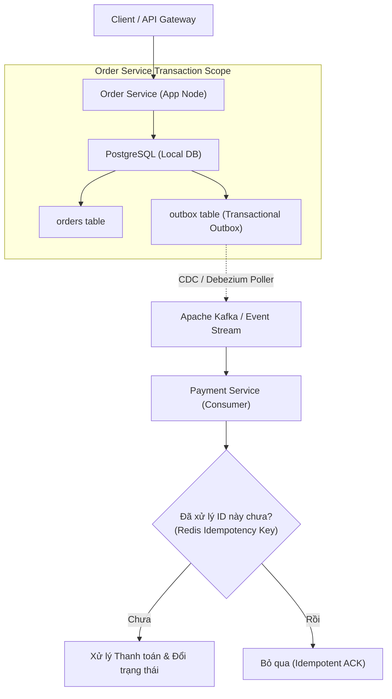

# System Design & Distributed Systems Knowledge Hub

> **Trọng tâm**: Thiết kế Hệ thống Phân tán Chịu tải cao (High-Load Distributed Systems), Các Mẫu hình Kiến trúc Bền vững (Resilience Patterns), Tính Nhất quán Dữ liệu (Consistency Models), và Xử lý Giao dịch Phân tán (Distributed Transactions).  
> **Nền tảng lý thuyết**: CAP / PACELC Theorems, Consensus Protocols, và Microservices Patterns.  
> **Tài liệu tham khảo kinh điển**: *Designing Data-Intensive Applications* (Martin Kleppmann).

---

## 1. Bản Đồ Kiến Trúc Hệ Thống Phân Tán (Distributed Systems Roadmap)

Thiết kế hệ thống phân tán cấp Senior Architect tập trung vào 4 bài toán lớn:
1. **Consistency vs. Availability**: Ứng dụng định lý CAP và định lý PACELC; hiểu rõ đánh đổi giữa Latency vs Consistency trong các hệ thống phân tán địa lý (Geo-distributed systems).
2. **Distributed Transactions**: Loại bỏ Two-Phase Commit (2PC) cồng kềnh trong microservices; thay thế bằng Saga Pattern (Choreography hoặc Orchestration) kết hợp Transactional Outbox Pattern để giải quyết triệt để lỗi Dual-Write.
3. **Resilience & Fault Tolerance**: Circuit Breaker (Netflix Hystrix / Resilience4j), Rate Limiting (Token Bucket / Sliding Window), Bulkhead pattern, và graceful degradation.
4. **Caching Architecture & Data Invalidation**: 2 vấn đề khó nhất của khoa học máy tính: Naming Things & Cache Invalidation; phòng chống Cache Stampede, Cache Penetration, và Cache Breakdown.

---

## 2. Danh Mục Chủ Đề Đang Phát Triển (Curated Topics)

### A. The Dual-Write Problem & Transactional Outbox Pattern
- **Vấn đề cốt lõi**: Khi một ứng dụng phải ghi vào Database đồng thời gửi Message vào Message Broker (Kafka/RabbitMQ), không thể có một giao dịch cục bộ bao trùm cả hai. Nếu một bên thành công và bên kia thất bại, hệ thống rơi vào trạng thái bất nhất (Inconsistent State).
- **Giải pháp Outbox Pattern**: Ghi payload message vào bảng `outbox` ngay trong cùng local database transaction của thực thể chính. Sử dụng Change Data Capture (CDC) như Debezium để streaming thay đổi sang Kafka với độ tin cậy At-Least-Once.

### B. Caching Architecture & Anti-Patterns
- **Cache Stampede (Thundering Herd)**: Xảy ra khi một cache key có lượt truy cập cực cao bị hết hạn (expire) cùng lúc, hàng ngàn requests đồng thời tràn vào Database. Giải pháp: Distributed Lock hoặc thuật toán Probabilistic Early Expiration (XFetch).
- **Cache Penetration**: Truy vấn vào các dữ liệu không hề tồn tại trong Database, khiến mọi request đều xuyên qua cache đập thẳng vào DB. Giải pháp: Lưu cache null có TTL ngắn hoặc sử dụng **Bloom Filter**.

### C. Rate Limiting Algorithms
- **Token Bucket vs. Leaky Bucket**: Token Bucket cho phép burst traffic trong giới hạn; Leaky Bucket xuất dữ liệu với tốc độ cố định mượt mà (smooth flow).
- **Sliding Window Counter**: Thuật toán kết hợp độ chính xác cao của Sliding Window Log nhưng chỉ tốn bộ nhớ cố định của Fixed Window Counter. Thực hiện trên Redis thông qua Lua Script để đảm bảo tính nguyên tử (Atomicity).

---

## 3. Bảng So Sánh Các Mô Hình Giao Dịch Phân Tán

| Tiêu chuẩn | Two-Phase Commit (2PC) | Saga Orchestration | Saga Choreography |
| :--- | :--- | :--- | :--- |
| **Độ trễ (Latency)** | Rất cao (Giữ lock qua network) | Thấp (Giao dịch cục bộ độc lập) | Thấp nhất (Bất đồng bộ) |
| **Độ phức tạp điều phối** | Điều phối bởi Transaction Manager | Tập trung tại 1 Orchestrator Service | Phân tán qua Event Streams |
| **Tính khả dụng (Availability)** | Thấp (Nghẽn khi Coordinator chết) | Cao | Rất cao |
| **Khả năng rollback** | Tự động qua Undo Log | Cần viết Compensating Transactions | Cần viết Compensating Transactions |

---

## 4. Tài Liệu Kiểm Chứng (Official References)

- *Designing Data-Intensive Applications* (Martin Kleppmann, O'Reilly)
- *Building Microservices, 2nd Edition* (Sam Newman)
- [Microservice Architecture: Pattern: Transactional outbox](https://microservices.io/patterns/data/transactional-outbox.html)
- [The Raft Consensus Algorithm](https://raft.github.io/)
