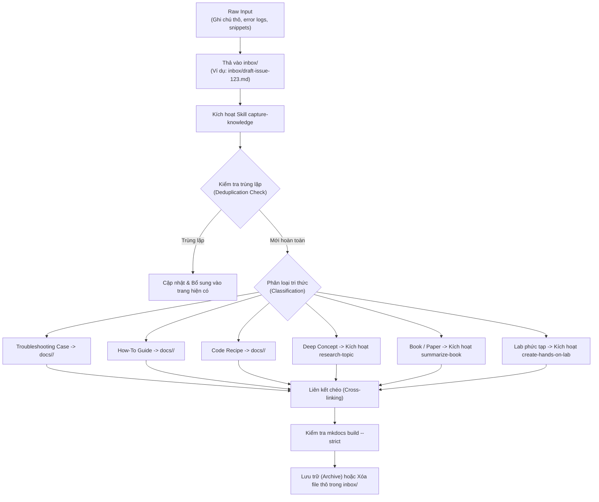

# Knowledge Inbox (Hòm Thư Thu Thập Tri Thức)

Chào mừng bạn đến với **Knowledge Inbox** — Nơi tiếp nhận và lưu trữ tạm thời (Staging Area) toàn bộ các ý tưởng, ghi chú thô, lỗi production thực tế, code snippet, hoặc tài liệu nghiên cứu trước khi được chuẩn hóa vào MkDocs Knowledge Base.

---

## 📥 Mục Đích Của Knowledge Inbox

Khi làm việc hàng ngày, bạn thường gặp:
- Một lỗi khó hiểu vừa giải quyết xong trên production (Troubleshooting Case).
- Một câu query tối ưu cực kỳ tâm đắc hoặc script bash hữu ích (SQL / Code Recipe).
- Một bài hướng dẫn cài đặt / cấu hình dịch vụ phức tạp (Practical How-to Guide).
- Một bài báo kỹ thuật, tweet, hoặc bản ghi chép từ NotebookLM.

Thay vì phải ngay lập tức định dạng thành Markdown chuẩn chỉnh, bạn chỉ cần **thả ghi chú thô vào thư mục `inbox/`** hoặc gửi trực tiếp cho AI Agent thông qua skill `capture-knowledge`.

---

## 🔄 Vòng Đời Của Một Mục Tri Thức (Knowledge Lifecycle)



---

## 📝 Định Dạng Gợi Ý Cho File Thô Trong `inbox/`

Bạn có thể tạo bất kỳ tệp Markdown hoặc text nào trong `inbox/` (ví dụ: `inbox/2026-10-pg-locks.md`).  
Chỉ cần cung cấp tối thiểu các thông tin:

```markdown
# [Tiêu đề hoặc Mô tả ngắn gọn]
- Chủ đề: [PostgreSQL / Java / Spring Boot / AWS / System Design]
- Nguồn / Bối cảnh: [Log hệ thống, Link bài viết, Dự án thực tế]
- Nội dung thô:
  [Dán log lỗi, câu lệnh query, hoặc các gạch đầu dòng ghi chú tại đây]
```

---

## ⚡ Kích Hoạt Xử Lý Tự Động

Mở chat với AI Agent và ra lệnh:

```text
Hãy sử dụng skill 'capture-knowledge' để xử lý ghi chú tại inbox/2026-10-pg-locks.md.
Kiểm tra trùng lặp với kho tri thức hiện có, chọn template phù hợp và tạo bài viết chính thức.
```
