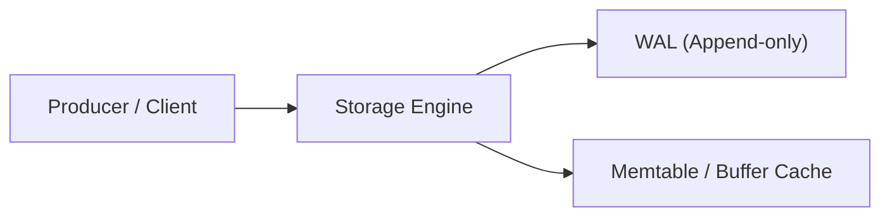

# [Tên Sách]: Ghi Chép & Mô Hình Tư Duy Kiến Trúc

> **Tác giả (Authors)**: [Tên tác giả]  
> **Ấn bản (Edition)**: [e.g., 2nd Edition, 2024]  
> **Lĩnh vực**: [Distributed Systems / Database Internals / Clean Architecture]  
> **Đánh giá tổng quan**: [Đánh giá ngắn về giá trị ứng dụng thực tiễn]  

---

## 1. Luận điểm Cốt lõi của Tác phẩm (Core Thesis)

- Tác giả đặt ra câu hỏi cốt lõi gì cho ngành kỹ thuật phần mềm?
- Các tiên đề (Assumptions) và thách thức mà cuốn sách tiếp cận.

---

## 2. Các Mô hình Tư duy Nền tảng (Foundational Mental Models)

### 2.1. [Mô hình tư duy 1 / Mental Model 1]
- Trình bày trực quan hóa nguyên lý:

- Phân tích sâu: Tại sao thiết kế này giải quyết được độ phức tạp?

### 2.2. [Mô hình tư duy 2 / Mental Model 2]
- So sánh các hướng tiếp cận đối nghịch (ví dụ: Optimistic vs Pessimistic Concurrency Control, B-Tree vs LSM-Tree).

| Đặc tính | Tiếp cận A | Tiếp cận B | Khi nào chọn? |
| :--- | :--- | :--- | :--- |
| **Write Amplification** | Thấp / Cao | ... | ... |
| **Read Amplification** | ... | ... | ... |

---

## 3. Các Chế độ Thất bại & Bất thường (Failure Modes & Anomalies)

- Những trạng thái phân tán (Distributed states) hoặc hiện tượng bất thường (Anomalies) mà kỹ sư thường đánh giá thấp:
  - *Network Partitions & Split Brain*
  - *Clock Drift & Linearizability limits*
  - *Phantom Reads & Write Skew*

---

## 4. Ánh xạ vào Kỹ thuật Thực tế (Production Mapping)

| Nguyên lý trong sách | Công nghệ ứng dụng | Cách hiện thực trong thực tế |
| :--- | :--- | :--- |
| WAL (Write-Ahead Logging) | PostgreSQL | `pg_wal`, Checkpoint processes, LSN tracking |
| Replication Quorums | AWS DynamoDB / Kafka | Read/Write Quorum $W + R > N$, Min In-Sync Replicas |
| Structured Concurrency | Java 21+ | Virtual Threads, Scoped Values, StructuredTaskScope |

---

## 5. Kết luận & Đúc kết Cá nhân (Key Takeaways)

1. **Takeaway 1**: ...
2. **Takeaway 2**: ...
3. **Checklist áp dụng khi thiết kế hệ thống**: ...
