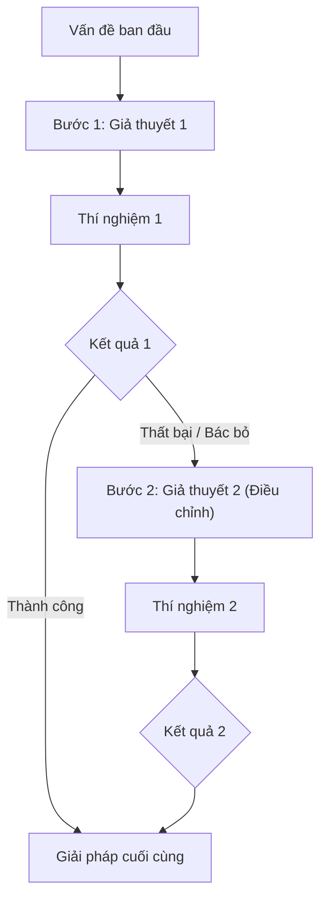

# Investigation Case: [Tên Cuộc Điều Tra / Chủ Đề]

> **Mã hồ sơ (Case ID)**: INV-[YYYYMM]-[SHORT-SLUG]  
> **Lĩnh vực (Domain)**: [PostgreSQL / Java / Spring Boot / AWS / System Design]  
> **Trạng thái (Status)**: [RESOLVED / PARTIALLY RESOLVED / IN PROGRESS / UNRESOLVED]  
> **Mức độ tác động**: [P1 - Critical / P2 - Major / P3 - Moderate]  
> **Thời gian điều tra**: [YYYY-MM-DD đến YYYY-MM-DD]  
> **Tài liệu gốc tại Inbox**: `inbox/investigations/<investigation-id>/notes.md`  

---

## ⚡ Quick Reference: Tóm Tắt Dành Cho Lãnh Đạo & Kỹ Sư Tra Cứu Nhanh

> [!NOTE]
> **Executive Summary (Tóm tắt Điều hành)**:  
> [Mô tả ngắn gọn trong 2-3 câu: Vấn đề gì đã xảy ra? Nguyên nhân gốc rễ là gì? Giải pháp chốt hạ là gì? Kết quả đo lường cải thiện ra sao?]

### Bảng Chỉ Số Đo Lường Chính (Key Metrics Summary)
| Chỉ số (Metric) | Trạng thái Ban đầu (Baseline) | Thử nghiệm Thất bại | Kết quả Sau Tối ưu (Final) | Mức cải thiện |
| :--- | :--- | :--- | :--- | :--- |
| **Execution Time / Latency** | ... ms | ... ms | ... ms | **Giảm x%** |
| **Resource Usage (CPU/RAM/IO)**| ... | ... | ... | **Tối ưu x%** |
| **Tác dụng phụ (Side-effects)** | ... | ... | Không có / Chấp nhận được | ... |

### Giải Pháp Cuối Cùng (Final Resolution)
```sql
-- Đoạn mã cấu hình hoặc truy vấn chốt hạ sau quá trình điều tra
```

---

## 🔍 Deep Dive: Tiến Trình Điều Tra Theo Trật Tự Thời Gian (Chronological Timeline)



---

### Bước 1: [Tên bước / Câu hỏi ban đầu đặt ra]
- **Câu hỏi kỹ thuật (Question)**: ...
- **Giả thuyết (Hypothesis)**: ...
- **Thí nghiệm thực hiện (Action / Experiment)**:
  ```bash
  # Lệnh thực thi hoặc query thử nghiệm
  ```
- **Kết quả quan sát & Bằng chứng thực tế (Observation & Evidence)**:
  ```text
  Log, Execution Plan hoặc số liệu đo đạc cụ thể
  ```
- **Phân tích kỹ thuật (Analysis)**: ...
- **Đánh giá & Quyết định kế tiếp (Decision)**:
  > [!WARNING]
  > **Thử nghiệm không đạt kỳ vọng (Failed Attempt)**: Lý do tại sao hướng đi này không giải quyết được vấn đề hoặc sinh ra tác dụng phụ ngoài dự kiến.

---

### Bước 2: [Tên bước tiếp theo / Thay đổi giả thuyết dựa trên dữ liệu mới]
- **Câu hỏi kỹ thuật (Question)**: ...
- **Giả thuyết mới (Revised Hypothesis)**: ...
- **Thí nghiệm thực hiện (Action / Experiment)**:
  ```sql
  -- Câu lệnh thử nghiệm tiếp theo
  ```
- **Kết quả quan sát & Bằng chứng (Observation & Evidence)**:
  ```text
  Kết quả trả về
  ```
- **Phân tích kỹ thuật (Analysis)**: ...
- **Đánh giá & Quyết định kế tiếp (Decision)**: ...

*(Tiếp tục ghi nhận các bước tiếp theo, giữ nguyên tính trung thực của tiến trình)*

---

## 🛠️ Nguyên Nhân Gốc Rễ Đã Xác Minh (Verified Root Cause Analysis)

Giải thích cơ chế bên dưới (Under the hood) tại sao hiện tượng này diễn ra:
- **Cơ chế hoạt động của Engine**: ...
- **Điểm nghẽn kiến trúc**: ...

---

## ❌ Các Hướng Thử Nghiệm Thất Bại & Bài Học Rút Ra (Failed Attempts & Pitfalls)

| Lần thử (Attempt) | Giả thuyết | Hành động | Tại sao thất bại / Không tối ưu? |
| :--- | :--- | :--- | :--- |
| **Thử nghiệm 1** | Giả định X... | Chạy Y... | Không giải quyết được Z vì cơ chế A... |
| **Thử nghiệm 2** | Giả định B... | Cấu hình C... | Gây ra tác dụng phụ D (Write Amplification)... |

---

## 📋 Tri Thức & Quy Chuẩn Có Thể Tái Sử Dụng (Reusable Knowledge)

Từ cuộc điều tra này, các tri thức tổng quát sau được rút ra cho toàn hệ thống:
1. **Best Practice 1**: ...
2. **Best Practice 2**: ...
3. **Cảnh báo cần đưa vào Runbook**: ...

---

## 🔗 Liên Kết & Nguồn Tham Khảo (Cross-Links & Citations)

- **Official Documentation**: [PostgreSQL / Java / Spring Boot / AWS Docs Link](https://...)
- **Bài viết liên quan trong Knowledge Base**:
  - [Tiêu đề bài viết liên quan](../...)
- **Thí nghiệm kiểm chứng (Hands-on Lab)**: [`labs/...`](../../labs/...)
