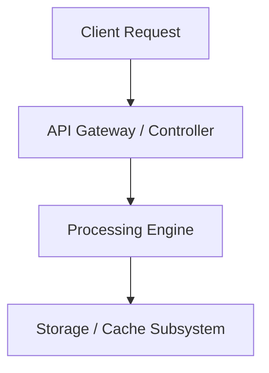

# [Chủ đề Kỹ thuật / Concept Name]

> **Phân loại**: [PostgreSQL / Java / Spring Boot / AWS / System Design]  
> **Phiên bản mục tiêu**: [e.g., PostgreSQL 16+, Java 21 LTS, Spring Boot 3.3+]  
> **Nguồn tài liệu chính thức**:  
> - [Tên tài liệu / Reference Link 1](https://...)  
> - [Tài liệu / Reference Link 2](https://...)  
> **Ngày cập nhật**: YYYY-MM-DD  

---

## 1. Tổng quan & Vấn đề giải quyết (Overview & Problem Statement)

- **Vấn đề cốt lõi (Core Problem)**: Mô tả bài toán hoặc thách thức trong kỹ thuật phần mềm mà cơ chế này giải quyết.
- **Bản chất giải pháp (Solution Mechanics)**: Định nghĩa súc tích bản chất kỹ thuật bên dưới.
- **Khi nào nên sử dụng (When to use)** vs **Khi nào không nên sử dụng (When NOT to use)**.

---

## 2. Cơ chế hoạt động bên dưới (Under the Hood / Deep Architecture)

Giải thích chi tiết luồng xử lý (Execution flow), trạng thái bộ nhớ (Memory structures), hoặc thuật toán nền tảng.



### Các thành phần chính (Core Components)
1. **Component A**: Vai trò và hành vi trong runtime.
2. **Component B**: Cách tương tác và xử lý tranh chấp (concurrency / locking).

---

## 3. Phân tích Chi tiết & Mã nguồn Minh họa (Code Samples & Analysis)

Trình bày mã nguồn chuẩn production-grade có chú thích chi tiết:

```sql
-- Ví dụ: Câu lệnh minh họa chuẩn production
SELECT ...
```

hoặc

```java
// Ví dụ: Mã nguồn Java chuẩn mực
public class ExampleService {
    // Thread-safe and properly scoped
}
```

---

## 4. Đánh đổi Kỹ thuật & Hiệu năng (Trade-offs & Performance Implications)

| Tiêu chí | Ưu điểm (Pros) | Đánh đổi / Rủi ro (Cons / Trade-offs) |
| :--- | :--- | :--- |
| **Throughput / Latency** | ... | ... |
| **Resource Consumption** | ... | ... |
| **Complexity** | ... | ... |

---

## 5. Cạm bẫy thực tế trong Production (Production Pitfalls & Anti-patterns)

> [!WARNING]
> **Pitfall 1**: Mô tả lỗi thường gặp khi triển khai thực tế (ví dụ: memory leak, lock contention, unindexed foreign key).
> **Giải pháp khắc phục**: Hướng dẫn xử lý dứt điểm.

> [!IMPORTANT]
> **Best Practice**: Nguyên tắc vàng cần tuân thủ khi đưa vào production checklist.

---

## 6. Liên kết & Bài viết liên quan (Related Notes & Labs)

- [Hands-on Lab thực nghiệm](../../labs/...)
- [Bài viết liên quan](../...)
